# Results: 2026-11-01-cloud-4vcpu

Generated by `npm run aggregate` and `npm run plot` from `raw/*.json`; only the notes section is written by hand.

<!-- notes:start -->
## Notes

Written by hand after looking at the numbers below. Every number here is in the tables, the CSVs, `raw/*.json` or
`logs/`.

### LDBC SNB Interactive: the engines are much closer

LDBC SNB (scale factor 0.1, 4.0M triples, one repetition) gives a very different picture from WatDiv and BSBM.
Comparing template means of the warm times (a template counts for an engine only if all five of its instances were
`ok` for it):

| | Comunica faster | Oxigraph faster | Geometric mean Comunica ÷ Oxigraph, instances both answered | Total warm time, same instances |
|---|---|---|---|---|
| Chromium | 10 of 21: IC2, IC3, IC4, IC6, IC8, IC11, IC13, IS2, IS3, IS6 | 11: IC1, IC5, IC7, IC9, IC10, IC12, IC14, IS1, IS4, IS5, IS7 | 0.40 (92 instances) | Comunica 207 s, Oxigraph 236 s |
| Firefox | 9: IC3, IC4, IC6, IC8, IC11, IC13, IS2, IS3, IS6 | 12: IC1, IC2, IC5, IC7, IC9, IC10, IC12, IC14, IS1, IS4, IS5, IS7 | 1.26 (91 instances) | Comunica 607 s, Oxigraph 231 s |
| WebKit | not completed for Comunica (below) | | | |

The differences are large in both directions. In Chromium, Comunica is faster on IS3 (6 ms against 1.3 s), IS6
(4 ms against 271 ms), IC3 (0.22 s against 10.1 s), IC6 (0.10 s against 3.0 s) and IC11 (0.09 s against 2.4 s).
Oxigraph is faster on IC5, IC7 and IC10 (about 2 times), IC14 (1.35 times), and on the sub-millisecond lookups IS1,
IS4 and IS5 (about 5 times).

Timeouts (60 s, so these instances have no time):
- Comunica: all five IC9 instances, and IS7 for the four messages without replies (the one with replies, IS7-3, takes
  0.56 s), in Chromium and Firefox; in Firefox also IC10-1. The same IS7 instances took Comunica over 300 s in Node.
- Oxigraph: IC4 for four of five instances, in all three browsers (also over 300 s in Node). Its fifth IC4 instance
  has no results and takes 0.5 s.

Loading 4.0M triples takes Comunica 24.4 s in Chromium and Oxigraph 20.8 s. In Firefox, Comunica takes 200 s, of
which 188 s are the single `addQuads()` batch into the ordered store (Oxigraph: 18.1 s). That batch is how
comunica/comunica#1839 loads files; with one batch per 16M-character chunk instead, loading took 121 s in Firefox
(111 s of store building) but 60 s in Chromium in a test run, so neither choice suits all browsers. In Chromium, memory after load is 681 MB for Comunica
(434 MB of it V8's heap) and 1,557 MB for Oxigraph (1,522 MB WASM memory).

**WebKit + Comunica on LDBC SNB was not completed.** On every page, the WebKit content process grew to 5 to 7.6 GB
RSS and then either stopped responding (about 175 % CPU, no progress, killed by the runner's watchdog) or crashed,
after only a few queries. After 38 page attempts in 80 minutes the run had not got past the re-warm rounds, and each
page's death was being recorded against whichever query happened to be running, so the per-query outcomes would have
described the page's memory state rather than the queries. I stopped this one configuration; it is listed under
Skipped, and its runner log and memory samples are in [`logs/webkit-comunica-ldbc-snb-0.1.txt`](logs/webkit-comunica-ldbc-snb-0.1.txt).
I did not find out whether this is the JavaScriptCore heap, WebKit's memory limits, or something in Comunica or
rdf-stores. Oxigraph in WebKit completed normally.

Values: on LDBC SNB the counts agree with the reference, but the checksums (sum of the lengths of all values read)
differ between the engines on 28 of the 105 instances. In the two I compared value by value in Node (IC8-1, IC2-2),
the differences were lexical: Oxigraph returns `xsd:dateTime` values in canonical form (`…:32.83Z` where the data and
Comunica have `…:32.830Z`), and it types projected `xsd:long` IDs as `xsd:integer`. The WatDiv and BSBM checksums are
identical between the engines for all 300 instances.

### WatDiv and BSBM: Oxigraph is faster per query, except WatDiv C3

All 300 WatDiv and BSBM instances are `ok` for both engines in all browsers and all 3 repetitions.

| | Templates where Comunica is faster (Chromium / Firefox / WebKit) | Geometric mean of Comunica ÷ Oxigraph (Chromium / Firefox / WebKit) |
|---|---|---|
| watdiv-1 | C3 / C3 / C3 | 3.6 / 8.2 / 4.2 |
| watdiv-10 | C2, C3, S4 / C3 / C2, C3 | 2.2 / 4.5 / 2.8 |
| bsbm-100 | none | 5.4 / 14.8 / 6.7 |
| bsbm-1k | Q8 / Q8 / Q8 | 4.3 / 11.5 / 5.2 |

WatDiv C3 (a 6-pattern star returning 43,144 solutions at scale 10) has instance means of 1.9 to 2.4 s for Oxigraph
against 0.14 to 0.30 s for Comunica. It makes up 95 to 99 % of Oxigraph's WatDiv total, which is why Comunica's
WatDiv totals are 1.7 to 10 times lower. Without C3, Oxigraph's totals are lower (watdiv-10: 154 against 246 ms in
Chromium, 205 against 690 ms in Firefox, 171 against 359 ms in WebKit), and on BSBM they are lower everywhere. A
diagnostic outside the pipeline ([`scripts/diagnostics/oxigraph-query-breakdown.mjs`](../../scripts/diagnostics/oxigraph-query-breakdown.mjs))
puts Oxigraph's C3 time inside `store.query()` (asking for serialized SPARQL JSON takes as long), so it is query
evaluation, not this harness. Merge joins over Comunica's subject-ordered store (comunica/comunica#1839) are a
plausible but unverified explanation.

Firefox runs Comunica 2.9 to 3.7 times slower than Chromium on these datasets (geometric means), Oxigraph 1.35 to
1.45 times. Comunica's cold pass costs 1.2 to 2.7 times its warm total, Oxigraph's 1.0 to 1.3 times (2.4 and 1.65
times for bsbm-100 in Chromium and WebKit, on totals of about 40 ms).

### Loading, memory, bundle

Load times (parse + ingest) are of the same order for both engines on WatDiv and BSBM, and which one is faster depends
on browser and dataset (watdiv-10, Chromium: Comunica 2.84 s, Oxigraph 4.54 s; bsbm-1k, Firefox: Comunica 3.22 s,
Oxigraph 1.87 s). Across the 3 repetitions, a configuration's slowest load is up to 1.42 times its fastest (bsbm-100,
WebKit, Comunica: 221 to 314 ms); LDBC SNB has one repetition, so its load times are single samples. Engine init is
187 to 301 ms for Comunica and 39 to 130 ms for Oxigraph (medians).

Memory after load in Chromium is lower for Comunica: 17 against 50 MB (watdiv-1), 91 against 411 MB (watdiv-10),
28 against 30 MB (bsbm-100), 103 against 173 MB (bsbm-1k), 681 against 1,557 MB (ldbc-snb-0.1). Oxigraph's figure is
almost all WebAssembly memory, which never shrinks, so it includes its peak during loading. For Comunica on watdiv-10,
V8's own heap is 29 of the 91 MB; the rest is mostly the store's `Int32Array` index blocks, so typed-array memory is
counted.

The Comunica page loads 1,319 kB of JS (285 kB gzipped), including N3.js and rdf-stores; the Oxigraph page loads
28 kB of JS and a 4,325 kB WASM module (1,542 kB gzipped): 5.4 times more over the wire.

### Not explained

In Node 22, Comunica takes 1.5 to 1.9 s for watdiv-10 C3-1 on the same ordered store
([`scripts/diagnostics/comunica-node-c3.mjs`](../../scripts/diagnostics/comunica-node-c3.mjs)), against 0.14 to 0.30 s
in the browsers, and about 105 s per LDBC IC9 instance (the browsers time out after 60 s). I did not investigate;
Node timings are out of scope, and the reference counts from Node are unaffected.

### How this run was produced

The run was started from commit `8ed5ffe` and resumed twice from `b207404`, which fixes a runner bug: two
consecutive page restarts during re-warm rounds ended a configuration as stalled (it hit Firefox + Comunica on
LDBC SNB, whose raw file was discarded and rerun). The two commits measure with the same page build; raw files written
by the resumed invocations name their commit. LDBC SNB ran once per configuration (`--repeat-overrides`), since one
repetition took about 6 hours over all browsers.
<!-- notes:end -->

## Setup

| | |
|---|---|
| Machine | `cloud-4vcpu`: Intel(R) Xeon(R) Processor @ 2.10GHz, 4 logical CPUs, 15.7 GiB RAM, Ubuntu 24.04.5 LTS (Linux 6.18.44-fc-v185 x64) |
| Browsers (Playwright 1.63.0, headless) | chromium 153.0.8010.12, firefox 155.0, webkit 26.6 |
| Comunica | `@comunica/query-sparql-rdfjs-lite` 5.4.1 built from https://github.com/comunica/comunica at [`e06d02e814`](https://github.com/comunica/comunica/commit/e06d02e8144786567152068bb3c9e69918784b2a) (2026-11-01T10:59:37+01:00), N3.js 2.13.12, rdf-stores 2.8.0 (ordered store) |
| Oxigraph | `oxigraph` 0.5.13 (`web.js` WASM build) |
| Benchmark code | `8ed5ffe` (invocation started 2026-11-01T17:59:47.577Z), `b207404` (invocation started 2026-11-01T20:44:40.421Z), `b207404` (invocation started 2026-11-02T01:04:27.067Z); each raw file written by a resumed invocation names its commit; Vite 8.3.5 |
| Settings | repetitions of every timing run: watdiv-1 3, watdiv-10 3, bsbm-100 3, bsbm-1k 3, ldbc-snb-0.1 1, each in a fresh browser and context; per run 1 warmup round and 5 timed rounds; timeout 60 s per execution |
| Run | 2026-11-01T17:59:47.577Z to 2026-11-02T01:59:45.076Z |

**Skipped configurations**

- `timing/webkit/comunica/ldbc-snb-0.1`: not completed: on every page the WebKit content process grew to 5 to 7.6 GB RSS and stopped responding (about 175 % CPU without progress) or crashed after a few queries, so 38 page attempts in 80 minutes reached only the re-warm rounds and the per-query outcomes would have reflected the page memory state rather than the queries (see logs/webkit-comunica-ldbc-snb-0.1.txt)

## Bundle size

Everything the page loads (harness, adapter, engine); gzip level 9; kB = 1000 bytes.

| Page | JS raw | JS gzip | WASM raw | WASM gzip | Total raw | Total gzip |
|---|---:|---:|---:|---:|---:|---:|
| comunica | 1,319.1 | 285.4 | 0 | 0 | 1,319.1 | 285.4 |
| oxigraph | 27.7 | 8.5 | 4,324.9 | 1,533.7 | 4,352.6 | 1,542.3 |

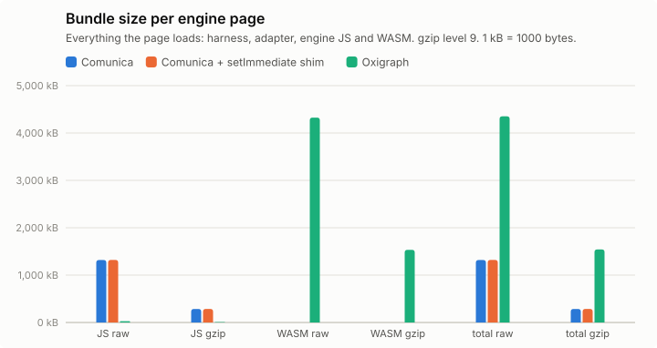

## Support matrix

One execution of every query instance at the smallest scale of each family, classified against `data/<dataset>/reference.json`. Per query: [`support-matrix.csv`](support-matrix.csv). For ldbc-snb-0.1 (one scale only), this is the cold pass of the first timing repetition, which is the same procedure.

**watdiv-1**

| | chromium/comunica | chromium/oxigraph | firefox/comunica | firefox/oxigraph | webkit/comunica | webkit/oxigraph |
|---|---:|---:|---:|---:|---:|---:|
| ok | 100/100 | 100/100 | 100/100 | 100/100 | 100/100 | 100/100 |
| other | – | – | – | – | – | – |

**bsbm-100**

| | chromium/comunica | chromium/oxigraph | firefox/comunica | firefox/oxigraph | webkit/comunica | webkit/oxigraph |
|---|---:|---:|---:|---:|---:|---:|
| ok | 50/50 | 50/50 | 50/50 | 50/50 | 50/50 | 50/50 |
| other | – | – | – | – | – | – |

**ldbc-snb-0.1**

| | chromium/comunica | chromium/oxigraph | firefox/comunica | firefox/oxigraph | webkit/comunica | webkit/oxigraph |
|---|---:|---:|---:|---:|---:|---:|
| ok | 98/105 | 101/105 | 98/105 | 101/105 | 0/105 | 101/105 |
| other | 7 timeout | 4 timeout | 7 timeout | 4 timeout | 105 skipped | 4 timeout |

- webkit/comunica: not run (see Skipped configurations)
- chromium/comunica IC9-1: timeout (Query exceeded 60000 ms)
- chromium/comunica IC9-2: timeout (Query exceeded 60000 ms)
- chromium/comunica IC9-3: timeout (Query exceeded 60000 ms)
- chromium/comunica IC9-4: timeout (Query exceeded 60000 ms)
- chromium/comunica IC9-5: timeout (Query exceeded 60000 ms)
- chromium/comunica IS7-1: timeout (Query exceeded 60000 ms)
- chromium/comunica IS7-4: timeout (Query exceeded 60000 ms)
- chromium/oxigraph IC4-1: timeout (no response within 90000 ms; page killed)
- chromium/oxigraph IC4-2: timeout (no response within 90000 ms; page killed)
- chromium/oxigraph IC4-3: timeout (no response within 90000 ms; page killed)
- chromium/oxigraph IC4-5: timeout (no response within 90000 ms; page killed)
- firefox/comunica IC9-1: timeout (Query exceeded 60000 ms)
- firefox/comunica IC9-2: timeout (Query exceeded 60000 ms)
- firefox/comunica IC9-3: timeout (Query exceeded 60000 ms)
- firefox/comunica IC9-4: timeout (Query exceeded 60000 ms)
- firefox/comunica IC9-5: timeout (Query exceeded 60000 ms)
- firefox/comunica IS7-1: timeout (Query exceeded 60000 ms)
- firefox/comunica IS7-4: timeout (Query exceeded 60000 ms)
- firefox/oxigraph IC4-1: timeout (no response within 90000 ms; page killed)
- firefox/oxigraph IC4-2: timeout (no response within 90000 ms; page killed)
- firefox/oxigraph IC4-3: timeout (no response within 90000 ms; page killed)
- firefox/oxigraph IC4-5: timeout (no response within 90000 ms; page killed)
- webkit/oxigraph IC4-1: timeout (no response within 90000 ms; page killed)
- webkit/oxigraph IC4-2: timeout (no response within 90000 ms; page killed)
- webkit/oxigraph IC4-3: timeout (no response within 90000 ms; page killed)
- webkit/oxigraph IC4-5: timeout (no response within 90000 ms; page killed)

## Query times, load and memory

Timing runs were repeated (see Setup); warm statistics pool the timed rounds of all repetitions (per instance: repetitions × 5 executions), cold is the mean of the cold executions over repetitions, and per-run values (init, load, memory) are medians over repetitions, with the range in parentheses. Totals add the per-instance warm means. "All ok" sums each engine over its own ok instances; "common" sums over the instances that both engines got ok in that browser, which is the comparable number. Engine init = loading the adapter chunk (JS, plus WASM for Oxigraph) + constructing the engine. Load = parse + ingest; Oxigraph parses and ingests inside one `Store.load()` call, so its parse column is empty. Memory: Chromium only.

### watdiv-1

| Browser | Engine | ok | Total warm (all ok) | Total warm (common) | Total cold (common) | Geomean warm (common) | Init | Fetch+inflate | Parse | Ingest | Load | Memory |
|---|---|---:|---:|---:|---:|---:|---:|---:|---:|---:|---:|---:|
| chromium | comunica | 100/100 | 254 ms | 254 ms (100) | 428 ms | 1.8 ms | 197 ms | 60 ms | 309 ms | 0.0 ms | 309 ms (291 ms–350 ms) | 17.1 MB |
| chromium | oxigraph | 100/100 | 998 ms | 998 ms (100) | 1.02 s | 0.5 ms | 39 ms | 56 ms | – | 385 ms | 385 ms (384 ms–427 ms) | 49.9 MB |
| firefox | comunica | 100/100 | 701 ms | 701 ms (100) | 893 ms | 5.8 ms | 294 ms | 123 ms | 416 ms | 0.0 ms | 416 ms (392 ms–424 ms) | – |
| firefox | oxigraph | 100/100 | 1.19 s | 1.19 s (100) | 1.16 s | 0.7 ms | 112 ms | 124 ms | – | 433 ms | 433 ms (394 ms–469 ms) | – |
| webkit | comunica | 100/100 | 299 ms | 299 ms (100) | 617 ms | 2.2 ms | 282 ms | 81 ms | 380 ms | 0.0 ms | 380 ms (380 ms–437 ms) | – |
| webkit | oxigraph | 100/100 | 1.02 s | 1.02 s (100) | 1.07 s | 0.5 ms | 91 ms | 74 ms | – | 379 ms | 379 ms (354 ms–491 ms) | – |

Three slowest instances per engine (warm mean [fastest–slowest execution]; cold mean)

- chromium / comunica: C3-1 22 ms [14 ms–40 ms]; cold 59 ms, C3-4 20 ms [14 ms–34 ms]; cold 19 ms, C3-5 20 ms [15 ms–33 ms]; cold 18 ms
- chromium / oxigraph: C3-3 198 ms [150 ms–263 ms]; cold 186 ms, C3-4 196 ms [148 ms–309 ms]; cold 180 ms, C3-2 194 ms [162 ms–261 ms]; cold 193 ms
- firefox / comunica: C3-4 40 ms [26 ms–56 ms]; cold 39 ms, C3-1 38 ms [27 ms–51 ms]; cold 59 ms, C3-5 37 ms [27 ms–53 ms]; cold 32 ms
- firefox / oxigraph: C3-5 243 ms [192 ms–318 ms]; cold 221 ms, C3-3 230 ms [195 ms–314 ms]; cold 204 ms, C3-2 229 ms [201 ms–327 ms]; cold 203 ms
- webkit / comunica: C3-5 22 ms [13 ms–34 ms]; cold 25 ms, C3-2 22 ms [15 ms–32 ms]; cold 34 ms, C3-4 22 ms [15 ms–34 ms]; cold 21 ms
- webkit / oxigraph: C3-3 203 ms [168 ms–280 ms]; cold 234 ms, C3-4 201 ms [161 ms–279 ms]; cold 203 ms, C3-5 195 ms [169 ms–254 ms]; cold 181 ms

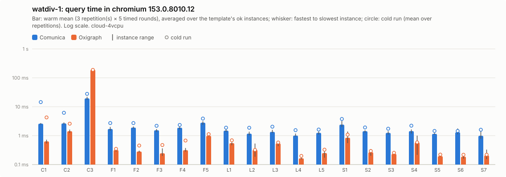

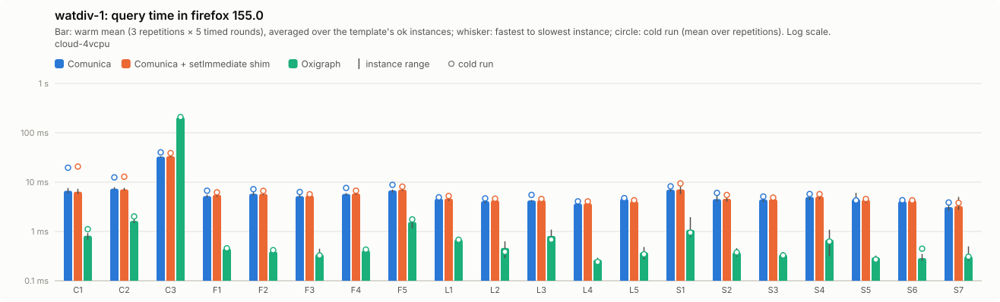

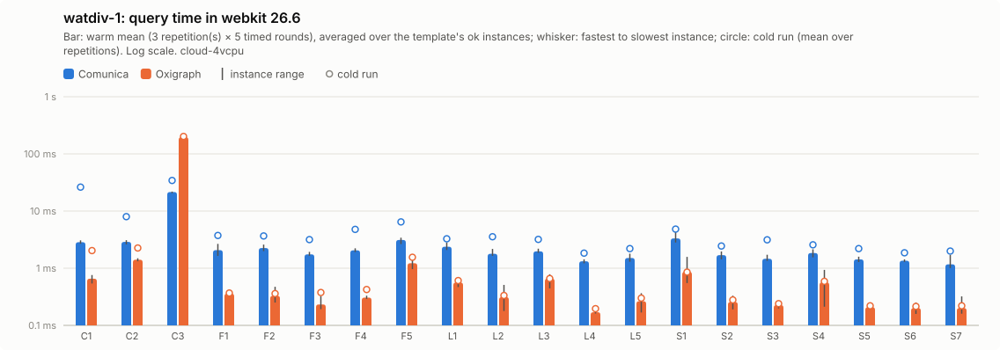

Per instance: [`watdiv-1/instances_chromium.csv`](watdiv-1/instances_chromium.csv), [`watdiv-1/instances_firefox.csv`](watdiv-1/instances_firefox.csv), [`watdiv-1/instances_webkit.csv`](watdiv-1/instances_webkit.csv); per template: `watdiv-1/plot_<browser>.csv`; totals: [`watdiv-1/totals.csv`](watdiv-1/totals.csv); load: [`watdiv-1/plot_load.csv`](watdiv-1/plot_load.csv).

### watdiv-10

| Browser | Engine | ok | Total warm (all ok) | Total warm (common) | Total cold (common) | Geomean warm (common) | Init | Fetch+inflate | Parse | Ingest | Load | Memory |
|---|---|---:|---:|---:|---:|---:|---:|---:|---:|---:|---:|---:|
| chromium | comunica | 100/100 | 1.01 s | 1.01 s (100) | 1.32 s | 2.7 ms | 190 ms | 489 ms | 2.84 s | 0.0 ms | 2.84 s (2.68 s–3.20 s) | 91.1 MB |
| chromium | oxigraph | 100/100 | 10.1 s | 10.1 s (100) | 10.9 s | 1.3 ms | 40 ms | 515 ms | – | 4.54 s | 4.54 s (4.28 s–4.61 s) | 411.2 MB |
| firefox | comunica | 100/100 | 2.12 s | 2.12 s (100) | 2.53 s | 8.1 ms | 301 ms | 953 ms | 5.02 s | 0.0 ms | 5.02 s (4.59 s–5.09 s) | – |
| firefox | oxigraph | 100/100 | 11.8 s | 11.8 s (100) | 11.6 s | 1.8 ms | 113 ms | 914 ms | – | 4.35 s | 4.35 s (4.32 s–4.72 s) | – |
| webkit | comunica | 100/100 | 1.32 s | 1.32 s (100) | 1.89 s | 3.9 ms | 223 ms | 708 ms | 3.57 s | 0.0 ms | 3.57 s (2.94 s–3.75 s) | – |
| webkit | oxigraph | 100/100 | 10.9 s | 10.9 s (100) | 10.7 s | 1.4 ms | 82 ms | 740 ms | – | 4.34 s | 4.34 s (4.07 s–4.36 s) | – |

Three slowest instances per engine (warm mean [fastest–slowest execution]; cold mean)

- chromium / comunica: C3-1 163 ms [128 ms–230 ms]; cold 279 ms, C3-3 161 ms [131 ms–216 ms]; cold 133 ms, C3-4 153 ms [125 ms–219 ms]; cold 138 ms
- chromium / oxigraph: C3-3 2.04 s [1.73 s–2.37 s]; cold 2.12 s, C3-1 2.03 s [1.84 s–2.49 s]; cold 2.11 s, C3-2 1.99 s [1.82 s–2.36 s]; cold 2.27 s
- firefox / comunica: C3-1 304 ms [254 ms–415 ms]; cold 477 ms, C3-2 288 ms [230 ms–398 ms]; cold 246 ms, C3-4 287 ms [242 ms–385 ms]; cold 295 ms
- firefox / oxigraph: C3-4 2.37 s [2.03 s–2.96 s]; cold 2.26 s, C3-3 2.36 s [2.07 s–2.78 s]; cold 2.29 s, C3-1 2.32 s [1.90 s–3.51 s]; cold 2.24 s
- webkit / comunica: C3-1 259 ms [212 ms–324 ms]; cold 319 ms, C3-3 187 ms [141 ms–285 ms]; cold 254 ms, C3-4 176 ms [139 ms–281 ms]; cold 237 ms
- webkit / oxigraph: C3-2 2.17 s [1.90 s–3.00 s]; cold 2.19 s, C3-4 2.16 s [1.86 s–2.56 s]; cold 2.09 s, C3-1 2.16 s [1.98 s–2.52 s]; cold 2.11 s

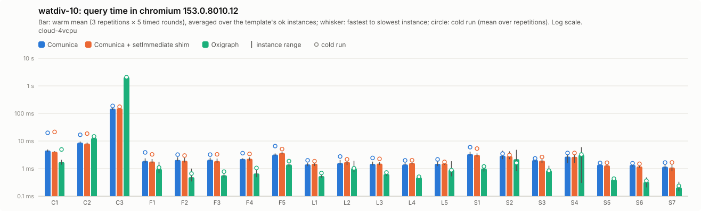

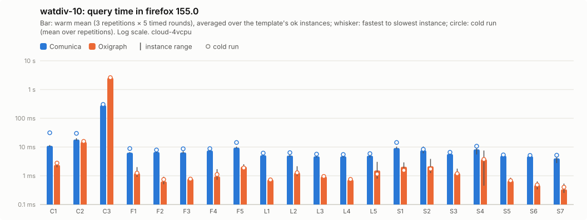

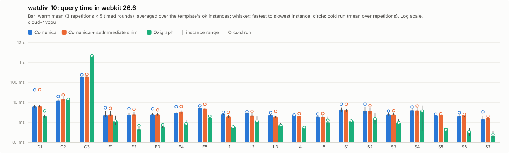

Per instance: [`watdiv-10/instances_chromium.csv`](watdiv-10/instances_chromium.csv), [`watdiv-10/instances_firefox.csv`](watdiv-10/instances_firefox.csv), [`watdiv-10/instances_webkit.csv`](watdiv-10/instances_webkit.csv); per template: `watdiv-10/plot_<browser>.csv`; totals: [`watdiv-10/totals.csv`](watdiv-10/totals.csv); load: [`watdiv-10/plot_load.csv`](watdiv-10/plot_load.csv).

### bsbm-100

| Browser | Engine | ok | Total warm (all ok) | Total warm (common) | Total cold (common) | Geomean warm (common) | Init | Fetch+inflate | Parse | Ingest | Load | Memory |
|---|---|---:|---:|---:|---:|---:|---:|---:|---:|---:|---:|---:|
| chromium | comunica | 50/50 | 192 ms | 192 ms (50) | 359 ms | 3.2 ms | 207 ms | 48 ms | 213 ms | 0.0 ms | 213 ms (205 ms–213 ms) | 28.2 MB |
| chromium | oxigraph | 50/50 | 41 ms | 41 ms (50) | 100 ms | 0.6 ms | 47 ms | 59 ms | – | 244 ms | 244 ms (238 ms–310 ms) | 30.1 MB |
| firefox | comunica | 50/50 | 765 ms | 765 ms (50) | 980 ms | 12 ms | 274 ms | 115 ms | 326 ms | 0.0 ms | 326 ms (296 ms–328 ms) | – |
| firefox | oxigraph | 50/50 | 53 ms | 53 ms (50) | 63 ms | 0.8 ms | 126 ms | 98 ms | – | 236 ms | 236 ms (221 ms–252 ms) | – |
| webkit | comunica | 50/50 | 232 ms | 232 ms (50) | 629 ms | 4.0 ms | 237 ms | 98 ms | 269 ms | 0.0 ms | 269 ms (221 ms–314 ms) | – |
| webkit | oxigraph | 50/50 | 42 ms | 42 ms (50) | 69 ms | 0.6 ms | 82 ms | 72 ms | – | 195 ms | 195 ms (195 ms–240 ms) | – |

Three slowest instances per engine (warm mean [fastest–slowest execution]; cold mean)

- chromium / comunica: Q5-5 9.9 ms [7.3 ms–14 ms]; cold 11 ms, Q5-4 9.1 ms [6.6 ms–12 ms]; cold 11 ms, Q5-2 9.0 ms [7.2 ms–12 ms]; cold 14 ms
- chromium / oxigraph: Q8-2 3.5 ms [2.8 ms–5.2 ms]; cold 9.3 ms, Q8-1 3.3 ms [2.8 ms–4.3 ms]; cold 8.0 ms, Q8-3 2.8 ms [2.4 ms–4.2 ms]; cold 5.9 ms
- firefox / comunica: Q5-2 48 ms [32 ms–112 ms]; cold 50 ms, Q5-5 47 ms [38 ms–74 ms]; cold 47 ms, Q5-1 42 ms [31 ms–66 ms]; cold 57 ms
- firefox / oxigraph: Q8-1 4.2 ms [3.1 ms–11 ms]; cold 4.7 ms, Q8-2 4.2 ms [3.2 ms–6.0 ms]; cold 5.2 ms, Q8-3 3.3 ms [2.4 ms–5.0 ms]; cold 3.8 ms
- webkit / comunica: Q5-2 11 ms [7.3 ms–23 ms]; cold 27 ms, Q5-1 11 ms [5.9 ms–19 ms]; cold 35 ms, Q5-5 10.0 ms [8.0 ms–16 ms]; cold 22 ms
- webkit / oxigraph: Q8-1 3.4 ms [2.6 ms–5.0 ms]; cold 5.1 ms, Q8-2 3.4 ms [2.7 ms–4.8 ms]; cold 5.4 ms, Q8-4 2.8 ms [2.1 ms–5.4 ms]; cold 3.3 ms

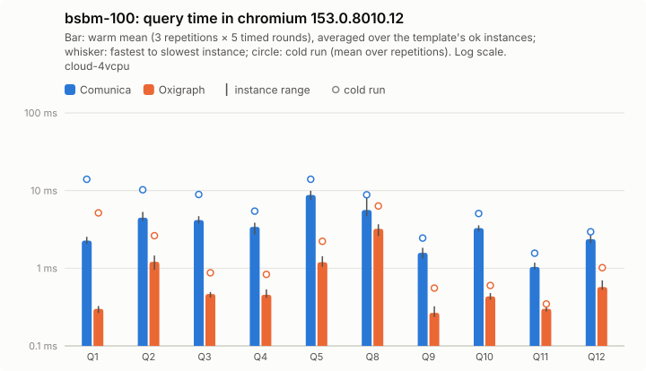

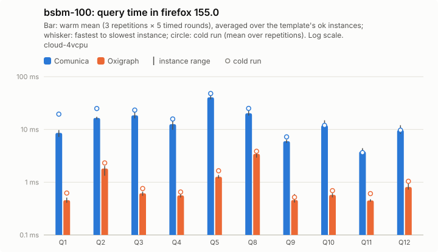

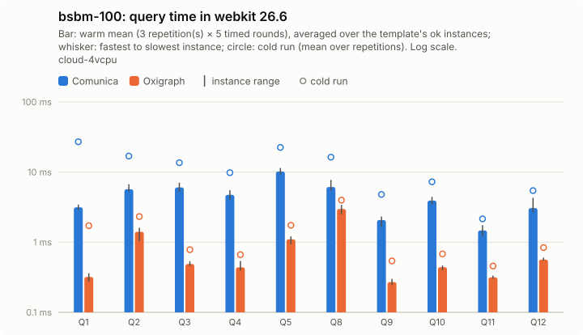

Per instance: [`bsbm-100/instances_chromium.csv`](bsbm-100/instances_chromium.csv), [`bsbm-100/instances_firefox.csv`](bsbm-100/instances_firefox.csv), [`bsbm-100/instances_webkit.csv`](bsbm-100/instances_webkit.csv); per template: `bsbm-100/plot_<browser>.csv`; totals: [`bsbm-100/totals.csv`](bsbm-100/totals.csv); load: [`bsbm-100/plot_load.csv`](bsbm-100/plot_load.csv).

### bsbm-1k

| Browser | Engine | ok | Total warm (all ok) | Total warm (common) | Total cold (common) | Geomean warm (common) | Init | Fetch+inflate | Parse | Ingest | Load | Memory |
|---|---|---:|---:|---:|---:|---:|---:|---:|---:|---:|---:|---:|
| chromium | comunica | 50/50 | 280 ms | 280 ms (50) | 531 ms | 3.7 ms | 204 ms | 409 ms | 1.70 s | 0.0 ms | 1.70 s (1.67 s–1.86 s) | 103.4 MB |
| chromium | oxigraph | 50/50 | 197 ms | 197 ms (50) | 262 ms | 0.9 ms | 58 ms | 426 ms | – | 2.04 s | 2.04 s (1.86 s–2.07 s) | 172.7 MB |
| firefox | comunica | 50/50 | 1.16 s | 1.16 s (50) | 1.45 s | 13 ms | 232 ms | 710 ms | 3.22 s | 0.0 ms | 3.22 s (3.14 s–3.24 s) | – |
| firefox | oxigraph | 50/50 | 216 ms | 216 ms (50) | 236 ms | 1.2 ms | 114 ms | 802 ms | – | 1.87 s | 1.87 s (1.87 s–1.97 s) | – |
| webkit | comunica | 50/50 | 332 ms | 332 ms (50) | 811 ms | 4.8 ms | 239 ms | 625 ms | 1.88 s | 0.0 ms | 1.88 s (1.84 s–2.00 s) | – |
| webkit | oxigraph | 50/50 | 198 ms | 198 ms (50) | 222 ms | 0.9 ms | 77 ms | 638 ms | – | 1.81 s | 1.81 s (1.70 s–1.90 s) | – |

Three slowest instances per engine (warm mean [fastest–slowest execution]; cold mean)

- chromium / comunica: Q5-5 32 ms [23 ms–42 ms]; cold 39 ms, Q5-2 31 ms [22 ms–49 ms]; cold 44 ms, Q5-4 31 ms [19 ms–42 ms]; cold 34 ms
- chromium / oxigraph: Q8-4 32 ms [25 ms–44 ms]; cold 33 ms, Q8-1 32 ms [28 ms–39 ms]; cold 42 ms, Q8-2 32 ms [27 ms–40 ms]; cold 36 ms
- firefox / comunica: Q5-2 167 ms [135 ms–212 ms]; cold 163 ms, Q5-5 159 ms [131 ms–213 ms]; cold 136 ms, Q5-4 134 ms [117 ms–205 ms]; cold 137 ms
- firefox / oxigraph: Q8-2 34 ms [29 ms–41 ms]; cold 37 ms, Q8-4 34 ms [28 ms–40 ms]; cold 35 ms, Q8-5 34 ms [28 ms–41 ms]; cold 36 ms
- webkit / comunica: Q5-2 34 ms [22 ms–73 ms]; cold 51 ms, Q5-5 30 ms [22 ms–41 ms]; cold 44 ms, Q5-4 29 ms [21 ms–41 ms]; cold 47 ms
- webkit / oxigraph: Q8-1 33 ms [26 ms–44 ms]; cold 32 ms, Q8-2 33 ms [26 ms–41 ms]; cold 33 ms, Q8-5 31 ms [26 ms–39 ms]; cold 31 ms

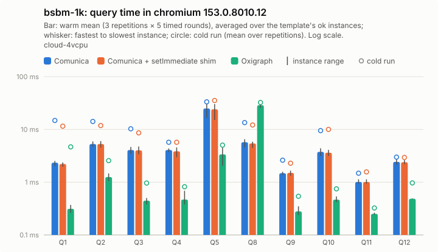

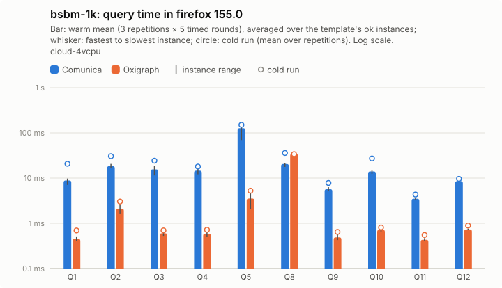

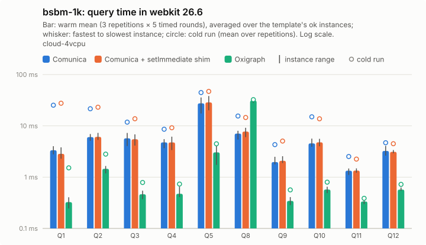

Per instance: [`bsbm-1k/instances_chromium.csv`](bsbm-1k/instances_chromium.csv), [`bsbm-1k/instances_firefox.csv`](bsbm-1k/instances_firefox.csv), [`bsbm-1k/instances_webkit.csv`](bsbm-1k/instances_webkit.csv); per template: `bsbm-1k/plot_<browser>.csv`; totals: [`bsbm-1k/totals.csv`](bsbm-1k/totals.csv); load: [`bsbm-1k/plot_load.csv`](bsbm-1k/plot_load.csv).

### ldbc-snb-0.1

| Browser | Engine | ok | Total warm (all ok) | Total warm (common) | Total cold (common) | Geomean warm (common) | Init | Fetch+inflate | Parse | Ingest | Load | Memory |
|---|---|---:|---:|---:|---:|---:|---:|---:|---:|---:|---:|---:|
| chromium | comunica | 96/105 (9 timeout) | 208.9 s | 207.5 s (92) | 219.3 s | 142 ms | 187 ms | 3.02 s | 24.4 s | 0.0 ms | 24.4 s (24.4 s–24.4 s) | 680.7 MB |
| chromium | oxigraph | 101/105 (4 timeout) | 267.9 s | 236.2 s (92) | 251.8 s | 353 ms | 61 ms | 2.96 s | – | 20.8 s | 20.8 s (20.8 s–20.8 s) | 1556.9 MB |
| firefox | comunica | 95/105 (10 timeout) | 613.0 s | 607.0 s (91) | 646.6 s | 462 ms | 242 ms | 4.50 s | 200.5 s | 0.0 ms | 200.5 s (200.5 s–200.5 s) | – |
| firefox | oxigraph | 101/105 (4 timeout) | 267.2 s | 230.9 s (91) | 216.6 s | 367 ms | 130 ms | 3.84 s | – | 18.1 s | 18.1 s (18.1 s–18.1 s) | – |
| webkit | comunica | 0/105 (105 skipped) | 0.0 ms | 0.0 ms (0) | 0.0 ms | – | – | – | – | – | – (–––) | – |
| webkit | oxigraph | 101/105 (4 timeout) | 267.5 s | 0.0 ms (0) | 0.0 ms | – | 98 ms | 4.33 s | – | 18.0 s | 18.0 s (18.0 s–18.0 s) | – |

Three slowest instances per engine (warm mean [fastest–slowest execution]; cold mean)

- chromium / comunica: IC14-4 15.8 s [14.6 s–17.3 s]; cold 15.9 s, IC14-5 15.0 s [13.1 s–16.5 s]; cold 17.6 s, IC14-2 14.6 s [12.8 s–17.5 s]; cold 16.1 s
- chromium / oxigraph: IC14-2 13.1 s [11.8 s–13.9 s]; cold 15.8 s, IC14-5 12.1 s [11.2 s–12.6 s]; cold 15.2 s, IC3-1 11.6 s [10.9 s–12.1 s]; cold 11.0 s
- firefox / comunica: IC10-4 52.6 s [51.6 s–54.2 s]; cold 56.9 s, IC10-5 50.7 s [48.0 s–54.8 s]; cold 50.1 s, IC10-3 45.0 s [41.7 s–50.3 s]; cold 45.2 s
- firefox / oxigraph: IC14-2 13.4 s [12.6 s–13.9 s]; cold 13.3 s, IC14-5 11.9 s [11.3 s–12.5 s]; cold 10.8 s, IC3-2 11.8 s [10.9 s–14.1 s]; cold 11.5 s
- webkit / comunica: 
- webkit / oxigraph: IC14-2 13.4 s [12.5 s–14.2 s]; cold 12.3 s, IC3-4 12.0 s [11.2 s–14.1 s]; cold 10.0 s, IC14-5 11.7 s [10.8 s–13.1 s]; cold 10.9 s

Not ok:

- chromium / comunica IC9-1: timeout (Query exceeded 60000 ms)
- chromium / comunica IC9-2: timeout (Query exceeded 60000 ms)
- chromium / comunica IC9-3: timeout (Query exceeded 60000 ms)
- chromium / comunica IC9-4: timeout (Query exceeded 60000 ms)
- chromium / comunica IC9-5: timeout (Query exceeded 60000 ms)
- chromium / comunica IS7-1: timeout (Query exceeded 60000 ms)
- chromium / comunica IS7-2: timeout (Query exceeded 60000 ms)
- chromium / comunica IS7-4: timeout (Query exceeded 60000 ms)
- chromium / comunica IS7-5: timeout (Query exceeded 60000 ms)
- chromium / oxigraph IC4-1: timeout (no response within 90000 ms; page killed)
- chromium / oxigraph IC4-2: timeout (no response within 90000 ms; page killed)
- chromium / oxigraph IC4-3: timeout (no response within 90000 ms; page killed)
- chromium / oxigraph IC4-5: timeout (no response within 90000 ms; page killed)
- firefox / comunica IC9-1: timeout (Query exceeded 60000 ms)
- firefox / comunica IC9-2: timeout (Query exceeded 60000 ms)
- firefox / comunica IC9-3: timeout (Query exceeded 60000 ms)
- firefox / comunica IC9-4: timeout (Query exceeded 60000 ms)
- firefox / comunica IC9-5: timeout (Query exceeded 60000 ms)
- firefox / comunica IC10-1: timeout (Query exceeded 60000 ms)
- firefox / comunica IS7-1: timeout (Query exceeded 60000 ms)
- firefox / comunica IS7-2: timeout (Query exceeded 60000 ms)
- firefox / comunica IS7-4: timeout (Query exceeded 60000 ms)
- firefox / comunica IS7-5: timeout (Query exceeded 60000 ms)
- firefox / oxigraph IC4-1: timeout (no response within 90000 ms; page killed)
- firefox / oxigraph IC4-2: timeout (no response within 90000 ms; page killed)
- firefox / oxigraph IC4-3: timeout (no response within 90000 ms; page killed)
- firefox / oxigraph IC4-5: timeout (no response within 90000 ms; page killed)
- webkit / comunica: not run (see Skipped configurations)
- webkit / oxigraph IC4-1: timeout (no response within 90000 ms; page killed)
- webkit / oxigraph IC4-2: timeout (no response within 90000 ms; page killed)
- webkit / oxigraph IC4-3: timeout (no response within 90000 ms; page killed)
- webkit / oxigraph IC4-5: timeout (no response within 90000 ms; page killed)

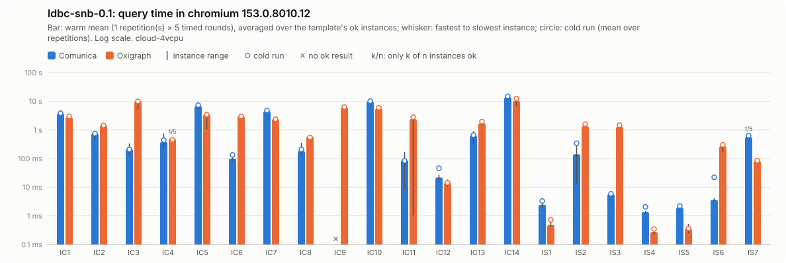

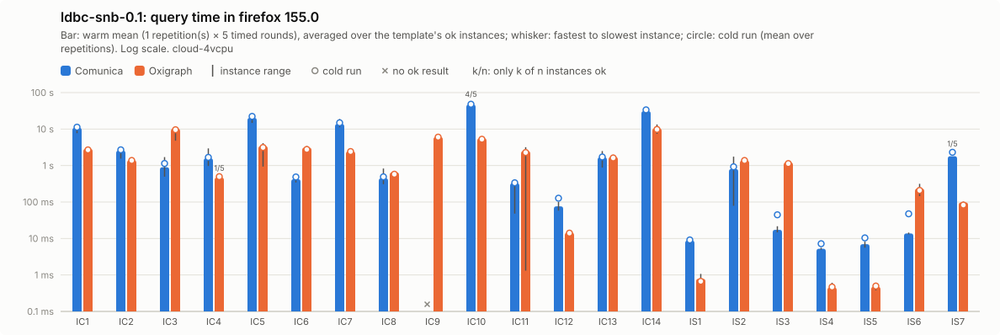

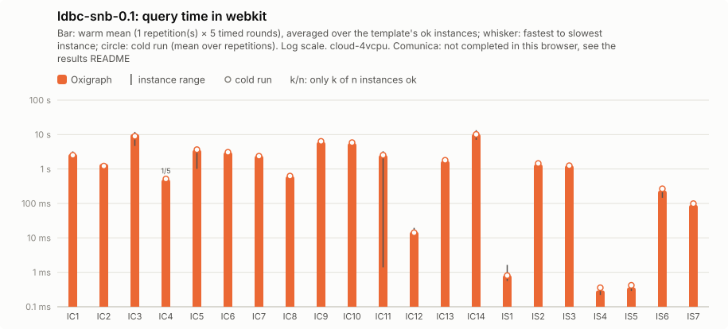

Per instance: [`ldbc-snb-0.1/instances_chromium.csv`](ldbc-snb-0.1/instances_chromium.csv), [`ldbc-snb-0.1/instances_firefox.csv`](ldbc-snb-0.1/instances_firefox.csv), [`ldbc-snb-0.1/instances_webkit.csv`](ldbc-snb-0.1/instances_webkit.csv); per template: `ldbc-snb-0.1/plot_<browser>.csv`; totals: [`ldbc-snb-0.1/totals.csv`](ldbc-snb-0.1/totals.csv); load: [`ldbc-snb-0.1/plot_load.csv`](ldbc-snb-0.1/plot_load.csv).

## Load and memory overview

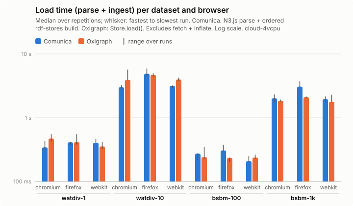

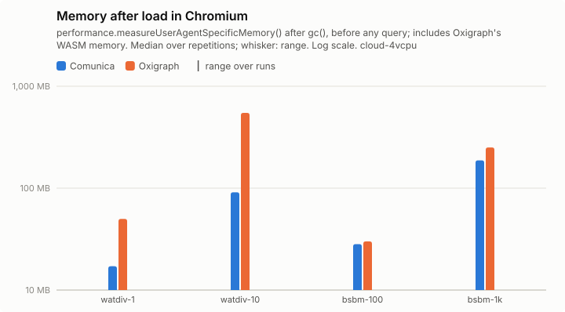

