# Results: 2026-11-04-cloud-4vcpu-comunica-483dc3c

Generated by `npm run aggregate` and `npm run plot` from `raw/*.json`; only the notes section is written by hand.

<!-- notes:start -->
_No notes for this run._
<!-- notes:end -->

## Setup

| | |
|---|---|
| Machine | `cloud-4vcpu`: Intel(R) Xeon(R) Processor @ 2.10GHz, 4 logical CPUs, 15.7 GiB RAM, Ubuntu 24.04.5 LTS (Linux 6.18.44-fc-v233 x64) |
| Browsers (Playwright 1.63.0, headless) | chromium 153.0.8010.12, firefox 155.0, webkit 26.6 |
| Comunica | `@comunica/query-sparql-rdfjs-lite` 5.4.1 built from https://github.com/comunica/comunica at [`483dc3cfad`](https://github.com/comunica/comunica/commit/483dc3cfad79d24b6f6eb081e0113b0092658bba) (2026-11-04T14:29:58+01:00), N3.js 2.13.12, rdf-stores 2.8.0 (ordered store) |
| Oxigraph | `oxigraph` 0.5.13 (`web.js` WASM build) |
| Benchmark code | `050f22b`; each raw file written by a resumed invocation names its commit; Vite 8.3.5 |
| Settings | 3 repetitions of every timing run, each in a fresh browser and context; per run 1 warmup round and 5 timed rounds; timeout 60 s per execution |
| Run | 2026-11-04T14:22:22.772Z to 2026-11-04T14:44:35.814Z |

## Bundle size

Everything the page loads (harness, adapter, engine); gzip level 9; kB = 1000 bytes.

| Page | JS raw | JS gzip | WASM raw | WASM gzip | Total raw | Total gzip |
|---|---:|---:|---:|---:|---:|---:|
| comunica | 1,319.8 | 285.4 | 0 | 0 | 1,319.8 | 285.4 |
| oxigraph | 28.1 | 8.7 | 4,324.9 | 1,533.7 | 4,353.1 | 1,542.4 |

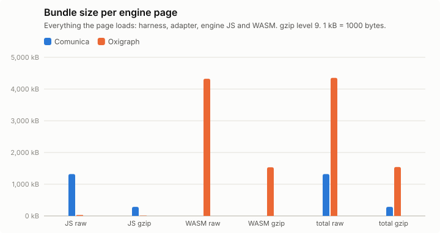

## Query times, load and memory

Timing runs were repeated (see Setup); warm statistics pool the timed rounds of all repetitions (per instance: repetitions × 5 executions), cold is the mean of the cold executions over repetitions, and per-run values (init, load, memory) are medians over repetitions, with the range in parentheses. Totals add the per-instance warm means. "All ok" sums each engine over its own ok instances; "common" sums over the instances that both engines got ok in that browser, which is the comparable number. Engine init = loading the adapter chunk (JS, plus WASM for Oxigraph) + constructing the engine. Load = parse + ingest; Oxigraph parses and ingests inside one `Store.load()` call, so its parse column is empty. Memory: Chromium only.

### watdiv-1

| Browser | Engine | ok | Total warm (all ok) | Total warm (common) | Total cold (common) | Geomean warm (common) | Init | Fetch+inflate | Parse | Ingest | Load | Memory |
|---|---|---:|---:|---:|---:|---:|---:|---:|---:|---:|---:|---:|
| chromium | comunica | 100/100 | 243 ms | 243 ms (100) | 412 ms | 1.7 ms | 201 ms | 49 ms | 367 ms | 0.0 ms | 367 ms (340 ms–427 ms) | 17.2 MB |
| chromium | oxigraph | 100/100 | 1.05 s | 1.05 s (100) | 1.05 s | 0.5 ms | 39 ms | 57 ms | – | 399 ms | 399 ms (371 ms–409 ms) | 49.9 MB |
| firefox | comunica | 100/100 | 767 ms | 767 ms (100) | 887 ms | 6.4 ms | 293 ms | 102 ms | 478 ms | 0.0 ms | 478 ms (390 ms–512 ms) | – |
| firefox | oxigraph | 100/100 | 1.21 s | 1.21 s (100) | 1.22 s | 0.7 ms | 120 ms | 106 ms | – | 464 ms | 464 ms (401 ms–467 ms) | – |
| webkit | comunica | 100/100 | 283 ms | 283 ms (100) | 544 ms | 2.1 ms | 219 ms | 68 ms | 348 ms | 0.0 ms | 348 ms (343 ms–379 ms) | – |
| webkit | oxigraph | 100/100 | 1.01 s | 1.01 s (100) | 1.08 s | 0.5 ms | 80 ms | 69 ms | – | 362 ms | 362 ms (330 ms–374 ms) | – |

Three slowest instances per engine (warm mean [fastest–slowest execution]; cold mean)

- chromium / comunica: C3-5 20 ms [13 ms–42 ms]; cold 18 ms, C3-1 19 ms [15 ms–26 ms]; cold 49 ms, C3-2 18 ms [13 ms–27 ms]; cold 22 ms
- chromium / oxigraph: C3-3 210 ms [167 ms–305 ms]; cold 195 ms, C3-2 209 ms [158 ms–340 ms]; cold 219 ms, C3-5 198 ms [166 ms–285 ms]; cold 173 ms
- firefox / comunica: C3-1 41 ms [27 ms–82 ms]; cold 71 ms, C3-5 40 ms [27 ms–73 ms]; cold 37 ms, C3-2 39 ms [26 ms–89 ms]; cold 36 ms
- firefox / oxigraph: C3-3 239 ms [202 ms–297 ms]; cold 223 ms, C3-4 230 ms [199 ms–328 ms]; cold 216 ms, C3-1 230 ms [198 ms–314 ms]; cold 253 ms
- webkit / comunica: C3-2 21 ms [16 ms–28 ms]; cold 27 ms, C3-4 20 ms [13 ms–26 ms]; cold 23 ms, C3-1 19 ms [15 ms–34 ms]; cold 54 ms
- webkit / oxigraph: C3-1 202 ms [165 ms–311 ms]; cold 213 ms, C3-3 198 ms [160 ms–283 ms]; cold 203 ms, C3-2 195 ms [162 ms–267 ms]; cold 197 ms

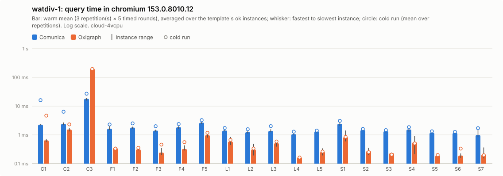

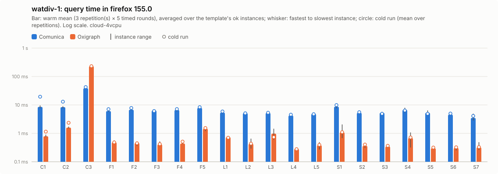

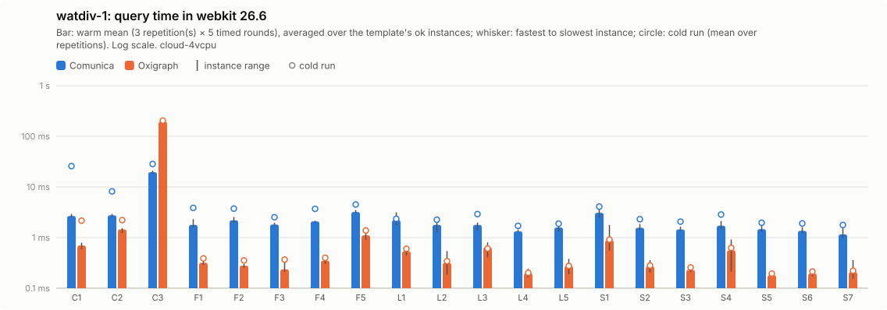

Per instance: [`watdiv-1/instances_chromium.csv`](watdiv-1/instances_chromium.csv), [`watdiv-1/instances_firefox.csv`](watdiv-1/instances_firefox.csv), [`watdiv-1/instances_webkit.csv`](watdiv-1/instances_webkit.csv); per template: `watdiv-1/plot_<browser>.csv`; totals: [`watdiv-1/totals.csv`](watdiv-1/totals.csv); load: [`watdiv-1/plot_load.csv`](watdiv-1/plot_load.csv).

### watdiv-10

| Browser | Engine | ok | Total warm (all ok) | Total warm (common) | Total cold (common) | Geomean warm (common) | Init | Fetch+inflate | Parse | Ingest | Load | Memory |
|---|---|---:|---:|---:|---:|---:|---:|---:|---:|---:|---:|---:|
| chromium | comunica | 100/100 | 956 ms | 956 ms (100) | 1.15 s | 2.6 ms | 172 ms | 444 ms | 2.79 s | 0.0 ms | 2.79 s (2.62 s–3.06 s) | 91.1 MB |
| chromium | oxigraph | 100/100 | 10.2 s | 10.2 s (100) | 10.4 s | 1.2 ms | 47 ms | 472 ms | – | 4.37 s | 4.37 s (3.91 s–4.74 s) | 411.2 MB |
| firefox | comunica | 100/100 | 2.02 s | 2.02 s (100) | 2.41 s | 7.7 ms | 261 ms | 917 ms | 4.89 s | 0.0 ms | 4.89 s (4.41 s–5.38 s) | – |
| firefox | oxigraph | 100/100 | 11.2 s | 11.2 s (100) | 11.9 s | 1.6 ms | 85 ms | 873 ms | – | 4.44 s | 4.44 s (4.39 s–4.77 s) | – |
| webkit | comunica | 100/100 | 1.14 s | 1.14 s (100) | 1.58 s | 3.2 ms | 252 ms | 692 ms | 3.37 s | 0.0 ms | 3.37 s (3.30 s–3.63 s) | – |
| webkit | oxigraph | 100/100 | 11.1 s | 11.1 s (100) | 10.6 s | 1.3 ms | 75 ms | 694 ms | – | 3.69 s | 3.69 s (3.56 s–3.78 s) | – |

Three slowest instances per engine (warm mean [fastest–slowest execution]; cold mean)

- chromium / comunica: C3-4 151 ms [116 ms–251 ms]; cold 141 ms, C3-2 147 ms [112 ms–214 ms]; cold 139 ms, C3-1 147 ms [115 ms–232 ms]; cold 241 ms
- chromium / oxigraph: C3-2 2.03 s [1.86 s–2.67 s]; cold 2.05 s, C3-4 2.01 s [1.88 s–2.23 s]; cold 2.06 s, C3-1 2.01 s [1.84 s–2.19 s]; cold 1.99 s
- firefox / comunica: C3-1 289 ms [213 ms–443 ms]; cold 456 ms, C3-2 274 ms [215 ms–371 ms]; cold 233 ms, C3-3 269 ms [228 ms–388 ms]; cold 269 ms
- firefox / oxigraph: C3-3 2.21 s [1.98 s–2.43 s]; cold 2.29 s, C3-2 2.20 s [2.05 s–2.33 s]; cold 2.34 s, C3-4 2.20 s [2.06 s–2.37 s]; cold 2.38 s
- webkit / comunica: C3-1 240 ms [197 ms–319 ms]; cold 275 ms, C3-3 159 ms [136 ms–215 ms]; cold 144 ms, C3-2 151 ms [135 ms–207 ms]; cold 166 ms
- webkit / oxigraph: C3-4 2.26 s [2.04 s–2.95 s]; cold 2.12 s, C3-5 2.23 s [1.97 s–2.92 s]; cold 2.04 s, C3-1 2.19 s [1.90 s–2.74 s]; cold 2.06 s

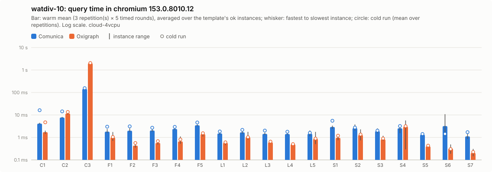

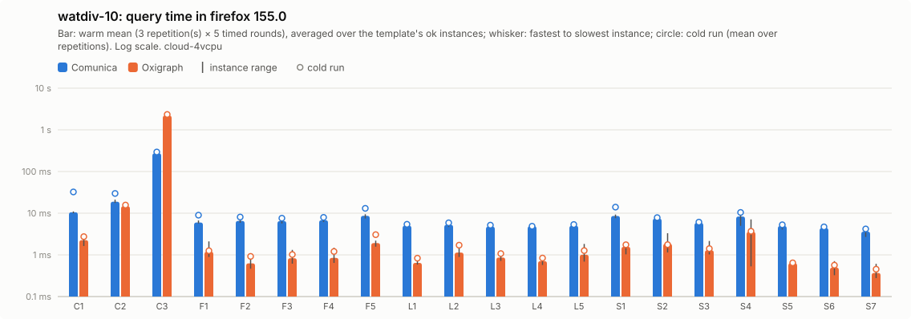

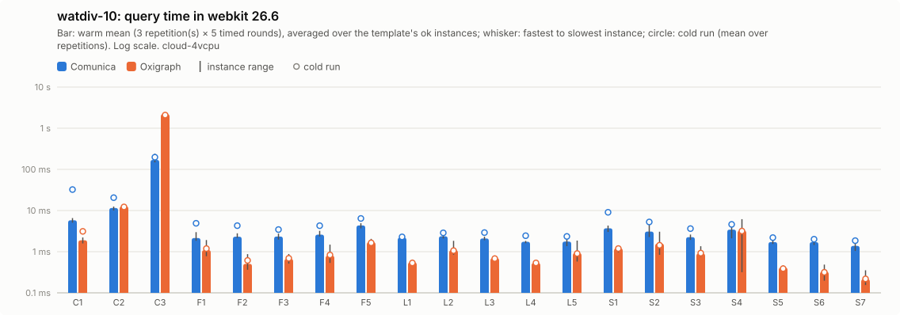

Per instance: [`watdiv-10/instances_chromium.csv`](watdiv-10/instances_chromium.csv), [`watdiv-10/instances_firefox.csv`](watdiv-10/instances_firefox.csv), [`watdiv-10/instances_webkit.csv`](watdiv-10/instances_webkit.csv); per template: `watdiv-10/plot_<browser>.csv`; totals: [`watdiv-10/totals.csv`](watdiv-10/totals.csv); load: [`watdiv-10/plot_load.csv`](watdiv-10/plot_load.csv).

### bsbm-100

| Browser | Engine | ok | Total warm (all ok) | Total warm (common) | Total cold (common) | Geomean warm (common) | Init | Fetch+inflate | Parse | Ingest | Load | Memory |
|---|---|---:|---:|---:|---:|---:|---:|---:|---:|---:|---:|---:|
| chromium | comunica | 50/50 | 169 ms | 169 ms (50) | 333 ms | 2.9 ms | 176 ms | 57 ms | 202 ms | 0.0 ms | 202 ms (197 ms–209 ms) | 28.2 MB |
| chromium | oxigraph | 50/50 | 39 ms | 39 ms (50) | 84 ms | 0.6 ms | 43 ms | 44 ms | – | 259 ms | 259 ms (221 ms–259 ms) | 30.1 MB |
| firefox | comunica | 50/50 | 686 ms | 686 ms (50) | 911 ms | 11 ms | 261 ms | 95 ms | 311 ms | 0.0 ms | 311 ms (309 ms–322 ms) | – |
| firefox | oxigraph | 50/50 | 47 ms | 47 ms (50) | 56 ms | 0.7 ms | 125 ms | 83 ms | – | 238 ms | 238 ms (228 ms–248 ms) | – |
| webkit | comunica | 50/50 | 221 ms | 221 ms (50) | 498 ms | 3.8 ms | 211 ms | 64 ms | 227 ms | 0.0 ms | 227 ms (224 ms–298 ms) | – |
| webkit | oxigraph | 50/50 | 40 ms | 40 ms (50) | 58 ms | 0.6 ms | 86 ms | 72 ms | – | 212 ms | 212 ms (211 ms–250 ms) | – |

Three slowest instances per engine (warm mean [fastest–slowest execution]; cold mean)

- chromium / comunica: Q5-5 8.3 ms [6.8 ms–11 ms]; cold 13 ms, Q5-4 7.8 ms [5.9 ms–10 ms]; cold 9.7 ms, Q5-2 7.2 ms [5.9 ms–9.1 ms]; cold 12 ms
- chromium / oxigraph: Q8-2 3.3 ms [2.9 ms–4.5 ms]; cold 6.0 ms, Q8-1 3.2 ms [2.7 ms–4.5 ms]; cold 5.8 ms, Q8-3 2.8 ms [2.3 ms–4.4 ms]; cold 5.6 ms
- firefox / comunica: Q5-1 41 ms [26 ms–145 ms]; cold 50 ms, Q5-5 40 ms [33 ms–74 ms]; cold 41 ms, Q5-2 38 ms [28 ms–68 ms]; cold 56 ms
- firefox / oxigraph: Q8-1 3.6 ms [3.0 ms–6.3 ms]; cold 3.5 ms, Q8-2 3.6 ms [3.0 ms–5.3 ms]; cold 4.8 ms, Q8-4 3.1 ms [2.4 ms–5.0 ms]; cold 2.9 ms
- webkit / comunica: Q5-1 11 ms [5.9 ms–32 ms]; cold 21 ms, Q5-5 10 ms [7.0 ms–23 ms]; cold 13 ms, Q5-2 9.3 ms [6.4 ms–15 ms]; cold 19 ms
- webkit / oxigraph: Q8-1 3.7 ms [2.7 ms–6.2 ms]; cold 3.6 ms, Q8-2 3.3 ms [2.6 ms–5.2 ms]; cold 4.0 ms, Q8-3 2.9 ms [2.3 ms–4.1 ms]; cold 2.6 ms

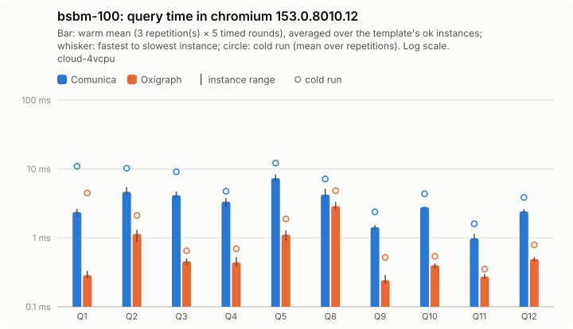

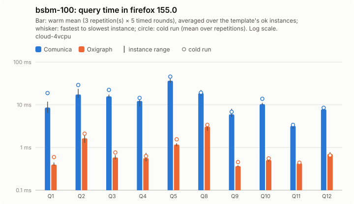

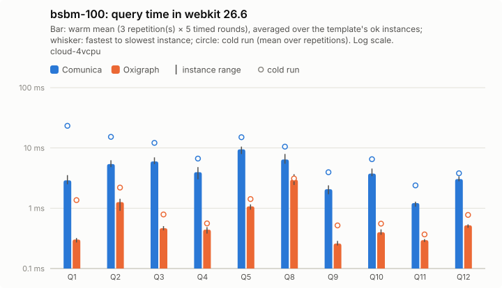

Per instance: [`bsbm-100/instances_chromium.csv`](bsbm-100/instances_chromium.csv), [`bsbm-100/instances_firefox.csv`](bsbm-100/instances_firefox.csv), [`bsbm-100/instances_webkit.csv`](bsbm-100/instances_webkit.csv); per template: `bsbm-100/plot_<browser>.csv`; totals: [`bsbm-100/totals.csv`](bsbm-100/totals.csv); load: [`bsbm-100/plot_load.csv`](bsbm-100/plot_load.csv).

### bsbm-1k

| Browser | Engine | ok | Total warm (all ok) | Total warm (common) | Total cold (common) | Geomean warm (common) | Init | Fetch+inflate | Parse | Ingest | Load | Memory |
|---|---|---:|---:|---:|---:|---:|---:|---:|---:|---:|---:|---:|
| chromium | comunica | 50/50 | 246 ms | 246 ms (50) | 468 ms | 3.3 ms | 183 ms | 396 ms | 1.57 s | 0.0 ms | 1.57 s (1.51 s–1.70 s) | 103.5 MB |
| chromium | oxigraph | 50/50 | 174 ms | 174 ms (50) | 228 ms | 0.8 ms | 61 ms | 416 ms | – | 1.93 s | 1.93 s (1.86 s–1.96 s) | 172.7 MB |
| firefox | comunica | 50/50 | 975 ms | 975 ms (50) | 1.32 s | 12 ms | 222 ms | 676 ms | 3.08 s | 0.0 ms | 3.08 s (3.08 s–3.28 s) | – |
| firefox | oxigraph | 50/50 | 188 ms | 188 ms (50) | 215 ms | 1.1 ms | 96 ms | 719 ms | – | 2.01 s | 2.01 s (1.99 s–2.21 s) | – |
| webkit | comunica | 50/50 | 291 ms | 291 ms (50) | 701 ms | 4.3 ms | 238 ms | 616 ms | 1.72 s | 0.0 ms | 1.72 s (1.65 s–1.90 s) | – |
| webkit | oxigraph | 50/50 | 185 ms | 185 ms (50) | 205 ms | 0.9 ms | 89 ms | 610 ms | – | 1.68 s | 1.68 s (1.61 s–1.86 s) | – |

Three slowest instances per engine (warm mean [fastest–slowest execution]; cold mean)

- chromium / comunica: Q5-2 29 ms [22 ms–47 ms]; cold 36 ms, Q5-5 25 ms [19 ms–34 ms]; cold 27 ms, Q5-4 24 ms [17 ms–36 ms]; cold 23 ms
- chromium / oxigraph: Q8-1 30 ms [28 ms–38 ms]; cold 36 ms, Q8-2 29 ms [25 ms–35 ms]; cold 31 ms, Q8-3 28 ms [22 ms–34 ms]; cold 26 ms
- firefox / comunica: Q5-5 133 ms [114 ms–176 ms]; cold 136 ms, Q5-2 129 ms [110 ms–178 ms]; cold 125 ms, Q5-4 115 ms [97 ms–151 ms]; cold 110 ms
- firefox / oxigraph: Q8-1 31 ms [28 ms–37 ms]; cold 33 ms, Q8-2 30 ms [25 ms–37 ms]; cold 35 ms, Q8-4 28 ms [22 ms–36 ms]; cold 30 ms
- webkit / comunica: Q5-2 28 ms [19 ms–44 ms]; cold 36 ms, Q5-4 28 ms [18 ms–66 ms]; cold 30 ms, Q5-5 25 ms [18 ms–37 ms]; cold 37 ms
- webkit / oxigraph: Q8-1 32 ms [26 ms–41 ms]; cold 30 ms, Q8-5 30 ms [19 ms–47 ms]; cold 26 ms, Q8-2 29 ms [24 ms–36 ms]; cold 33 ms

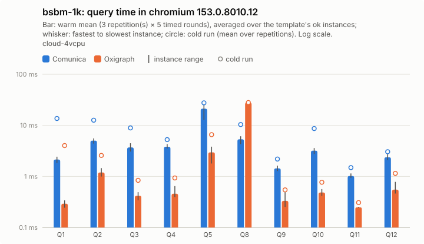

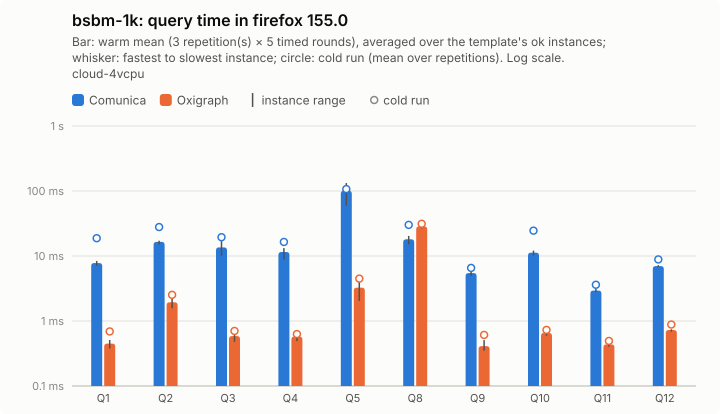

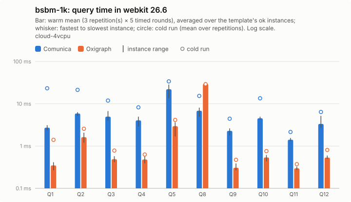

Per instance: [`bsbm-1k/instances_chromium.csv`](bsbm-1k/instances_chromium.csv), [`bsbm-1k/instances_firefox.csv`](bsbm-1k/instances_firefox.csv), [`bsbm-1k/instances_webkit.csv`](bsbm-1k/instances_webkit.csv); per template: `bsbm-1k/plot_<browser>.csv`; totals: [`bsbm-1k/totals.csv`](bsbm-1k/totals.csv); load: [`bsbm-1k/plot_load.csv`](bsbm-1k/plot_load.csv).

## Load and memory overview

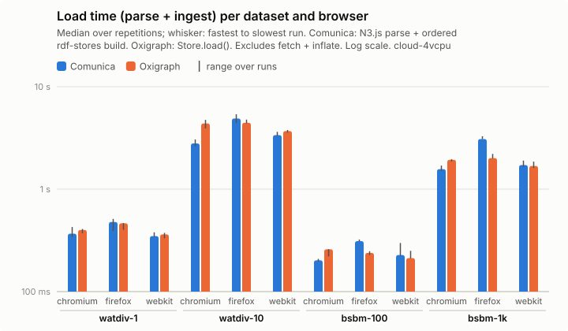

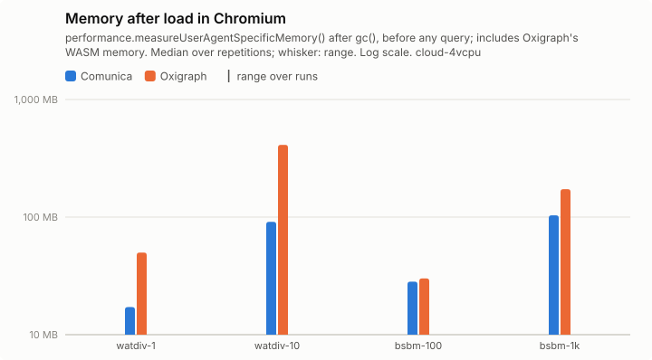

