# Results: 2026-11-04-cloud-4vcpu-comunica-e06d02e-rerun

Generated by `npm run aggregate` and `npm run plot` from `raw/*.json`; only the notes section is written by hand.

<!-- notes:start -->
_No notes for this run._
<!-- notes:end -->

## Setup

| | |
|---|---|
| Machine | `cloud-4vcpu`: Intel(R) Xeon(R) Processor @ 2.10GHz, 4 logical CPUs, 15.7 GiB RAM, Ubuntu 24.04.5 LTS (Linux 6.18.44-fc-v233 x64) |
| Browsers (Playwright 1.63.0, headless) | chromium 153.0.8010.12, firefox 155.0, webkit 26.6 |
| Comunica | `@comunica/query-sparql-rdfjs-lite` 5.4.1 built from https://github.com/comunica/comunica at [`e06d02e814`](https://github.com/comunica/comunica/commit/e06d02e8144786567152068bb3c9e69918784b2a) (2026-11-01T10:59:37+01:00), N3.js 2.13.12, rdf-stores 2.8.0 (ordered store) |
| Oxigraph | `oxigraph` 0.5.13 (`web.js` WASM build) |
| Benchmark code | `050f22b`; each raw file written by a resumed invocation names its commit; Vite 8.3.5 |
| Settings | 3 repetitions of every timing run, each in a fresh browser and context; per run 1 warmup round and 5 timed rounds; timeout 60 s per execution |
| Run | 2026-11-04T14:44:36.768Z to 2026-11-04T14:51:02.894Z |

## Bundle size

Everything the page loads (harness, adapter, engine); gzip level 9; kB = 1000 bytes.

| Page | JS raw | JS gzip | WASM raw | WASM gzip | Total raw | Total gzip |
|---|---:|---:|---:|---:|---:|---:|
| comunica | 1,319.3 | 285.5 | 0 | 0 | 1,319.3 | 285.5 |
| oxigraph | 28.1 | 8.7 | 4,324.9 | 1,533.7 | 4,353 | 1,542.4 |

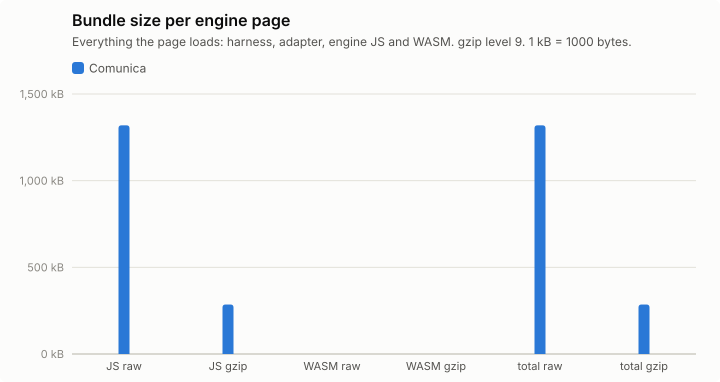

## Query times, load and memory

Timing runs were repeated (see Setup); warm statistics pool the timed rounds of all repetitions (per instance: repetitions × 5 executions), cold is the mean of the cold executions over repetitions, and per-run values (init, load, memory) are medians over repetitions, with the range in parentheses. Totals add the per-instance warm means. "All ok" sums each engine over its own ok instances; "common" sums over the instances that both engines got ok in that browser, which is the comparable number. Engine init = loading the adapter chunk (JS, plus WASM for Oxigraph) + constructing the engine. Load = parse + ingest; Oxigraph parses and ingests inside one `Store.load()` call, so its parse column is empty. Memory: Chromium only.

### watdiv-1

| Browser | Engine | ok | Total warm (all ok) | Total warm (common) | Total cold (common) | Geomean warm (common) | Init | Fetch+inflate | Parse | Ingest | Load | Memory |
|---|---|---:|---:|---:|---:|---:|---:|---:|---:|---:|---:|---:|
| chromium | comunica | 100/100 | 233 ms | 233 ms (100) | 402 ms | 1.7 ms | 177 ms | 49 ms | 314 ms | 0.0 ms | 314 ms (313 ms–345 ms) | 17.1 MB |
| firefox | comunica | 100/100 | 670 ms | 670 ms (100) | 878 ms | 5.6 ms | 266 ms | 107 ms | 462 ms | 0.0 ms | 462 ms (450 ms–492 ms) | – |
| webkit | comunica | 100/100 | 300 ms | 300 ms (100) | 560 ms | 2.1 ms | 219 ms | 68 ms | 376 ms | 0.0 ms | 376 ms (335 ms–495 ms) | – |

Three slowest instances per engine (warm mean [fastest–slowest execution]; cold mean)

- chromium / comunica: C3-1 18 ms [14 ms–31 ms]; cold 54 ms, C3-5 17 ms [14 ms–30 ms]; cold 20 ms, C3-2 17 ms [14 ms–34 ms]; cold 23 ms
- firefox / comunica: C3-1 35 ms [29 ms–46 ms]; cold 75 ms, C3-3 34 ms [26 ms–41 ms]; cold 36 ms, C3-5 34 ms [26 ms–46 ms]; cold 31 ms
- webkit / comunica: C3-2 25 ms [17 ms–34 ms]; cold 28 ms, C3-3 22 ms [16 ms–29 ms]; cold 22 ms, C3-1 22 ms [16 ms–34 ms]; cold 51 ms

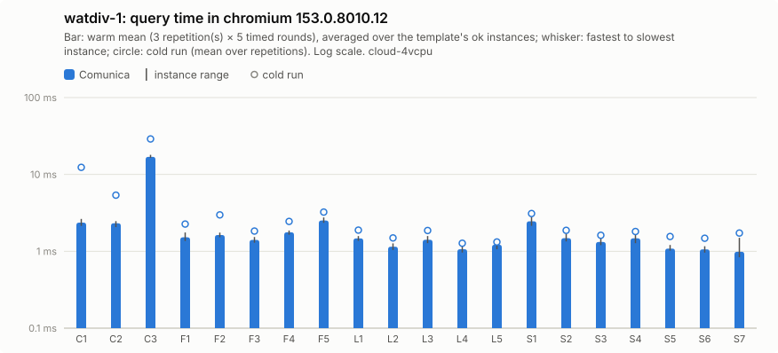

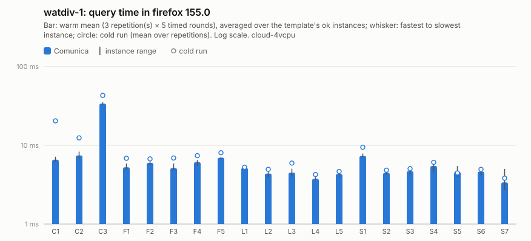

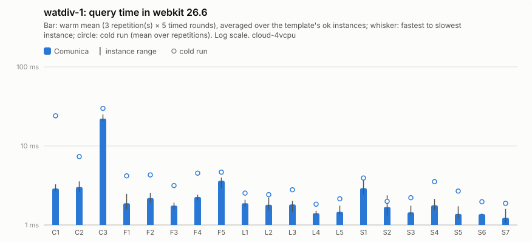

Per instance: [`watdiv-1/instances_chromium.csv`](watdiv-1/instances_chromium.csv), [`watdiv-1/instances_firefox.csv`](watdiv-1/instances_firefox.csv), [`watdiv-1/instances_webkit.csv`](watdiv-1/instances_webkit.csv); per template: `watdiv-1/plot_<browser>.csv`; totals: [`watdiv-1/totals.csv`](watdiv-1/totals.csv); load: [`watdiv-1/plot_load.csv`](watdiv-1/plot_load.csv).

### watdiv-10

| Browser | Engine | ok | Total warm (all ok) | Total warm (common) | Total cold (common) | Geomean warm (common) | Init | Fetch+inflate | Parse | Ingest | Load | Memory |
|---|---|---:|---:|---:|---:|---:|---:|---:|---:|---:|---:|---:|
| chromium | comunica | 100/100 | 991 ms | 991 ms (100) | 1.27 s | 2.7 ms | 205 ms | 468 ms | 3.05 s | 0.0 ms | 3.05 s (2.94 s–3.52 s) | 91.1 MB |
| firefox | comunica | 100/100 | 2.09 s | 2.09 s (100) | 2.44 s | 7.9 ms | 273 ms | 946 ms | 4.89 s | 0.0 ms | 4.89 s (4.69 s–5.14 s) | – |
| webkit | comunica | 100/100 | 1.26 s | 1.26 s (100) | 1.69 s | 3.8 ms | 256 ms | 686 ms | 3.51 s | 0.0 ms | 3.51 s (3.32 s–3.87 s) | – |

Three slowest instances per engine (warm mean [fastest–slowest execution]; cold mean)

- chromium / comunica: C3-2 165 ms [127 ms–251 ms]; cold 161 ms, C3-1 150 ms [131 ms–183 ms]; cold 257 ms, C3-4 148 ms [125 ms–237 ms]; cold 136 ms
- firefox / comunica: C3-5 296 ms [247 ms–381 ms]; cold 259 ms, C3-1 287 ms [249 ms–374 ms]; cold 497 ms, C3-2 282 ms [241 ms–357 ms]; cold 253 ms
- webkit / comunica: C3-1 236 ms [209 ms–306 ms]; cold 302 ms, C3-5 177 ms [136 ms–248 ms]; cold 189 ms, C3-3 171 ms [144 ms–213 ms]; cold 191 ms

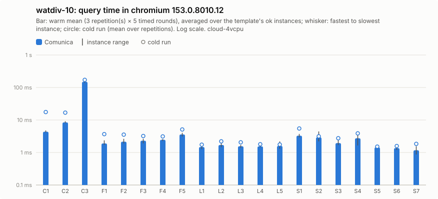

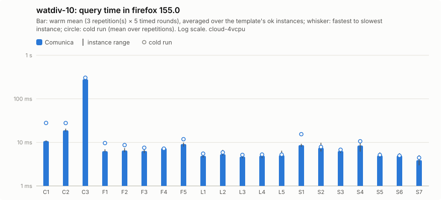

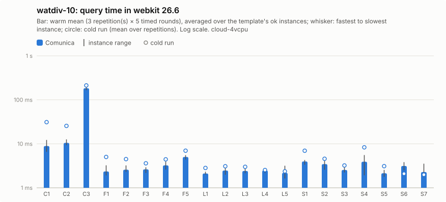

Per instance: [`watdiv-10/instances_chromium.csv`](watdiv-10/instances_chromium.csv), [`watdiv-10/instances_firefox.csv`](watdiv-10/instances_firefox.csv), [`watdiv-10/instances_webkit.csv`](watdiv-10/instances_webkit.csv); per template: `watdiv-10/plot_<browser>.csv`; totals: [`watdiv-10/totals.csv`](watdiv-10/totals.csv); load: [`watdiv-10/plot_load.csv`](watdiv-10/plot_load.csv).

### bsbm-100

| Browser | Engine | ok | Total warm (all ok) | Total warm (common) | Total cold (common) | Geomean warm (common) | Init | Fetch+inflate | Parse | Ingest | Load | Memory |
|---|---|---:|---:|---:|---:|---:|---:|---:|---:|---:|---:|---:|
| chromium | comunica | 50/50 | 196 ms | 196 ms (50) | 396 ms | 3.3 ms | 188 ms | 49 ms | 201 ms | 0.0 ms | 201 ms (188 ms–268 ms) | 28.2 MB |
| firefox | comunica | 50/50 | 718 ms | 718 ms (50) | 996 ms | 12 ms | 250 ms | 92 ms | 323 ms | 0.0 ms | 323 ms (307 ms–328 ms) | – |
| webkit | comunica | 50/50 | 216 ms | 216 ms (50) | 590 ms | 3.7 ms | 239 ms | 70 ms | 230 ms | 0.0 ms | 230 ms (222 ms–240 ms) | – |

Three slowest instances per engine (warm mean [fastest–slowest execution]; cold mean)

- chromium / comunica: Q5-5 11 ms [7.5 ms–20 ms]; cold 16 ms, Q5-3 10 ms [7.0 ms–25 ms]; cold 12 ms, Q5-2 9.5 ms [6.6 ms–18 ms]; cold 16 ms
- firefox / comunica: Q5-5 45 ms [37 ms–53 ms]; cold 47 ms, Q5-3 42 ms [33 ms–55 ms]; cold 54 ms, Q5-2 41 ms [33 ms–93 ms]; cold 49 ms
- webkit / comunica: Q5-5 10 ms [7.7 ms–18 ms]; cold 15 ms, Q5-2 9.5 ms [6.6 ms–19 ms]; cold 17 ms, Q5-3 9.4 ms [6.5 ms–16 ms]; cold 14 ms

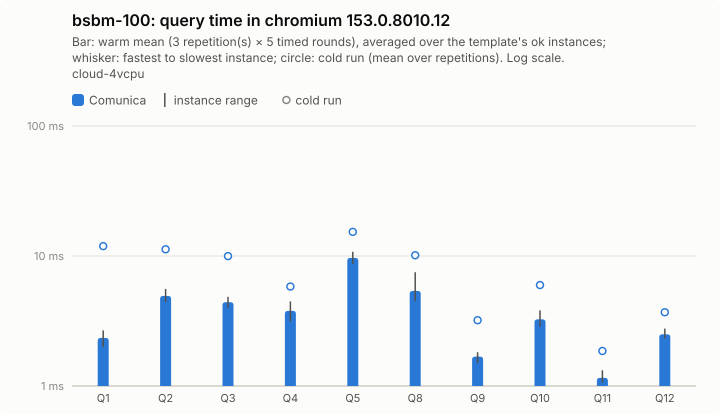

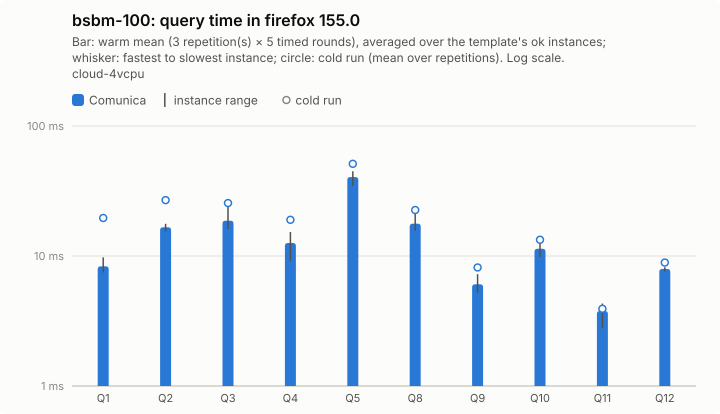

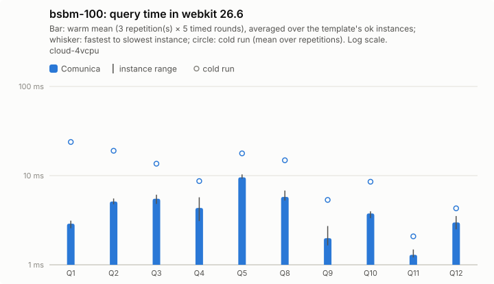

Per instance: [`bsbm-100/instances_chromium.csv`](bsbm-100/instances_chromium.csv), [`bsbm-100/instances_firefox.csv`](bsbm-100/instances_firefox.csv), [`bsbm-100/instances_webkit.csv`](bsbm-100/instances_webkit.csv); per template: `bsbm-100/plot_<browser>.csv`; totals: [`bsbm-100/totals.csv`](bsbm-100/totals.csv); load: [`bsbm-100/plot_load.csv`](bsbm-100/plot_load.csv).

### bsbm-1k

| Browser | Engine | ok | Total warm (all ok) | Total warm (common) | Total cold (common) | Geomean warm (common) | Init | Fetch+inflate | Parse | Ingest | Load | Memory |
|---|---|---:|---:|---:|---:|---:|---:|---:|---:|---:|---:|---:|
| chromium | comunica | 50/50 | 254 ms | 254 ms (50) | 492 ms | 3.4 ms | 211 ms | 392 ms | 1.74 s | 0.0 ms | 1.74 s (1.72 s–1.74 s) | 103.5 MB |
| firefox | comunica | 50/50 | 1.08 s | 1.08 s (50) | 1.43 s | 12 ms | 249 ms | 743 ms | 3.22 s | 0.0 ms | 3.22 s (3.03 s–3.24 s) | – |
| webkit | comunica | 50/50 | 320 ms | 320 ms (50) | 769 ms | 4.6 ms | 235 ms | 629 ms | 1.75 s | 0.0 ms | 1.75 s (1.66 s–1.89 s) | – |

Three slowest instances per engine (warm mean [fastest–slowest execution]; cold mean)

- chromium / comunica: Q5-2 30 ms [22 ms–45 ms]; cold 34 ms, Q5-5 29 ms [22 ms–39 ms]; cold 37 ms, Q5-4 27 ms [19 ms–43 ms]; cold 28 ms
- firefox / comunica: Q5-5 154 ms [130 ms–192 ms]; cold 156 ms, Q5-2 152 ms [123 ms–237 ms]; cold 151 ms, Q5-4 129 ms [116 ms–160 ms]; cold 126 ms
- webkit / comunica: Q5-2 36 ms [23 ms–57 ms]; cold 40 ms, Q5-5 30 ms [24 ms–47 ms]; cold 37 ms, Q5-4 28 ms [22 ms–54 ms]; cold 73 ms

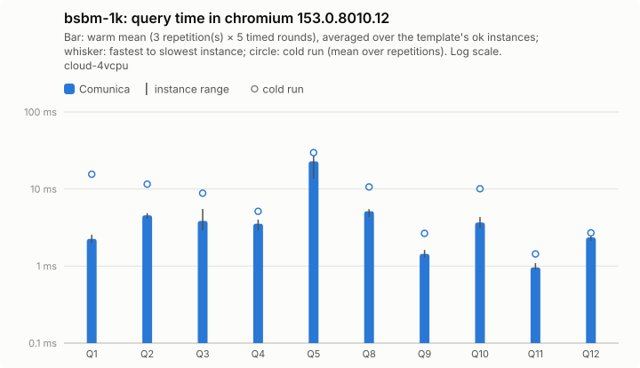

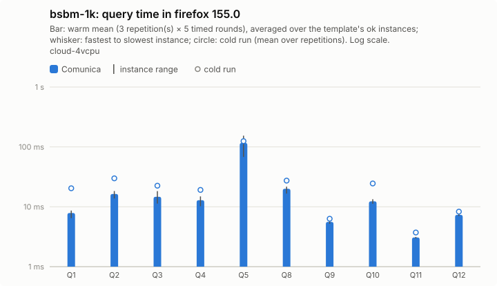

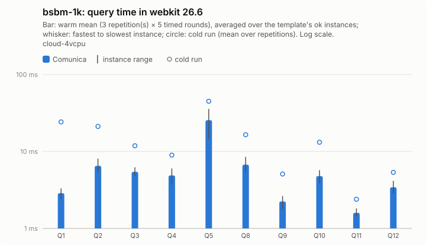

Per instance: [`bsbm-1k/instances_chromium.csv`](bsbm-1k/instances_chromium.csv), [`bsbm-1k/instances_firefox.csv`](bsbm-1k/instances_firefox.csv), [`bsbm-1k/instances_webkit.csv`](bsbm-1k/instances_webkit.csv); per template: `bsbm-1k/plot_<browser>.csv`; totals: [`bsbm-1k/totals.csv`](bsbm-1k/totals.csv); load: [`bsbm-1k/plot_load.csv`](bsbm-1k/plot_load.csv).

## Load and memory overview

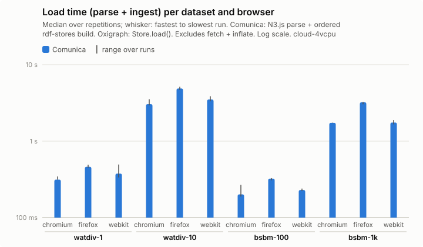

