# Results: 2026-11-04-cloud-4vcpu-comunica-e06d02e

Generated by `npm run aggregate` and `npm run plot` from `raw/*.json`; only the notes section is written by hand.

<!-- notes:start -->
_No notes for this run._
<!-- notes:end -->

## Setup

| | |
|---|---|
| Machine | `cloud-4vcpu`: Intel(R) Xeon(R) Processor @ 2.10GHz, 4 logical CPUs, 15.7 GiB RAM, Ubuntu 24.04.5 LTS (Linux 6.18.44-fc-v233 x64) |
| Browsers (Playwright 1.63.0, headless) | chromium 153.0.8010.12, firefox 155.0, webkit 26.6 |
| Comunica | `@comunica/query-sparql-rdfjs-lite` 5.4.1 built from https://github.com/comunica/comunica at [`e06d02e814`](https://github.com/comunica/comunica/commit/e06d02e8144786567152068bb3c9e69918784b2a) (2026-11-01T10:59:37+01:00), N3.js 2.13.12, rdf-stores 2.8.0 (ordered store) |
| Oxigraph | `oxigraph` 0.5.13 (`web.js` WASM build) |
| Benchmark code | `050f22b`; each raw file written by a resumed invocation names its commit; Vite 8.3.5 |
| Settings | 3 repetitions of every timing run, each in a fresh browser and context; per run 1 warmup round and 5 timed rounds; timeout 60 s per execution |
| Run | 2026-11-04T13:59:04.129Z to 2026-11-04T14:22:21.797Z |

## Bundle size

Everything the page loads (harness, adapter, engine); gzip level 9; kB = 1000 bytes.

| Page | JS raw | JS gzip | WASM raw | WASM gzip | Total raw | Total gzip |
|---|---:|---:|---:|---:|---:|---:|
| comunica | 1,319.3 | 285.5 | 0 | 0 | 1,319.3 | 285.5 |
| oxigraph | 28.1 | 8.7 | 4,324.9 | 1,533.7 | 4,353 | 1,542.4 |

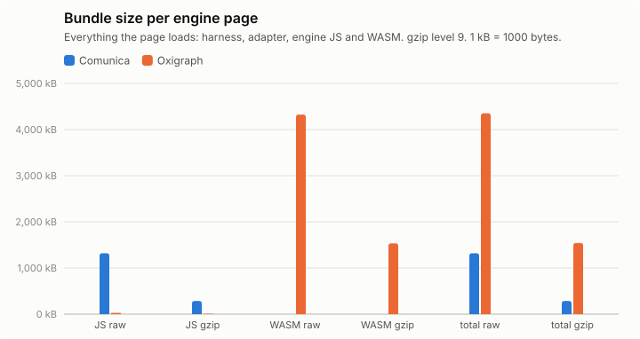

## Query times, load and memory

Timing runs were repeated (see Setup); warm statistics pool the timed rounds of all repetitions (per instance: repetitions × 5 executions), cold is the mean of the cold executions over repetitions, and per-run values (init, load, memory) are medians over repetitions, with the range in parentheses. Totals add the per-instance warm means. "All ok" sums each engine over its own ok instances; "common" sums over the instances that both engines got ok in that browser, which is the comparable number. Engine init = loading the adapter chunk (JS, plus WASM for Oxigraph) + constructing the engine. Load = parse + ingest; Oxigraph parses and ingests inside one `Store.load()` call, so its parse column is empty. Memory: Chromium only.

### watdiv-1

| Browser | Engine | ok | Total warm (all ok) | Total warm (common) | Total cold (common) | Geomean warm (common) | Init | Fetch+inflate | Parse | Ingest | Load | Memory |
|---|---|---:|---:|---:|---:|---:|---:|---:|---:|---:|---:|---:|
| chromium | comunica | 100/100 | 229 ms | 229 ms (100) | 395 ms | 1.6 ms | 199 ms | 55 ms | 300 ms | 0.0 ms | 300 ms (297 ms–334 ms) | 17.1 MB |
| chromium | oxigraph | 100/100 | 930 ms | 930 ms (100) | 990 ms | 0.5 ms | 42 ms | 48 ms | – | 375 ms | 375 ms (374 ms–441 ms) | 49.9 MB |
| firefox | comunica | 100/100 | 664 ms | 664 ms (100) | 881 ms | 5.5 ms | 249 ms | 102 ms | 415 ms | 0.0 ms | 415 ms (393 ms–430 ms) | – |
| firefox | oxigraph | 100/100 | 1.12 s | 1.12 s (100) | 1.15 s | 0.7 ms | 115 ms | 122 ms | – | 427 ms | 427 ms (369 ms–522 ms) | – |
| webkit | comunica | 100/100 | 294 ms | 294 ms (100) | 515 ms | 2.1 ms | 222 ms | 69 ms | 397 ms | 0.0 ms | 397 ms (326 ms–452 ms) | – |
| webkit | oxigraph | 100/100 | 1.03 s | 1.03 s (100) | 1.11 s | 0.5 ms | 72 ms | 82 ms | – | 354 ms | 354 ms (354 ms–426 ms) | – |

Three slowest instances per engine (warm mean [fastest–slowest execution]; cold mean)

- chromium / comunica: C3-1 19 ms [15 ms–27 ms]; cold 51 ms, C3-3 17 ms [13 ms–26 ms]; cold 17 ms, C3-2 16 ms [13 ms–25 ms]; cold 23 ms
- chromium / oxigraph: C3-4 183 ms [159 ms–280 ms]; cold 190 ms, C3-5 183 ms [167 ms–231 ms]; cold 168 ms, C3-1 178 ms [157 ms–228 ms]; cold 206 ms
- firefox / comunica: C3-1 36 ms [28 ms–53 ms]; cold 63 ms, C3-3 35 ms [28 ms–60 ms]; cold 37 ms, C3-4 35 ms [27 ms–50 ms]; cold 31 ms
- firefox / oxigraph: C3-3 217 ms [183 ms–306 ms]; cold 219 ms, C3-4 217 ms [173 ms–302 ms]; cold 218 ms, C3-1 213 ms [179 ms–262 ms]; cold 214 ms
- webkit / comunica: C3-2 24 ms [15 ms–39 ms]; cold 27 ms, C3-3 22 ms [14 ms–31 ms]; cold 21 ms, C3-1 20 ms [16 ms–27 ms]; cold 47 ms
- webkit / oxigraph: C3-4 206 ms [175 ms–277 ms]; cold 232 ms, C3-1 196 ms [176 ms–238 ms]; cold 222 ms, C3-2 196 ms [163 ms–238 ms]; cold 188 ms

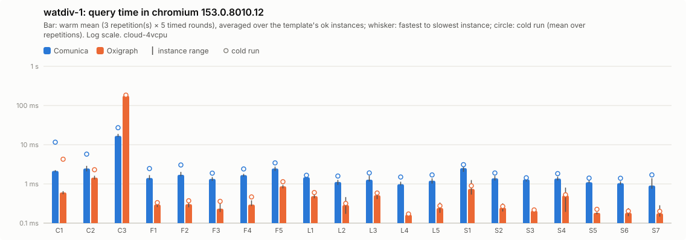

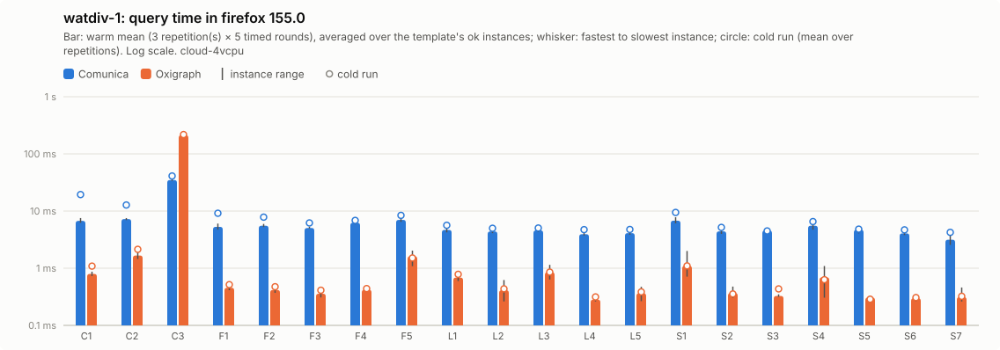

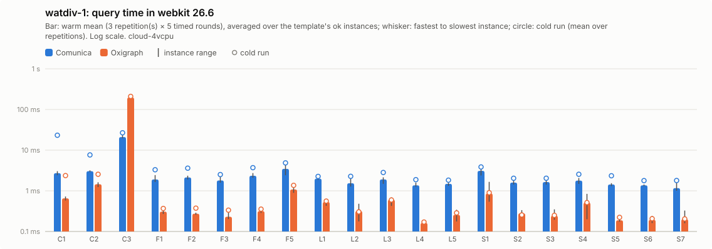

Per instance: [`watdiv-1/instances_chromium.csv`](watdiv-1/instances_chromium.csv), [`watdiv-1/instances_firefox.csv`](watdiv-1/instances_firefox.csv), [`watdiv-1/instances_webkit.csv`](watdiv-1/instances_webkit.csv); per template: `watdiv-1/plot_<browser>.csv`; totals: [`watdiv-1/totals.csv`](watdiv-1/totals.csv); load: [`watdiv-1/plot_load.csv`](watdiv-1/plot_load.csv).

### watdiv-10

| Browser | Engine | ok | Total warm (all ok) | Total warm (common) | Total cold (common) | Geomean warm (common) | Init | Fetch+inflate | Parse | Ingest | Load | Memory |
|---|---|---:|---:|---:|---:|---:|---:|---:|---:|---:|---:|---:|
| chromium | comunica | 100/100 | 962 ms | 962 ms (100) | 1.24 s | 2.6 ms | 176 ms | 481 ms | 2.78 s | 0.0 ms | 2.78 s (2.71 s–3.82 s) | 91.1 MB |
| chromium | oxigraph | 100/100 | 10.1 s | 10.1 s (100) | 10.4 s | 1.2 ms | 43 ms | 445 ms | – | 4.61 s | 4.61 s (4.28 s–5.23 s) | 411.2 MB |
| firefox | comunica | 100/100 | 1.93 s | 1.93 s (100) | 2.35 s | 7.4 ms | 267 ms | 1.02 s | 5.59 s | 0.0 ms | 5.59 s (4.88 s–5.89 s) | – |
| firefox | oxigraph | 100/100 | 12.0 s | 12.0 s (100) | 11.7 s | 1.6 ms | 88 ms | 940 ms | – | 4.61 s | 4.61 s (4.17 s–4.85 s) | – |
| webkit | comunica | 100/100 | 1.22 s | 1.22 s (100) | 1.62 s | 3.5 ms | 251 ms | 732 ms | 4.40 s | 0.0 ms | 4.40 s (3.63 s–4.67 s) | – |
| webkit | oxigraph | 100/100 | 11.3 s | 11.3 s (100) | 10.7 s | 1.5 ms | 85 ms | 701 ms | – | 4.00 s | 4.00 s (3.91 s–4.14 s) | – |

Three slowest instances per engine (warm mean [fastest–slowest execution]; cold mean)

- chromium / comunica: C3-5 153 ms [129 ms–237 ms]; cold 131 ms, C3-1 149 ms [130 ms–190 ms]; cold 283 ms, C3-4 145 ms [128 ms–179 ms]; cold 144 ms
- chromium / oxigraph: C3-3 2.03 s [1.78 s–2.70 s]; cold 1.98 s, C3-4 2.00 s [1.76 s–2.27 s]; cold 2.01 s, C3-2 2.00 s [1.81 s–2.22 s]; cold 2.14 s
- firefox / comunica: C3-1 268 ms [211 ms–334 ms]; cold 498 ms, C3-3 266 ms [210 ms–342 ms]; cold 229 ms, C3-2 261 ms [210 ms–361 ms]; cold 259 ms
- firefox / oxigraph: C3-5 2.40 s [2.23 s–2.80 s]; cold 2.34 s, C3-1 2.39 s [2.23 s–3.00 s]; cold 2.22 s, C3-4 2.38 s [2.10 s–2.79 s]; cold 2.37 s
- webkit / comunica: C3-1 248 ms [199 ms–328 ms]; cold 315 ms, C3-3 180 ms [144 ms–258 ms]; cold 175 ms, C3-2 160 ms [136 ms–200 ms]; cold 167 ms
- webkit / oxigraph: C3-5 2.26 s [2.01 s–3.56 s]; cold 2.20 s, C3-1 2.23 s [1.89 s–2.91 s]; cold 2.21 s, C3-2 2.22 s [1.94 s–2.58 s]; cold 2.03 s

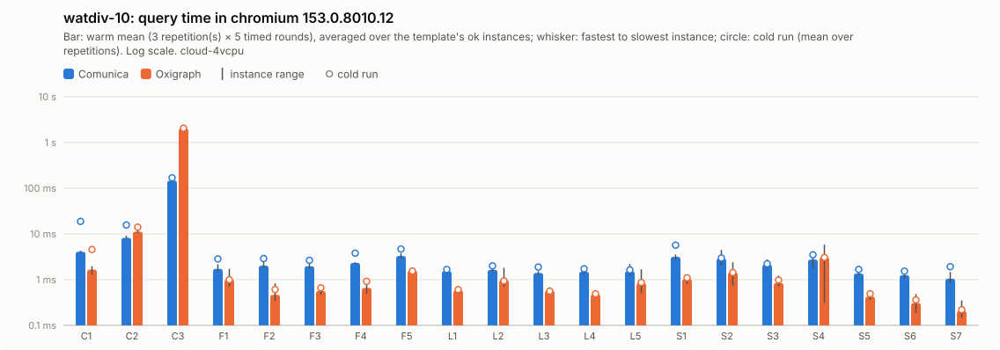

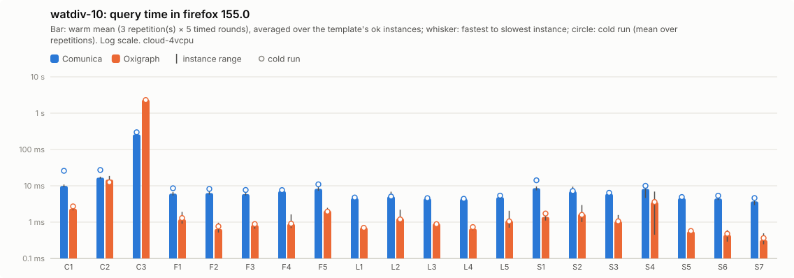

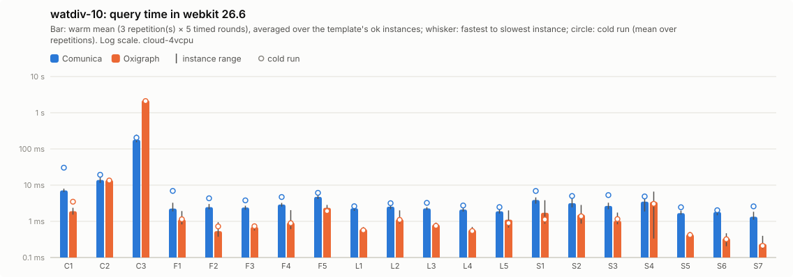

Per instance: [`watdiv-10/instances_chromium.csv`](watdiv-10/instances_chromium.csv), [`watdiv-10/instances_firefox.csv`](watdiv-10/instances_firefox.csv), [`watdiv-10/instances_webkit.csv`](watdiv-10/instances_webkit.csv); per template: `watdiv-10/plot_<browser>.csv`; totals: [`watdiv-10/totals.csv`](watdiv-10/totals.csv); load: [`watdiv-10/plot_load.csv`](watdiv-10/plot_load.csv).

### bsbm-100

| Browser | Engine | ok | Total warm (all ok) | Total warm (common) | Total cold (common) | Geomean warm (common) | Init | Fetch+inflate | Parse | Ingest | Load | Memory |
|---|---|---:|---:|---:|---:|---:|---:|---:|---:|---:|---:|---:|
| chromium | comunica | 50/50 | 180 ms | 180 ms (50) | 333 ms | 3.0 ms | 173 ms | 49 ms | 191 ms | 0.0 ms | 191 ms (191 ms–203 ms) | 28.2 MB |
| chromium | oxigraph | 50/50 | 39 ms | 39 ms (50) | 96 ms | 0.6 ms | 49 ms | 46 ms | – | 258 ms | 258 ms (209 ms–269 ms) | 30.1 MB |
| firefox | comunica | 50/50 | 701 ms | 701 ms (50) | 903 ms | 11 ms | 263 ms | 90 ms | 311 ms | 0.0 ms | 311 ms (298 ms–390 ms) | – |
| firefox | oxigraph | 50/50 | 52 ms | 52 ms (50) | 61 ms | 0.8 ms | 119 ms | 104 ms | – | 231 ms | 231 ms (219 ms–245 ms) | – |
| webkit | comunica | 50/50 | 215 ms | 215 ms (50) | 651 ms | 3.7 ms | 244 ms | 70 ms | 220 ms | 0.0 ms | 220 ms (217 ms–272 ms) | – |
| webkit | oxigraph | 50/50 | 41 ms | 41 ms (50) | 67 ms | 0.6 ms | 91 ms | 76 ms | – | 199 ms | 199 ms (195 ms–224 ms) | – |

Three slowest instances per engine (warm mean [fastest–slowest execution]; cold mean)

- chromium / comunica: Q5-5 9.6 ms [7.4 ms–15 ms]; cold 9.5 ms, Q5-4 9.3 ms [6.8 ms–14 ms]; cold 9.1 ms, Q5-2 8.8 ms [6.7 ms–13 ms]; cold 14 ms
- chromium / oxigraph: Q8-2 3.3 ms [2.7 ms–5.1 ms]; cold 7.4 ms, Q8-1 3.1 ms [2.7 ms–4.5 ms]; cold 8.0 ms, Q8-4 2.8 ms [2.2 ms–4.0 ms]; cold 4.5 ms
- firefox / comunica: Q5-5 46 ms [36 ms–71 ms]; cold 44 ms, Q5-3 40 ms [30 ms–68 ms]; cold 44 ms, Q5-2 39 ms [30 ms–62 ms]; cold 46 ms
- firefox / oxigraph: Q8-2 3.9 ms [3.1 ms–6.3 ms]; cold 4.9 ms, Q8-1 3.8 ms [3.1 ms–4.8 ms]; cold 5.6 ms, Q8-4 3.3 ms [2.4 ms–5.0 ms]; cold 3.0 ms
- webkit / comunica: Q5-5 11 ms [8.0 ms–17 ms]; cold 16 ms, Q5-2 9.4 ms [6.8 ms–13 ms]; cold 16 ms, Q5-4 9.1 ms [7.0 ms–17 ms]; cold 17 ms
- webkit / oxigraph: Q8-2 3.7 ms [2.6 ms–6.4 ms]; cold 4.1 ms, Q8-1 3.3 ms [2.6 ms–4.7 ms]; cold 3.6 ms, Q8-3 2.8 ms [2.2 ms–3.9 ms]; cold 2.7 ms

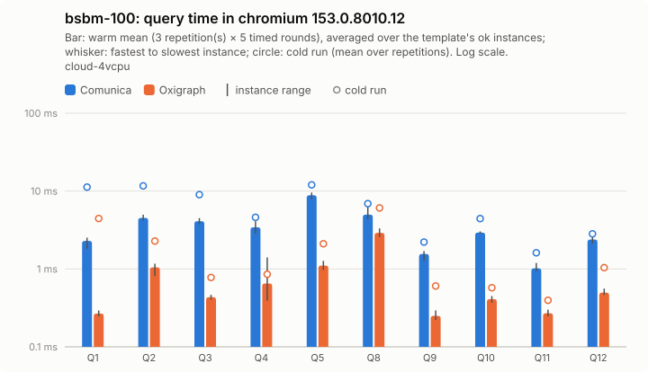

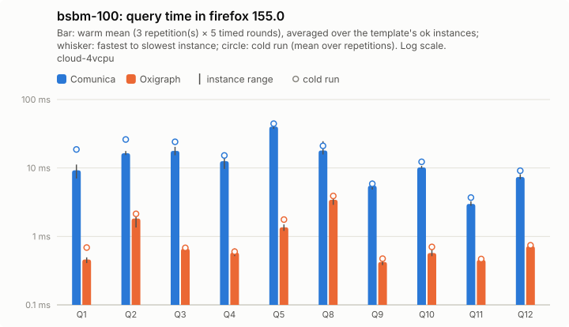

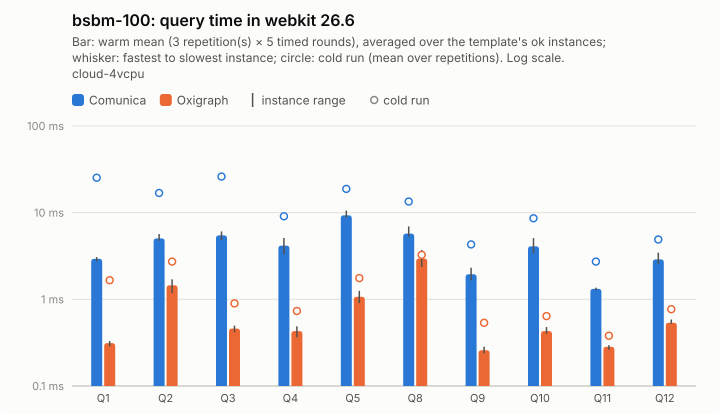

Per instance: [`bsbm-100/instances_chromium.csv`](bsbm-100/instances_chromium.csv), [`bsbm-100/instances_firefox.csv`](bsbm-100/instances_firefox.csv), [`bsbm-100/instances_webkit.csv`](bsbm-100/instances_webkit.csv); per template: `bsbm-100/plot_<browser>.csv`; totals: [`bsbm-100/totals.csv`](bsbm-100/totals.csv); load: [`bsbm-100/plot_load.csv`](bsbm-100/plot_load.csv).

### bsbm-1k

| Browser | Engine | ok | Total warm (all ok) | Total warm (common) | Total cold (common) | Geomean warm (common) | Init | Fetch+inflate | Parse | Ingest | Load | Memory |
|---|---|---:|---:|---:|---:|---:|---:|---:|---:|---:|---:|---:|
| chromium | comunica | 50/50 | 294 ms | 294 ms (50) | 558 ms | 3.9 ms | 199 ms | 453 ms | 1.64 s | 0.0 ms | 1.64 s (1.62 s–1.77 s) | 103.5 MB |
| chromium | oxigraph | 50/50 | 185 ms | 185 ms (50) | 250 ms | 0.8 ms | 48 ms | 429 ms | – | 2.01 s | 2.01 s (1.75 s–2.09 s) | 172.7 MB |
| firefox | comunica | 50/50 | 1.06 s | 1.06 s (50) | 1.36 s | 12 ms | 239 ms | 725 ms | 3.30 s | 0.0 ms | 3.30 s (3.06 s–3.43 s) | – |
| firefox | oxigraph | 50/50 | 185 ms | 185 ms (50) | 212 ms | 1.1 ms | 86 ms | 741 ms | – | 1.96 s | 1.96 s (1.91 s–2.07 s) | – |
| webkit | comunica | 50/50 | 325 ms | 325 ms (50) | 773 ms | 4.8 ms | 233 ms | 594 ms | 1.78 s | 0.0 ms | 1.78 s (1.74 s–2.02 s) | – |
| webkit | oxigraph | 50/50 | 189 ms | 189 ms (50) | 189 ms | 0.9 ms | 89 ms | 612 ms | – | 1.79 s | 1.79 s (1.59 s–1.89 s) | – |

Three slowest instances per engine (warm mean [fastest–slowest execution]; cold mean)

- chromium / comunica: Q5-2 35 ms [22 ms–58 ms]; cold 44 ms, Q5-5 34 ms [22 ms–59 ms]; cold 36 ms, Q5-4 32 ms [20 ms–65 ms]; cold 34 ms
- chromium / oxigraph: Q8-1 32 ms [28 ms–38 ms]; cold 38 ms, Q8-2 31 ms [25 ms–40 ms]; cold 35 ms, Q8-3 29 ms [22 ms–38 ms]; cold 30 ms
- firefox / comunica: Q5-5 145 ms [123 ms–177 ms]; cold 141 ms, Q5-2 139 ms [120 ms–161 ms]; cold 145 ms, Q5-4 135 ms [114 ms–205 ms]; cold 128 ms
- firefox / oxigraph: Q8-1 30 ms [27 ms–39 ms]; cold 33 ms, Q8-2 29 ms [25 ms–37 ms]; cold 35 ms, Q8-3 28 ms [21 ms–44 ms]; cold 30 ms
- webkit / comunica: Q5-2 32 ms [23 ms–56 ms]; cold 45 ms, Q5-5 30 ms [25 ms–43 ms]; cold 40 ms, Q5-4 26 ms [21 ms–34 ms]; cold 51 ms
- webkit / oxigraph: Q8-3 32 ms [24 ms–60 ms]; cold 25 ms, Q8-1 31 ms [26 ms–41 ms]; cold 30 ms, Q8-2 31 ms [23 ms–41 ms]; cold 30 ms

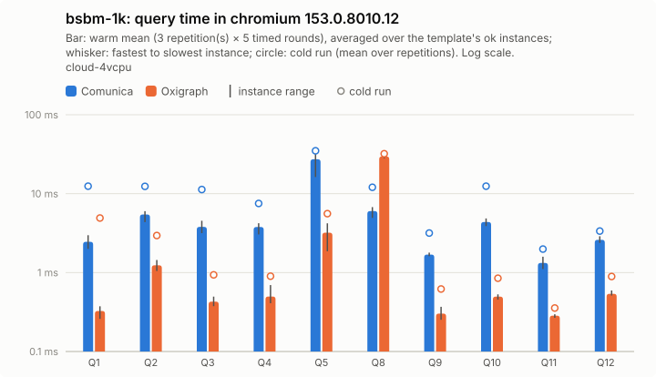

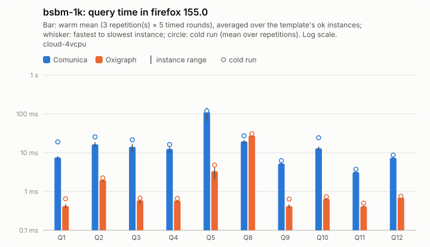

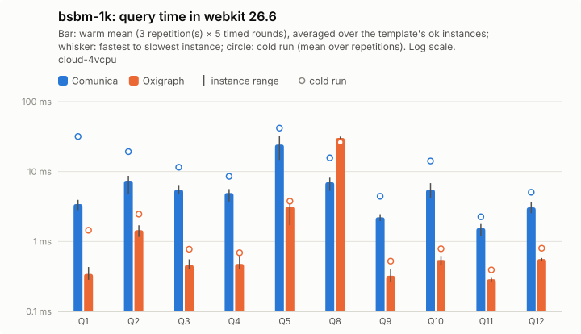

Per instance: [`bsbm-1k/instances_chromium.csv`](bsbm-1k/instances_chromium.csv), [`bsbm-1k/instances_firefox.csv`](bsbm-1k/instances_firefox.csv), [`bsbm-1k/instances_webkit.csv`](bsbm-1k/instances_webkit.csv); per template: `bsbm-1k/plot_<browser>.csv`; totals: [`bsbm-1k/totals.csv`](bsbm-1k/totals.csv); load: [`bsbm-1k/plot_load.csv`](bsbm-1k/plot_load.csv).

## Load and memory overview

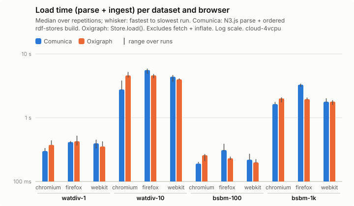

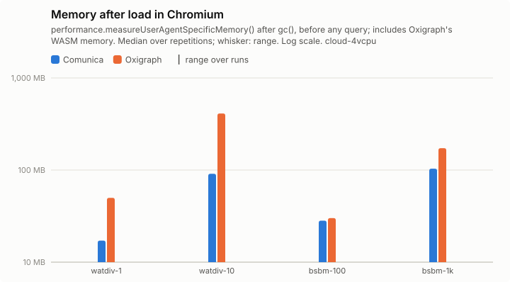

