# Results: 2026-11-04-comunica-55a70ad/1-483dc3c-rdf-stores-2.8.0

Generated by `npm run aggregate` and `npm run plot` from `raw/*.json`; only the notes section is written by hand.

<!-- notes:start -->
_No notes for this run._
<!-- notes:end -->

## Setup

| | |
|---|---|
| Machine | `cloud-4vcpu`: Intel(R) Xeon(R) Processor @ 2.10GHz, 4 logical CPUs, 15.7 GiB RAM, Ubuntu 24.04.5 LTS (Linux 6.18.44-fc-v233 x64) |
| Browsers (Playwright 1.63.0, headless) | chromium 153.0.8010.12, firefox 155.0, webkit 26.6 |
| Comunica | `@comunica/query-sparql-rdfjs-lite` 5.4.1 built from https://github.com/comunica/comunica at [`483dc3cfad`](https://github.com/comunica/comunica/commit/483dc3cfad79d24b6f6eb081e0113b0092658bba) (2026-11-04T14:29:58+01:00), N3.js 2.13.12, rdf-stores 2.8.0 (ordered store) |
| Oxigraph | `oxigraph` 0.5.13 (`web.js` WASM build) |
| Benchmark code | `bbe9fe7`; each raw file written by a resumed invocation names its commit; Vite 8.3.5 |
| Settings | 3 repetitions of every timing run, each in a fresh browser and context; per run 1 warmup round and 5 timed rounds; timeout 60 s per execution |
| Run | 2026-11-04T19:26:40.848Z to 2026-11-04T19:49:11.280Z |

## Bundle size

Everything the page loads (harness, adapter, engine); gzip level 9; kB = 1000 bytes.

| Page | JS raw | JS gzip | WASM raw | WASM gzip | Total raw | Total gzip |
|---|---:|---:|---:|---:|---:|---:|
| comunica | 1,319.8 | 285.4 | 0 | 0 | 1,319.8 | 285.4 |
| oxigraph | 28.1 | 8.7 | 4,324.9 | 1,533.7 | 4,353.1 | 1,542.4 |

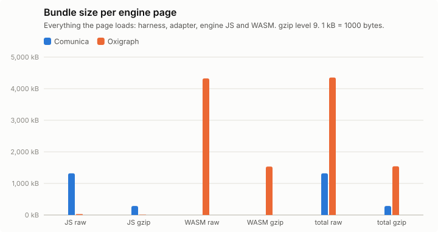

## Query times, load and memory

Timing runs were repeated (see Setup); warm statistics pool the timed rounds of all repetitions (per instance: repetitions × 5 executions), cold is the mean of the cold executions over repetitions, and per-run values (init, load, memory) are medians over repetitions, with the range in parentheses. Totals add the per-instance warm means. "All ok" sums each engine over its own ok instances; "common" sums over the instances that both engines got ok in that browser, which is the comparable number. Engine init = loading the adapter chunk (JS, plus WASM for Oxigraph) + constructing the engine. Load = parse + ingest; Oxigraph parses and ingests inside one `Store.load()` call, so its parse column is empty. Memory: Chromium only.

### watdiv-1

| Browser | Engine | ok | Total warm (all ok) | Total warm (common) | Total cold (common) | Geomean warm (common) | Init | Fetch+inflate | Parse | Ingest | Load | Memory |
|---|---|---:|---:|---:|---:|---:|---:|---:|---:|---:|---:|---:|
| chromium | comunica | 100/100 | 223 ms | 223 ms (100) | 398 ms | 1.6 ms | 178 ms | 49 ms | 310 ms | 0.0 ms | 310 ms (283 ms–323 ms) | 17.2 MB |
| chromium | oxigraph | 100/100 | 927 ms | 927 ms (100) | 1.02 s | 0.5 ms | 37 ms | 44 ms | – | 388 ms | 388 ms (365 ms–401 ms) | 49.9 MB |
| firefox | comunica | 100/100 | 655 ms | 655 ms (100) | 843 ms | 5.5 ms | 258 ms | 105 ms | 407 ms | 0.0 ms | 407 ms (397 ms–410 ms) | – |
| firefox | oxigraph | 100/100 | 1.14 s | 1.14 s (100) | 1.11 s | 0.7 ms | 113 ms | 104 ms | – | 398 ms | 398 ms (386 ms–634 ms) | – |
| webkit | comunica | 100/100 | 274 ms | 274 ms (100) | 544 ms | 2.0 ms | 243 ms | 74 ms | 352 ms | 0.0 ms | 352 ms (334 ms–355 ms) | – |
| webkit | oxigraph | 100/100 | 1.00 s | 1.00 s (100) | 1.03 s | 0.5 ms | 77 ms | 77 ms | – | 349 ms | 349 ms (340 ms–355 ms) | – |

Three slowest instances per engine (warm mean [fastest–slowest execution]; cold mean)

- chromium / comunica: C3-5 18 ms [13 ms–28 ms]; cold 21 ms, C3-1 17 ms [14 ms–27 ms]; cold 54 ms, C3-4 16 ms [13 ms–27 ms]; cold 21 ms
- chromium / oxigraph: C3-2 182 ms [160 ms–218 ms]; cold 206 ms, C3-4 178 ms [162 ms–218 ms]; cold 178 ms, C3-5 177 ms [161 ms–209 ms]; cold 174 ms
- firefox / comunica: C3-1 35 ms [26 ms–57 ms]; cold 81 ms, C3-4 33 ms [26 ms–47 ms]; cold 37 ms, C3-2 33 ms [27 ms–41 ms]; cold 33 ms
- firefox / oxigraph: C3-2 222 ms [180 ms–386 ms]; cold 207 ms, C3-4 221 ms [179 ms–391 ms]; cold 208 ms, C3-3 218 ms [170 ms–362 ms]; cold 214 ms
- webkit / comunica: C3-2 22 ms [15 ms–32 ms]; cold 31 ms, C3-1 21 ms [16 ms–37 ms]; cold 64 ms, C3-3 20 ms [15 ms–28 ms]; cold 22 ms
- webkit / oxigraph: C3-5 200 ms [167 ms–263 ms]; cold 180 ms, C3-2 196 ms [174 ms–268 ms]; cold 181 ms, C3-4 192 ms [173 ms–276 ms]; cold 210 ms

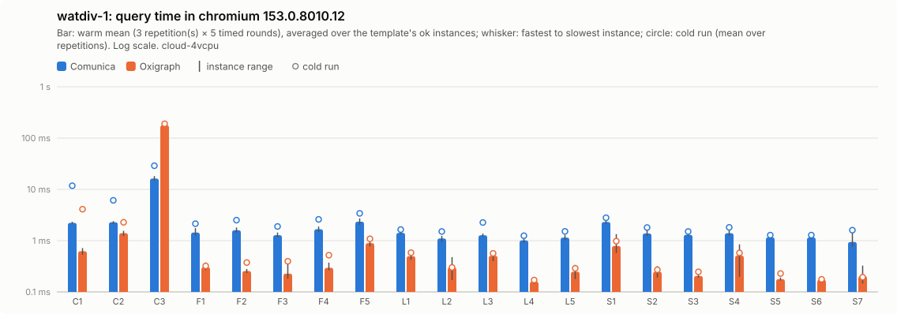

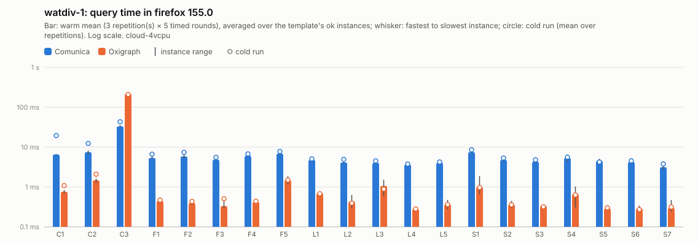

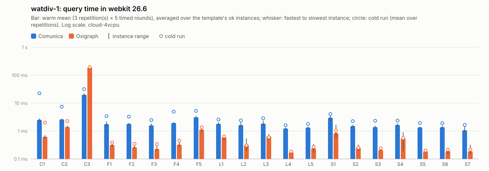

Per instance: [`watdiv-1/instances_chromium.csv`](watdiv-1/instances_chromium.csv), [`watdiv-1/instances_firefox.csv`](watdiv-1/instances_firefox.csv), [`watdiv-1/instances_webkit.csv`](watdiv-1/instances_webkit.csv); per template: `watdiv-1/plot_<browser>.csv`; totals: [`watdiv-1/totals.csv`](watdiv-1/totals.csv); load: [`watdiv-1/plot_load.csv`](watdiv-1/plot_load.csv).

### watdiv-10

| Browser | Engine | ok | Total warm (all ok) | Total warm (common) | Total cold (common) | Geomean warm (common) | Init | Fetch+inflate | Parse | Ingest | Load | Memory |
|---|---|---:|---:|---:|---:|---:|---:|---:|---:|---:|---:|---:|
| chromium | comunica | 100/100 | 870 ms | 870 ms (100) | 1.21 s | 2.4 ms | 184 ms | 453 ms | 2.71 s | 0.0 ms | 2.71 s (2.64 s–2.95 s) | 91.1 MB |
| chromium | oxigraph | 100/100 | 9.98 s | 9.98 s (100) | 9.95 s | 1.2 ms | 43 ms | 452 ms | – | 4.32 s | 4.32 s (3.93 s–4.56 s) | 411.2 MB |
| firefox | comunica | 100/100 | 1.86 s | 1.86 s (100) | 2.22 s | 7.1 ms | 226 ms | 902 ms | 4.79 s | 0.0 ms | 4.79 s (4.46 s–6.06 s) | – |
| firefox | oxigraph | 100/100 | 11.5 s | 11.5 s (100) | 11.6 s | 1.6 ms | 101 ms | 856 ms | – | 4.30 s | 4.30 s (4.07 s–5.28 s) | – |
| webkit | comunica | 100/100 | 1.21 s | 1.21 s (100) | 1.82 s | 3.6 ms | 220 ms | 710 ms | 3.93 s | 0.0 ms | 3.93 s (3.06 s–4.71 s) | – |
| webkit | oxigraph | 100/100 | 11.1 s | 11.1 s (100) | 10.8 s | 1.4 ms | 87 ms | 733 ms | – | 4.06 s | 4.06 s (3.98 s–4.62 s) | – |

Three slowest instances per engine (warm mean [fastest–slowest execution]; cold mean)

- chromium / comunica: C3-4 137 ms [120 ms–217 ms]; cold 128 ms, C3-3 136 ms [119 ms–172 ms]; cold 133 ms, C3-2 131 ms [115 ms–161 ms]; cold 141 ms
- chromium / oxigraph: C3-4 2.01 s [1.80 s–2.63 s]; cold 1.95 s, C3-3 1.98 s [1.81 s–2.31 s]; cold 1.96 s, C3-2 1.97 s [1.85 s–2.14 s]; cold 1.92 s
- firefox / comunica: C3-1 263 ms [230 ms–357 ms]; cold 435 ms, C3-2 251 ms [205 ms–314 ms]; cold 248 ms, C3-3 250 ms [202 ms–307 ms]; cold 242 ms
- firefox / oxigraph: C3-4 2.31 s [2.15 s–2.53 s]; cold 2.22 s, C3-2 2.27 s [2.13 s–2.60 s]; cold 2.30 s, C3-5 2.25 s [2.09 s–2.63 s]; cold 2.34 s
- webkit / comunica: C3-1 252 ms [215 ms–327 ms]; cold 354 ms, C3-3 163 ms [137 ms–197 ms]; cold 214 ms, C3-5 157 ms [135 ms–209 ms]; cold 204 ms
- webkit / oxigraph: C3-5 2.22 s [2.04 s–2.76 s]; cold 2.16 s, C3-1 2.20 s [1.93 s–2.91 s]; cold 2.07 s, C3-2 2.17 s [1.99 s–2.41 s]; cold 2.06 s

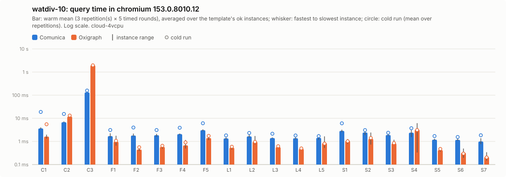

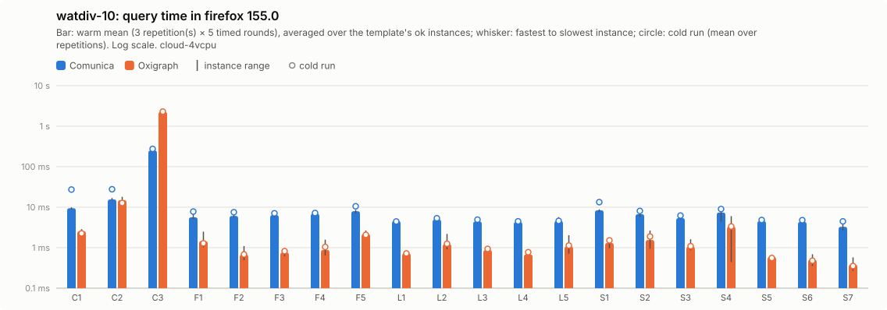

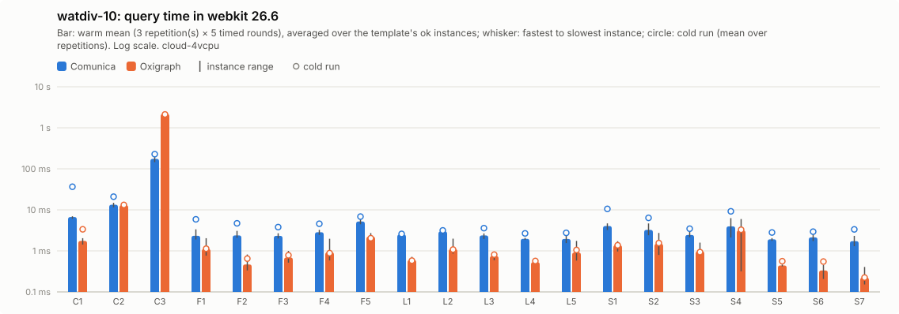

Per instance: [`watdiv-10/instances_chromium.csv`](watdiv-10/instances_chromium.csv), [`watdiv-10/instances_firefox.csv`](watdiv-10/instances_firefox.csv), [`watdiv-10/instances_webkit.csv`](watdiv-10/instances_webkit.csv); per template: `watdiv-10/plot_<browser>.csv`; totals: [`watdiv-10/totals.csv`](watdiv-10/totals.csv); load: [`watdiv-10/plot_load.csv`](watdiv-10/plot_load.csv).

### bsbm-100

| Browser | Engine | ok | Total warm (all ok) | Total warm (common) | Total cold (common) | Geomean warm (common) | Init | Fetch+inflate | Parse | Ingest | Load | Memory |
|---|---|---:|---:|---:|---:|---:|---:|---:|---:|---:|---:|---:|
| chromium | comunica | 50/50 | 169 ms | 169 ms (50) | 354 ms | 2.9 ms | 188 ms | 55 ms | 235 ms | 0.0 ms | 235 ms (196 ms–265 ms) | 28.2 MB |
| chromium | oxigraph | 50/50 | 39 ms | 39 ms (50) | 97 ms | 0.6 ms | 58 ms | 44 ms | – | 237 ms | 237 ms (229 ms–246 ms) | 30.1 MB |
| firefox | comunica | 50/50 | 677 ms | 677 ms (50) | 895 ms | 11 ms | 245 ms | 90 ms | 319 ms | 0.0 ms | 319 ms (314 ms–351 ms) | – |
| firefox | oxigraph | 50/50 | 49 ms | 49 ms (50) | 61 ms | 0.8 ms | 113 ms | 89 ms | – | 269 ms | 269 ms (259 ms–311 ms) | – |
| webkit | comunica | 50/50 | 207 ms | 207 ms (50) | 540 ms | 3.6 ms | 234 ms | 68 ms | 219 ms | 0.0 ms | 219 ms (214 ms–225 ms) | – |
| webkit | oxigraph | 50/50 | 39 ms | 39 ms (50) | 68 ms | 0.6 ms | 74 ms | 81 ms | – | 195 ms | 195 ms (191 ms–203 ms) | – |

Three slowest instances per engine (warm mean [fastest–slowest execution]; cold mean)

- chromium / comunica: Q5-5 8.5 ms [6.7 ms–12 ms]; cold 9.2 ms, Q5-4 8.0 ms [5.8 ms–12 ms]; cold 10 ms, Q5-3 7.6 ms [5.5 ms–16 ms]; cold 12 ms
- chromium / oxigraph: Q8-2 3.3 ms [2.7 ms–4.1 ms]; cold 8.3 ms, Q8-1 3.1 ms [2.8 ms–4.0 ms]; cold 6.3 ms, Q8-3 2.8 ms [2.3 ms–3.8 ms]; cold 5.7 ms
- firefox / comunica: Q5-5 41 ms [33 ms–83 ms]; cold 49 ms, Q5-1 37 ms [25 ms–111 ms]; cold 49 ms, Q5-4 36 ms [27 ms–77 ms]; cold 35 ms
- firefox / oxigraph: Q8-2 3.6 ms [3.1 ms–4.3 ms]; cold 4.3 ms, Q8-1 3.6 ms [3.0 ms–4.6 ms]; cold 4.4 ms, Q8-4 2.9 ms [2.4 ms–3.8 ms]; cold 3.1 ms
- webkit / comunica: Q5-5 9.3 ms [6.8 ms–15 ms]; cold 14 ms, Q5-1 9.0 ms [6.0 ms–15 ms]; cold 20 ms, Q5-2 9.0 ms [6.2 ms–18 ms]; cold 25 ms
- webkit / oxigraph: Q8-1 3.7 ms [2.6 ms–6.0 ms]; cold 4.7 ms, Q8-2 3.3 ms [2.7 ms–4.6 ms]; cold 4.7 ms, Q8-3 2.9 ms [2.1 ms–6.7 ms]; cold 2.7 ms

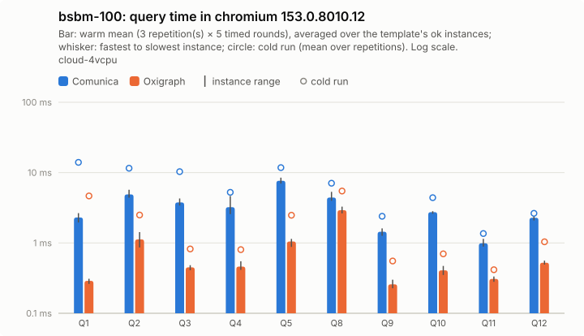

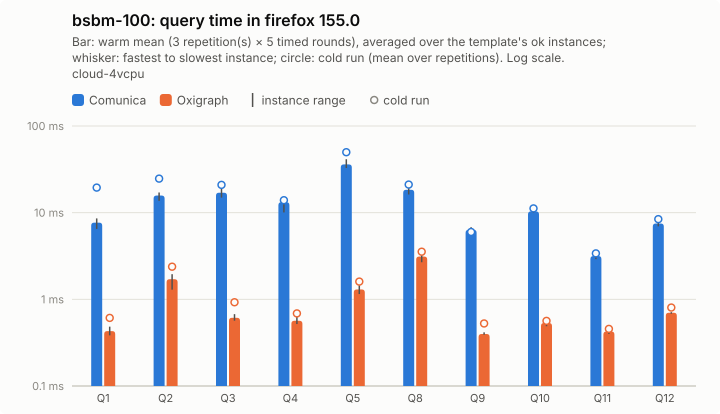

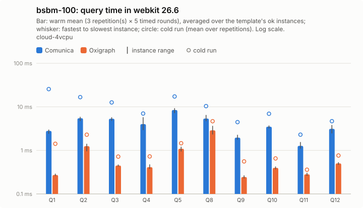

Per instance: [`bsbm-100/instances_chromium.csv`](bsbm-100/instances_chromium.csv), [`bsbm-100/instances_firefox.csv`](bsbm-100/instances_firefox.csv), [`bsbm-100/instances_webkit.csv`](bsbm-100/instances_webkit.csv); per template: `bsbm-100/plot_<browser>.csv`; totals: [`bsbm-100/totals.csv`](bsbm-100/totals.csv); load: [`bsbm-100/plot_load.csv`](bsbm-100/plot_load.csv).

### bsbm-1k

| Browser | Engine | ok | Total warm (all ok) | Total warm (common) | Total cold (common) | Geomean warm (common) | Init | Fetch+inflate | Parse | Ingest | Load | Memory |
|---|---|---:|---:|---:|---:|---:|---:|---:|---:|---:|---:|---:|
| chromium | comunica | 50/50 | 217 ms | 217 ms (50) | 431 ms | 3.0 ms | 209 ms | 389 ms | 1.57 s | 0.0 ms | 1.57 s (1.51 s–1.61 s) | 103.5 MB |
| chromium | oxigraph | 50/50 | 180 ms | 180 ms (50) | 228 ms | 0.8 ms | 43 ms | 385 ms | – | 1.87 s | 1.87 s (1.75 s–1.88 s) | 172.7 MB |
| firefox | comunica | 50/50 | 990 ms | 990 ms (50) | 1.27 s | 12 ms | 225 ms | 713 ms | 3.10 s | 0.0 ms | 3.10 s (2.96 s–3.12 s) | – |
| firefox | oxigraph | 50/50 | 185 ms | 185 ms (50) | 207 ms | 1.1 ms | 83 ms | 730 ms | – | 1.96 s | 1.96 s (1.83 s–1.98 s) | – |
| webkit | comunica | 50/50 | 290 ms | 290 ms (50) | 714 ms | 4.2 ms | 222 ms | 592 ms | 1.71 s | 0.0 ms | 1.71 s (1.62 s–1.75 s) | – |
| webkit | oxigraph | 50/50 | 173 ms | 173 ms (50) | 199 ms | 0.9 ms | 89 ms | 604 ms | – | 1.67 s | 1.67 s (1.64 s–1.79 s) | – |

Three slowest instances per engine (warm mean [fastest–slowest execution]; cold mean)

- chromium / comunica: Q5-2 27 ms [21 ms–37 ms]; cold 30 ms, Q5-5 21 ms [19 ms–24 ms]; cold 27 ms, Q5-4 19 ms [18 ms–21 ms]; cold 22 ms
- chromium / oxigraph: Q8-1 33 ms [28 ms–55 ms]; cold 37 ms, Q8-2 29 ms [26 ms–36 ms]; cold 32 ms, Q8-3 28 ms [26 ms–36 ms]; cold 28 ms
- firefox / comunica: Q5-5 139 ms [108 ms–216 ms]; cold 121 ms, Q5-4 120 ms [93 ms–170 ms]; cold 101 ms, Q5-2 118 ms [102 ms–138 ms]; cold 128 ms
- firefox / oxigraph: Q8-1 30 ms [28 ms–35 ms]; cold 30 ms, Q8-2 29 ms [23 ms–37 ms]; cold 33 ms, Q8-3 28 ms [21 ms–39 ms]; cold 33 ms
- webkit / comunica: Q5-4 31 ms [18 ms–65 ms]; cold 31 ms, Q5-5 28 ms [20 ms–51 ms]; cold 69 ms, Q5-2 26 ms [19 ms–36 ms]; cold 38 ms
- webkit / oxigraph: Q8-1 29 ms [26 ms–43 ms]; cold 32 ms, Q8-2 29 ms [25 ms–38 ms]; cold 30 ms, Q8-3 27 ms [21 ms–37 ms]; cold 25 ms

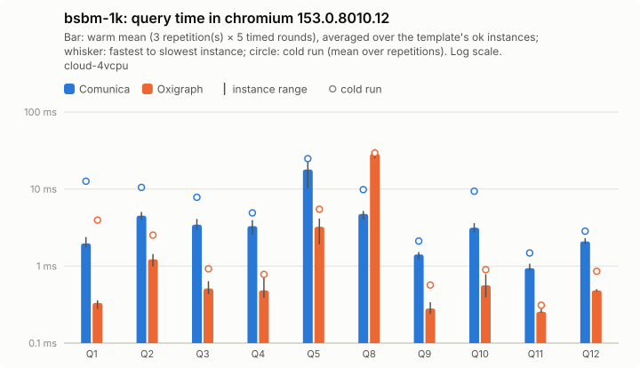

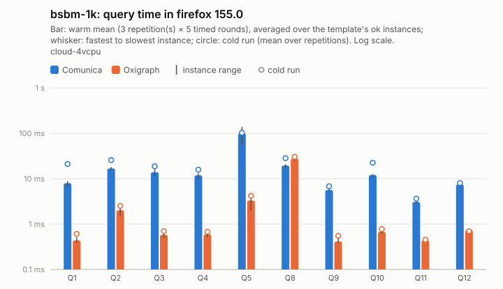

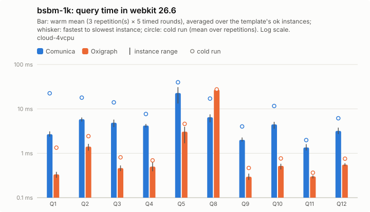

Per instance: [`bsbm-1k/instances_chromium.csv`](bsbm-1k/instances_chromium.csv), [`bsbm-1k/instances_firefox.csv`](bsbm-1k/instances_firefox.csv), [`bsbm-1k/instances_webkit.csv`](bsbm-1k/instances_webkit.csv); per template: `bsbm-1k/plot_<browser>.csv`; totals: [`bsbm-1k/totals.csv`](bsbm-1k/totals.csv); load: [`bsbm-1k/plot_load.csv`](bsbm-1k/plot_load.csv).

## Load and memory overview

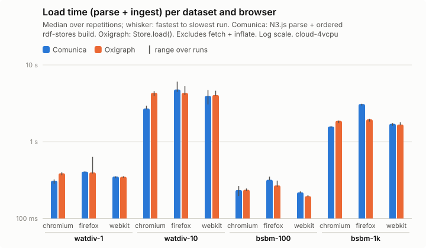

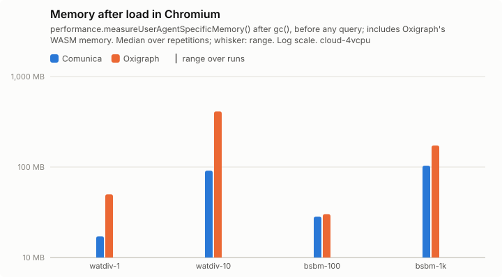

