# Results: 2026-11-04-comunica-55a70ad/2-483dc3c-rdf-stores-2.9.0

Generated by `npm run aggregate` and `npm run plot` from `raw/*.json`; only the notes section is written by hand.

<!-- notes:start -->
_No notes for this run._
<!-- notes:end -->

## Setup

| | |
|---|---|
| Machine | `cloud-4vcpu`: Intel(R) Xeon(R) Processor @ 2.10GHz, 4 logical CPUs, 15.7 GiB RAM, Ubuntu 24.04.5 LTS (Linux 6.18.44-fc-v233 x64) |
| Browsers (Playwright 1.63.0, headless) | chromium 153.0.8010.12, firefox 155.0, webkit 26.6 |
| Comunica | `@comunica/query-sparql-rdfjs-lite` 5.4.1 built from https://github.com/comunica/comunica at [`483dc3cfad`](https://github.com/comunica/comunica/commit/483dc3cfad79d24b6f6eb081e0113b0092658bba) (2026-11-04T14:29:58+01:00), N3.js 2.13.12, rdf-stores 2.9.0 (ordered store) |
| Oxigraph | `oxigraph` 0.5.13 (`web.js` WASM build) |
| Benchmark code | `bbe9fe7`; each raw file written by a resumed invocation names its commit; Vite 8.3.5 |
| Settings | 3 repetitions of every timing run, each in a fresh browser and context; per run 1 warmup round and 5 timed rounds; timeout 60 s per execution |
| Run | 2026-11-04T19:49:12.223Z to 2026-11-04T19:55:24.534Z |

## Bundle size

Everything the page loads (harness, adapter, engine); gzip level 9; kB = 1000 bytes.

| Page | JS raw | JS gzip | WASM raw | WASM gzip | Total raw | Total gzip |
|---|---:|---:|---:|---:|---:|---:|
| comunica | 1,320.9 | 285.7 | 0 | 0 | 1,320.9 | 285.7 |
| oxigraph | 28.1 | 8.7 | 4,324.9 | 1,533.7 | 4,353.1 | 1,542.4 |

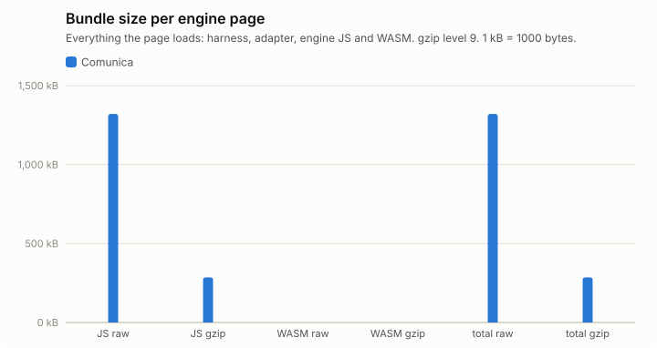

## Query times, load and memory

Timing runs were repeated (see Setup); warm statistics pool the timed rounds of all repetitions (per instance: repetitions × 5 executions), cold is the mean of the cold executions over repetitions, and per-run values (init, load, memory) are medians over repetitions, with the range in parentheses. Totals add the per-instance warm means. "All ok" sums each engine over its own ok instances; "common" sums over the instances that both engines got ok in that browser, which is the comparable number. Engine init = loading the adapter chunk (JS, plus WASM for Oxigraph) + constructing the engine. Load = parse + ingest; Oxigraph parses and ingests inside one `Store.load()` call, so its parse column is empty. Memory: Chromium only.

### watdiv-1

| Browser | Engine | ok | Total warm (all ok) | Total warm (common) | Total cold (common) | Geomean warm (common) | Init | Fetch+inflate | Parse | Ingest | Load | Memory |
|---|---|---:|---:|---:|---:|---:|---:|---:|---:|---:|---:|---:|
| chromium | comunica | 100/100 | 241 ms | 241 ms (100) | 409 ms | 1.7 ms | 186 ms | 56 ms | 331 ms | 0.0 ms | 331 ms (318 ms–344 ms) | 17.2 MB |
| firefox | comunica | 100/100 | 682 ms | 682 ms (100) | 874 ms | 5.7 ms | 273 ms | 103 ms | 446 ms | 0.0 ms | 446 ms (416 ms–450 ms) | – |
| webkit | comunica | 100/100 | 278 ms | 278 ms (100) | 569 ms | 2.0 ms | 228 ms | 72 ms | 394 ms | 0.0 ms | 394 ms (352 ms–419 ms) | – |

Three slowest instances per engine (warm mean [fastest–slowest execution]; cold mean)

- chromium / comunica: C3-1 21 ms [15 ms–30 ms]; cold 48 ms, C3-3 19 ms [15 ms–26 ms]; cold 22 ms, C3-2 19 ms [13 ms–28 ms]; cold 21 ms
- firefox / comunica: C3-3 37 ms [27 ms–58 ms]; cold 33 ms, C3-1 37 ms [29 ms–52 ms]; cold 71 ms, C3-5 34 ms [26 ms–47 ms]; cold 40 ms
- webkit / comunica: C3-3 23 ms [14 ms–33 ms]; cold 24 ms, C3-2 22 ms [14 ms–31 ms]; cold 32 ms, C3-1 19 ms [15 ms–31 ms]; cold 57 ms

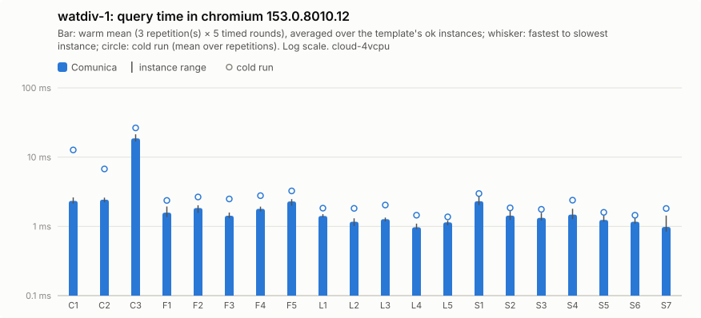

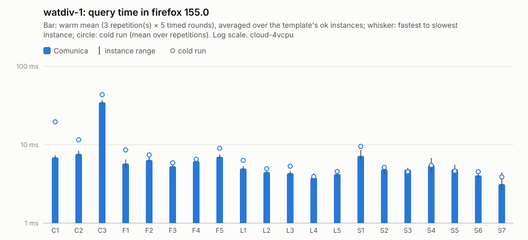

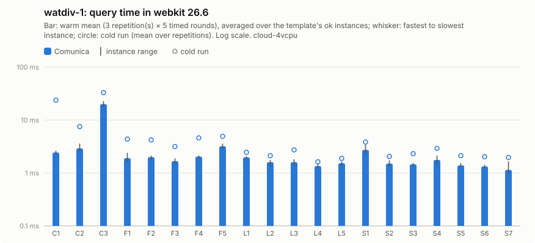

Per instance: [`watdiv-1/instances_chromium.csv`](watdiv-1/instances_chromium.csv), [`watdiv-1/instances_firefox.csv`](watdiv-1/instances_firefox.csv), [`watdiv-1/instances_webkit.csv`](watdiv-1/instances_webkit.csv); per template: `watdiv-1/plot_<browser>.csv`; totals: [`watdiv-1/totals.csv`](watdiv-1/totals.csv); load: [`watdiv-1/plot_load.csv`](watdiv-1/plot_load.csv).

### watdiv-10

| Browser | Engine | ok | Total warm (all ok) | Total warm (common) | Total cold (common) | Geomean warm (common) | Init | Fetch+inflate | Parse | Ingest | Load | Memory |
|---|---|---:|---:|---:|---:|---:|---:|---:|---:|---:|---:|---:|
| chromium | comunica | 100/100 | 915 ms | 915 ms (100) | 1.25 s | 2.4 ms | 188 ms | 477 ms | 2.61 s | 0.0 ms | 2.61 s (2.60 s–3.40 s) | 91.1 MB |
| firefox | comunica | 100/100 | 1.95 s | 1.95 s (100) | 2.40 s | 7.6 ms | 231 ms | 921 ms | 4.95 s | 0.0 ms | 4.95 s (4.77 s–4.96 s) | – |
| webkit | comunica | 100/100 | 1.17 s | 1.17 s (100) | 1.71 s | 3.4 ms | 211 ms | 691 ms | 3.01 s | 0.0 ms | 3.01 s (2.98 s–3.25 s) | – |

Three slowest instances per engine (warm mean [fastest–slowest execution]; cold mean)

- chromium / comunica: C3-3 152 ms [119 ms–228 ms]; cold 132 ms, C3-1 143 ms [126 ms–211 ms]; cold 292 ms, C3-2 141 ms [125 ms–169 ms]; cold 145 ms
- firefox / comunica: C3-1 274 ms [234 ms–346 ms]; cold 481 ms, C3-2 271 ms [224 ms–353 ms]; cold 272 ms, C3-3 256 ms [223 ms–331 ms]; cold 241 ms
- webkit / comunica: C3-1 235 ms [194 ms–304 ms]; cold 361 ms, C3-5 163 ms [133 ms–216 ms]; cold 166 ms, C3-3 162 ms [135 ms–216 ms]; cold 157 ms

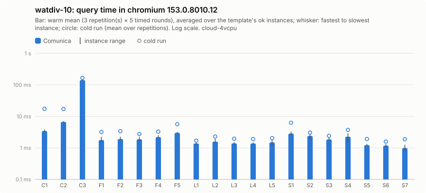

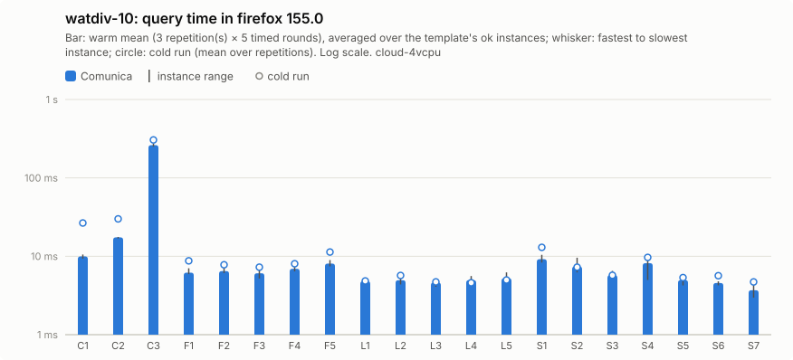

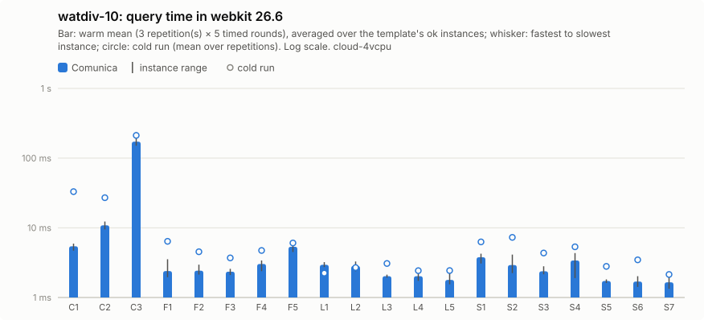

Per instance: [`watdiv-10/instances_chromium.csv`](watdiv-10/instances_chromium.csv), [`watdiv-10/instances_firefox.csv`](watdiv-10/instances_firefox.csv), [`watdiv-10/instances_webkit.csv`](watdiv-10/instances_webkit.csv); per template: `watdiv-10/plot_<browser>.csv`; totals: [`watdiv-10/totals.csv`](watdiv-10/totals.csv); load: [`watdiv-10/plot_load.csv`](watdiv-10/plot_load.csv).

### bsbm-100

| Browser | Engine | ok | Total warm (all ok) | Total warm (common) | Total cold (common) | Geomean warm (common) | Init | Fetch+inflate | Parse | Ingest | Load | Memory |
|---|---|---:|---:|---:|---:|---:|---:|---:|---:|---:|---:|---:|
| chromium | comunica | 50/50 | 163 ms | 163 ms (50) | 351 ms | 2.8 ms | 174 ms | 47 ms | 213 ms | 0.0 ms | 213 ms (192 ms–298 ms) | 28.2 MB |
| firefox | comunica | 50/50 | 700 ms | 700 ms (50) | 889 ms | 11 ms | 248 ms | 109 ms | 323 ms | 0.0 ms | 323 ms (312 ms–369 ms) | – |
| webkit | comunica | 50/50 | 206 ms | 206 ms (50) | 528 ms | 3.6 ms | 218 ms | 69 ms | 244 ms | 0.0 ms | 244 ms (219 ms–261 ms) | – |

Three slowest instances per engine (warm mean [fastest–slowest execution]; cold mean)

- chromium / comunica: Q5-5 8.3 ms [6.3 ms–17 ms]; cold 12 ms, Q5-4 7.6 ms [5.5 ms–12 ms]; cold 12 ms, Q5-3 7.3 ms [5.4 ms–13 ms]; cold 12 ms
- firefox / comunica: Q5-5 43 ms [33 ms–78 ms]; cold 38 ms, Q5-1 42 ms [26 ms–156 ms]; cold 50 ms, Q5-2 37 ms [28 ms–59 ms]; cold 51 ms
- webkit / comunica: Q5-2 10 ms [6.4 ms–22 ms]; cold 20 ms, Q5-1 8.5 ms [6.1 ms–13 ms]; cold 21 ms, Q5-5 8.1 ms [6.9 ms–11 ms]; cold 11 ms

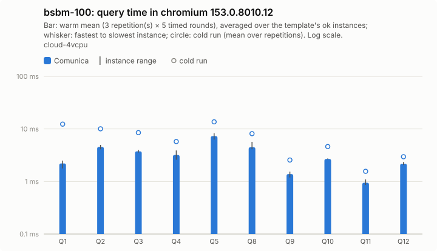

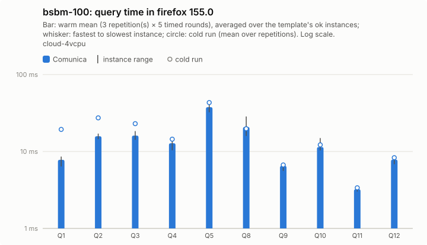

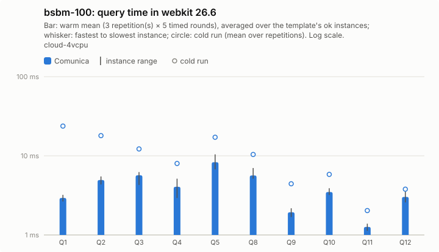

Per instance: [`bsbm-100/instances_chromium.csv`](bsbm-100/instances_chromium.csv), [`bsbm-100/instances_firefox.csv`](bsbm-100/instances_firefox.csv), [`bsbm-100/instances_webkit.csv`](bsbm-100/instances_webkit.csv); per template: `bsbm-100/plot_<browser>.csv`; totals: [`bsbm-100/totals.csv`](bsbm-100/totals.csv); load: [`bsbm-100/plot_load.csv`](bsbm-100/plot_load.csv).

### bsbm-1k

| Browser | Engine | ok | Total warm (all ok) | Total warm (common) | Total cold (common) | Geomean warm (common) | Init | Fetch+inflate | Parse | Ingest | Load | Memory |
|---|---|---:|---:|---:|---:|---:|---:|---:|---:|---:|---:|---:|
| chromium | comunica | 50/50 | 225 ms | 225 ms (50) | 450 ms | 3.2 ms | 193 ms | 388 ms | 1.64 s | 0.0 ms | 1.64 s (1.60 s–1.65 s) | 103.5 MB |
| firefox | comunica | 50/50 | 1.03 s | 1.03 s (50) | 1.38 s | 12 ms | 223 ms | 706 ms | 3.15 s | 0.0 ms | 3.15 s (3.14 s–3.35 s) | – |
| webkit | comunica | 50/50 | 280 ms | 280 ms (50) | 739 ms | 4.2 ms | 247 ms | 636 ms | 1.76 s | 0.0 ms | 1.76 s (1.67 s–1.90 s) | – |

Three slowest instances per engine (warm mean [fastest–slowest execution]; cold mean)

- chromium / comunica: Q5-2 25 ms [17 ms–41 ms]; cold 34 ms, Q5-5 20 ms [18 ms–27 ms]; cold 24 ms, Q5-4 20 ms [16 ms–32 ms]; cold 24 ms
- firefox / comunica: Q5-2 132 ms [109 ms–161 ms]; cold 147 ms, Q5-5 130 ms [114 ms–162 ms]; cold 125 ms, Q5-4 122 ms [99 ms–161 ms]; cold 108 ms
- webkit / comunica: Q5-2 26 ms [18 ms–51 ms]; cold 46 ms, Q5-5 25 ms [18 ms–42 ms]; cold 41 ms, Q5-4 23 ms [16 ms–38 ms]; cold 43 ms

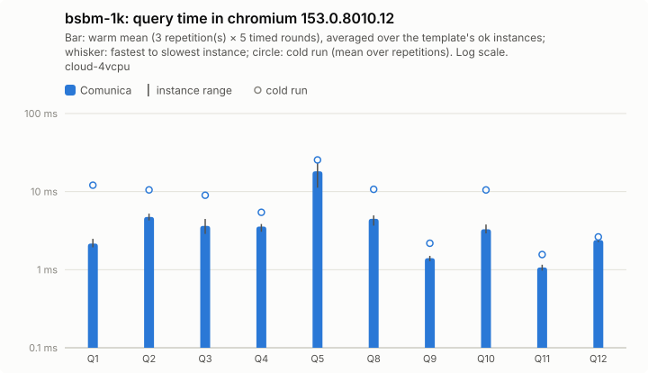

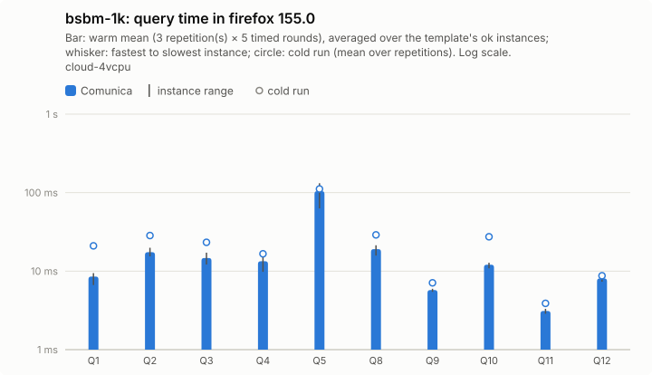

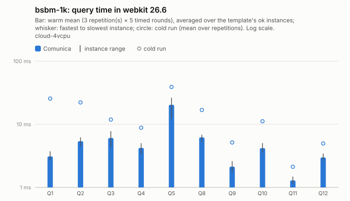

Per instance: [`bsbm-1k/instances_chromium.csv`](bsbm-1k/instances_chromium.csv), [`bsbm-1k/instances_firefox.csv`](bsbm-1k/instances_firefox.csv), [`bsbm-1k/instances_webkit.csv`](bsbm-1k/instances_webkit.csv); per template: `bsbm-1k/plot_<browser>.csv`; totals: [`bsbm-1k/totals.csv`](bsbm-1k/totals.csv); load: [`bsbm-1k/plot_load.csv`](bsbm-1k/plot_load.csv).

## Load and memory overview

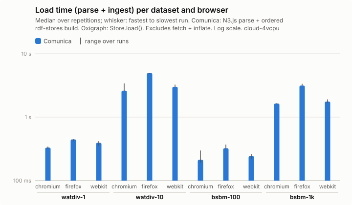

