# Results: 2026-11-04-comunica-55a70ad/3-55a70ad-rdf-stores-2.9.0

Generated by `npm run aggregate` and `npm run plot` from `raw/*.json`; only the notes section is written by hand.

<!-- notes:start -->
_No notes for this run._
<!-- notes:end -->

## Setup

| | |
|---|---|
| Machine | `cloud-4vcpu`: Intel(R) Xeon(R) Processor @ 2.10GHz, 4 logical CPUs, 15.7 GiB RAM, Ubuntu 24.04.5 LTS (Linux 6.18.44-fc-v233 x64) |
| Browsers (Playwright 1.63.0, headless) | chromium 153.0.8010.12, firefox 155.0, webkit 26.6 |
| Comunica | `@comunica/query-sparql-rdfjs-lite` 5.4.1 built from https://github.com/comunica/comunica at [`55a70ad782`](https://github.com/comunica/comunica/commit/55a70ad782bd107d6e1fecfef620cd5cd265ec54) (2026-11-04T20:18:57+01:00), N3.js 2.13.12, rdf-stores 2.9.0 (ordered store) |
| Oxigraph | `oxigraph` 0.5.13 (`web.js` WASM build) |
| Benchmark code | `bbe9fe7`; each raw file written by a resumed invocation names its commit; Vite 8.3.5 |
| Settings | 3 repetitions of every timing run, each in a fresh browser and context; per run 1 warmup round and 5 timed rounds; timeout 60 s per execution |
| Run | 2026-11-04T19:55:25.493Z to 2026-11-04T20:17:12.097Z |

## Bundle size

Everything the page loads (harness, adapter, engine); gzip level 9; kB = 1000 bytes.

| Page | JS raw | JS gzip | WASM raw | WASM gzip | Total raw | Total gzip |
|---|---:|---:|---:|---:|---:|---:|
| comunica | 1,321.7 | 286.1 | 0 | 0 | 1,321.7 | 286.1 |
| oxigraph | 28.1 | 8.7 | 4,324.9 | 1,533.7 | 4,353 | 1,542.4 |

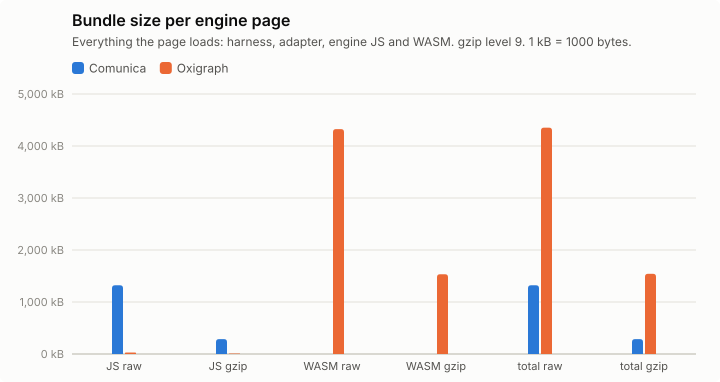

## Query times, load and memory

Timing runs were repeated (see Setup); warm statistics pool the timed rounds of all repetitions (per instance: repetitions × 5 executions), cold is the mean of the cold executions over repetitions, and per-run values (init, load, memory) are medians over repetitions, with the range in parentheses. Totals add the per-instance warm means. "All ok" sums each engine over its own ok instances; "common" sums over the instances that both engines got ok in that browser, which is the comparable number. Engine init = loading the adapter chunk (JS, plus WASM for Oxigraph) + constructing the engine. Load = parse + ingest; Oxigraph parses and ingests inside one `Store.load()` call, so its parse column is empty. Memory: Chromium only.

### watdiv-1

| Browser | Engine | ok | Total warm (all ok) | Total warm (common) | Total cold (common) | Geomean warm (common) | Init | Fetch+inflate | Parse | Ingest | Load | Memory |
|---|---|---:|---:|---:|---:|---:|---:|---:|---:|---:|---:|---:|
| chromium | comunica | 100/100 | 202 ms | 202 ms (100) | 348 ms | 1.5 ms | 184 ms | 50 ms | 321 ms | 0.0 ms | 321 ms (297 ms–337 ms) | 17.2 MB |
| chromium | oxigraph | 100/100 | 931 ms | 931 ms (100) | 970 ms | 0.5 ms | 36 ms | 48 ms | – | 377 ms | 377 ms (364 ms–453 ms) | 49.9 MB |
| firefox | comunica | 100/100 | 664 ms | 664 ms (100) | 778 ms | 5.8 ms | 241 ms | 109 ms | 502 ms | 0.0 ms | 502 ms (408 ms–503 ms) | – |
| firefox | oxigraph | 100/100 | 1.07 s | 1.07 s (100) | 1.11 s | 0.7 ms | 128 ms | 117 ms | – | 383 ms | 383 ms (376 ms–388 ms) | – |
| webkit | comunica | 100/100 | 258 ms | 258 ms (100) | 514 ms | 1.9 ms | 225 ms | 83 ms | 337 ms | 0.0 ms | 337 ms (336 ms–400 ms) | – |
| webkit | oxigraph | 100/100 | 1.04 s | 1.04 s (100) | 1.03 s | 0.5 ms | 73 ms | 79 ms | – | 362 ms | 362 ms (350 ms–379 ms) | – |

Three slowest instances per engine (warm mean [fastest–slowest execution]; cold mean)

- chromium / comunica: C3-1 17 ms [14 ms–23 ms]; cold 46 ms, C3-2 14 ms [12 ms–18 ms]; cold 17 ms, C3-5 13 ms [12 ms–16 ms]; cold 14 ms
- chromium / oxigraph: C3-5 184 ms [157 ms–224 ms]; cold 187 ms, C3-2 180 ms [161 ms–213 ms]; cold 180 ms, C3-4 177 ms [159 ms–226 ms]; cold 175 ms
- firefox / comunica: C3-1 33 ms [25 ms–84 ms]; cold 55 ms, C3-4 30 ms [24 ms–48 ms]; cold 28 ms, C3-5 30 ms [24 ms–42 ms]; cold 30 ms
- firefox / oxigraph: C3-5 204 ms [182 ms–252 ms]; cold 210 ms, C3-2 204 ms [180 ms–243 ms]; cold 203 ms, C3-3 204 ms [179 ms–236 ms]; cold 224 ms
- webkit / comunica: C3-1 20 ms [14 ms–30 ms]; cold 44 ms, C3-2 19 ms [15 ms–25 ms]; cold 27 ms, C3-4 18 ms [13 ms–29 ms]; cold 20 ms
- webkit / oxigraph: C3-1 205 ms [172 ms–265 ms]; cold 222 ms, C3-2 204 ms [180 ms–256 ms]; cold 177 ms, C3-4 198 ms [168 ms–238 ms]; cold 204 ms

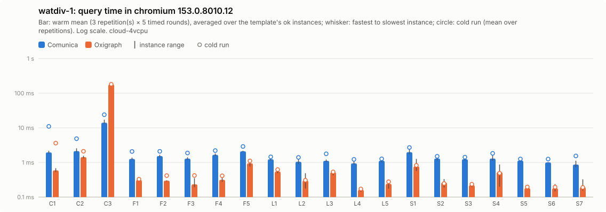

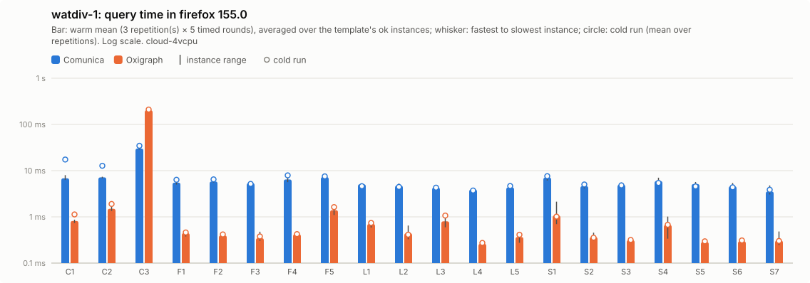

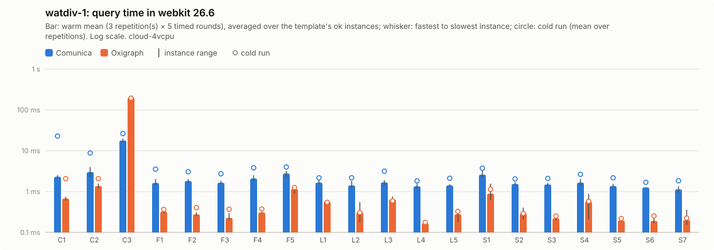

Per instance: [`watdiv-1/instances_chromium.csv`](watdiv-1/instances_chromium.csv), [`watdiv-1/instances_firefox.csv`](watdiv-1/instances_firefox.csv), [`watdiv-1/instances_webkit.csv`](watdiv-1/instances_webkit.csv); per template: `watdiv-1/plot_<browser>.csv`; totals: [`watdiv-1/totals.csv`](watdiv-1/totals.csv); load: [`watdiv-1/plot_load.csv`](watdiv-1/plot_load.csv).

### watdiv-10

| Browser | Engine | ok | Total warm (all ok) | Total warm (common) | Total cold (common) | Geomean warm (common) | Init | Fetch+inflate | Parse | Ingest | Load | Memory |
|---|---|---:|---:|---:|---:|---:|---:|---:|---:|---:|---:|---:|
| chromium | comunica | 100/100 | 811 ms | 811 ms (100) | 1.07 s | 2.2 ms | 173 ms | 466 ms | 2.73 s | 0.0 ms | 2.73 s (2.62 s–2.81 s) | 91.1 MB |
| chromium | oxigraph | 100/100 | 10.2 s | 10.2 s (100) | 10.5 s | 1.2 ms | 59 ms | 459 ms | – | 4.20 s | 4.20 s (3.91 s–4.21 s) | 411.2 MB |
| firefox | comunica | 100/100 | 1.78 s | 1.78 s (100) | 2.20 s | 6.9 ms | 225 ms | 931 ms | 4.77 s | 0.0 ms | 4.77 s (4.51 s–5.18 s) | – |
| firefox | oxigraph | 100/100 | 11.4 s | 11.4 s (100) | 11.6 s | 1.7 ms | 108 ms | 896 ms | – | 4.40 s | 4.40 s (4.32 s–4.62 s) | – |
| webkit | comunica | 100/100 | 1.04 s | 1.04 s (100) | 1.63 s | 3.1 ms | 218 ms | 747 ms | 2.87 s | 0.0 ms | 2.87 s (2.86 s–3.24 s) | – |
| webkit | oxigraph | 100/100 | 11.0 s | 11.0 s (100) | 10.5 s | 1.4 ms | 66 ms | 665 ms | – | 3.77 s | 3.77 s (3.74 s–3.96 s) | – |

Three slowest instances per engine (warm mean [fastest–slowest execution]; cold mean)

- chromium / comunica: C3-5 133 ms [112 ms–212 ms]; cold 117 ms, C3-3 130 ms [112 ms–209 ms]; cold 124 ms, C3-4 125 ms [110 ms–215 ms]; cold 112 ms
- chromium / oxigraph: C3-2 2.08 s [1.91 s–2.76 s]; cold 2.25 s, C3-1 2.07 s [1.87 s–2.78 s]; cold 2.02 s, C3-4 1.98 s [1.83 s–2.15 s]; cold 1.95 s
- firefox / comunica: C3-5 248 ms [208 ms–315 ms]; cold 235 ms, C3-2 242 ms [202 ms–361 ms]; cold 240 ms, C3-1 237 ms [199 ms–298 ms]; cold 438 ms
- firefox / oxigraph: C3-4 2.30 s [1.97 s–2.69 s]; cold 2.24 s, C3-5 2.27 s [2.06 s–2.78 s]; cold 2.38 s, C3-2 2.24 s [2.03 s–2.55 s]; cold 2.30 s
- webkit / comunica: C3-1 211 ms [178 ms–278 ms]; cold 341 ms, C3-5 141 ms [118 ms–200 ms]; cold 145 ms, C3-3 141 ms [117 ms–191 ms]; cold 179 ms
- webkit / oxigraph: C3-5 2.22 s [2.04 s–2.55 s]; cold 2.04 s, C3-1 2.20 s [1.91 s–2.56 s]; cold 2.10 s, C3-4 2.15 s [1.94 s–2.48 s]; cold 2.04 s

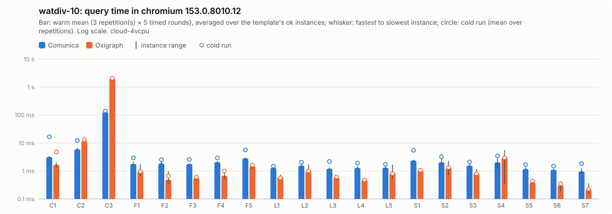

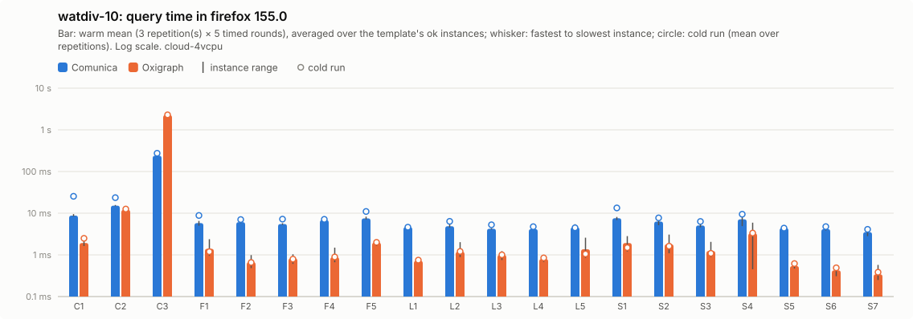

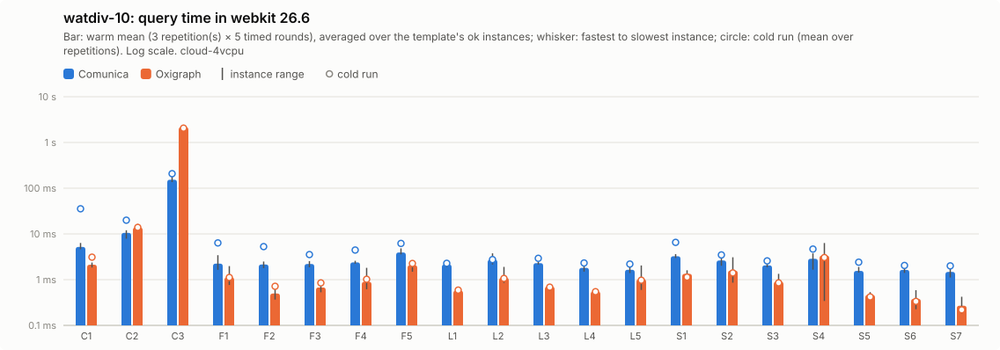

Per instance: [`watdiv-10/instances_chromium.csv`](watdiv-10/instances_chromium.csv), [`watdiv-10/instances_firefox.csv`](watdiv-10/instances_firefox.csv), [`watdiv-10/instances_webkit.csv`](watdiv-10/instances_webkit.csv); per template: `watdiv-10/plot_<browser>.csv`; totals: [`watdiv-10/totals.csv`](watdiv-10/totals.csv); load: [`watdiv-10/plot_load.csv`](watdiv-10/plot_load.csv).

### bsbm-100

| Browser | Engine | ok | Total warm (all ok) | Total warm (common) | Total cold (common) | Geomean warm (common) | Init | Fetch+inflate | Parse | Ingest | Load | Memory |
|---|---|---:|---:|---:|---:|---:|---:|---:|---:|---:|---:|---:|
| chromium | comunica | 50/50 | 158 ms | 158 ms (50) | 343 ms | 2.7 ms | 183 ms | 58 ms | 232 ms | 0.0 ms | 232 ms (199 ms–320 ms) | 28.2 MB |
| chromium | oxigraph | 50/50 | 38 ms | 38 ms (50) | 92 ms | 0.6 ms | 46 ms | 52 ms | – | 242 ms | 242 ms (217 ms–282 ms) | 30.1 MB |
| firefox | comunica | 50/50 | 641 ms | 641 ms (50) | 814 ms | 11 ms | 243 ms | 87 ms | 293 ms | 0.0 ms | 293 ms (288 ms–331 ms) | – |
| firefox | oxigraph | 50/50 | 49 ms | 49 ms (50) | 59 ms | 0.8 ms | 111 ms | 88 ms | – | 248 ms | 248 ms (227 ms–297 ms) | – |
| webkit | comunica | 50/50 | 191 ms | 191 ms (50) | 510 ms | 3.4 ms | 213 ms | 69 ms | 215 ms | 0.0 ms | 215 ms (205 ms–237 ms) | – |
| webkit | oxigraph | 50/50 | 41 ms | 41 ms (50) | 59 ms | 0.6 ms | 72 ms | 70 ms | – | 194 ms | 194 ms (188 ms–226 ms) | – |

Three slowest instances per engine (warm mean [fastest–slowest execution]; cold mean)

- chromium / comunica: Q5-5 7.8 ms [5.9 ms–11 ms]; cold 13 ms, Q5-2 7.4 ms [5.9 ms–11 ms]; cold 12 ms, Q5-4 7.1 ms [5.2 ms–11 ms]; cold 9.3 ms
- chromium / oxigraph: Q8-2 3.1 ms [2.8 ms–4.0 ms]; cold 5.1 ms, Q8-1 3.1 ms [2.7 ms–3.9 ms]; cold 5.7 ms, Q8-4 2.6 ms [2.2 ms–3.4 ms]; cold 4.9 ms
- firefox / comunica: Q5-5 36 ms [29 ms–50 ms]; cold 36 ms, Q5-1 32 ms [25 ms–50 ms]; cold 45 ms, Q5-2 31 ms [25 ms–53 ms]; cold 40 ms
- firefox / oxigraph: Q8-2 3.9 ms [3.1 ms–5.3 ms]; cold 5.5 ms, Q8-1 3.4 ms [2.9 ms–4.4 ms]; cold 3.9 ms, Q8-3 3.1 ms [2.6 ms–4.0 ms]; cold 3.6 ms
- webkit / comunica: Q5-5 7.9 ms [6.1 ms–15 ms]; cold 12 ms, Q5-4 7.8 ms [5.5 ms–17 ms]; cold 14 ms, Q5-2 7.7 ms [5.8 ms–11 ms]; cold 13 ms
- webkit / oxigraph: Q8-2 3.7 ms [2.7 ms–4.8 ms]; cold 4.3 ms, Q8-1 3.5 ms [2.6 ms–4.6 ms]; cold 3.6 ms, Q8-3 2.7 ms [2.2 ms–3.8 ms]; cold 2.5 ms

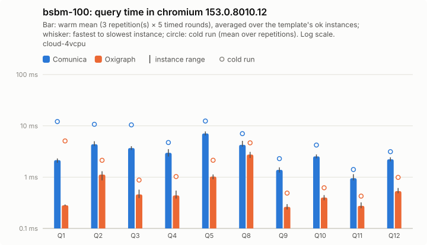

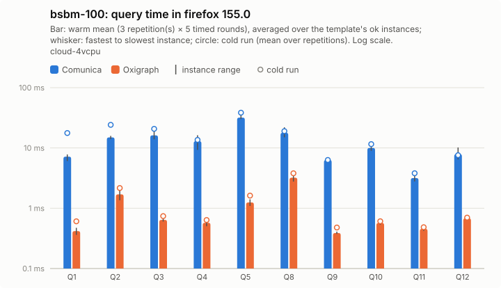

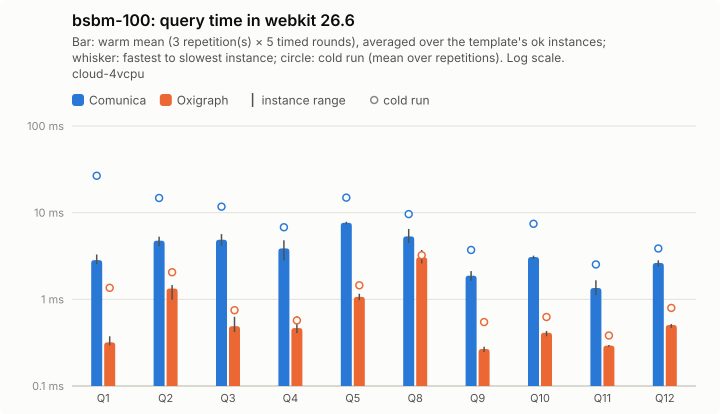

Per instance: [`bsbm-100/instances_chromium.csv`](bsbm-100/instances_chromium.csv), [`bsbm-100/instances_firefox.csv`](bsbm-100/instances_firefox.csv), [`bsbm-100/instances_webkit.csv`](bsbm-100/instances_webkit.csv); per template: `bsbm-100/plot_<browser>.csv`; totals: [`bsbm-100/totals.csv`](bsbm-100/totals.csv); load: [`bsbm-100/plot_load.csv`](bsbm-100/plot_load.csv).

### bsbm-1k

| Browser | Engine | ok | Total warm (all ok) | Total warm (common) | Total cold (common) | Geomean warm (common) | Init | Fetch+inflate | Parse | Ingest | Load | Memory |
|---|---|---:|---:|---:|---:|---:|---:|---:|---:|---:|---:|---:|
| chromium | comunica | 50/50 | 201 ms | 201 ms (50) | 418 ms | 2.9 ms | 167 ms | 369 ms | 1.64 s | 0.0 ms | 1.64 s (1.55 s–1.70 s) | 103.5 MB |
| chromium | oxigraph | 50/50 | 177 ms | 177 ms (50) | 234 ms | 0.8 ms | 40 ms | 415 ms | – | 1.85 s | 1.85 s (1.83 s–1.96 s) | 172.7 MB |
| firefox | comunica | 50/50 | 928 ms | 928 ms (50) | 1.28 s | 11 ms | 228 ms | 735 ms | 3.12 s | 0.0 ms | 3.12 s (2.98 s–3.27 s) | – |
| firefox | oxigraph | 50/50 | 195 ms | 195 ms (50) | 213 ms | 1.1 ms | 86 ms | 731 ms | – | 1.92 s | 1.92 s (1.81 s–2.08 s) | – |
| webkit | comunica | 50/50 | 253 ms | 253 ms (50) | 712 ms | 3.8 ms | 208 ms | 589 ms | 1.74 s | 0.0 ms | 1.74 s (1.63 s–1.75 s) | – |
| webkit | oxigraph | 50/50 | 181 ms | 181 ms (50) | 222 ms | 0.8 ms | 69 ms | 584 ms | – | 1.64 s | 1.64 s (1.62 s–1.83 s) | – |

Three slowest instances per engine (warm mean [fastest–slowest execution]; cold mean)

- chromium / comunica: Q5-2 21 ms [17 ms–31 ms]; cold 23 ms, Q5-5 20 ms [17 ms–31 ms]; cold 22 ms, Q5-4 17 ms [15 ms–24 ms]; cold 21 ms
- chromium / oxigraph: Q8-1 30 ms [28 ms–41 ms]; cold 36 ms, Q8-2 29 ms [24 ms–38 ms]; cold 33 ms, Q8-4 28 ms [21 ms–45 ms]; cold 25 ms
- firefox / comunica: Q5-2 120 ms [100 ms–157 ms]; cold 115 ms, Q5-5 117 ms [107 ms–135 ms]; cold 125 ms, Q5-4 107 ms [89 ms–158 ms]; cold 98 ms
- firefox / oxigraph: Q8-1 32 ms [28 ms–42 ms]; cold 33 ms, Q8-2 31 ms [26 ms–41 ms]; cold 32 ms, Q8-3 30 ms [22 ms–37 ms]; cold 31 ms
- webkit / comunica: Q5-2 22 ms [17 ms–33 ms]; cold 39 ms, Q5-5 21 ms [18 ms–28 ms]; cold 62 ms, Q5-4 18 ms [15 ms–26 ms]; cold 25 ms
- webkit / oxigraph: Q8-1 30 ms [26 ms–44 ms]; cold 38 ms, Q8-2 30 ms [24 ms–43 ms]; cold 39 ms, Q8-4 30 ms [21 ms–42 ms]; cold 27 ms

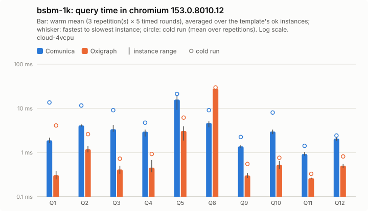

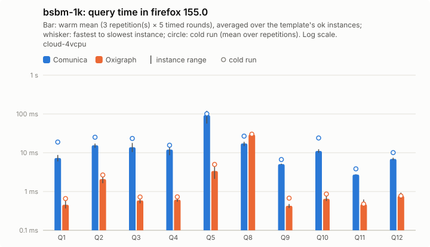

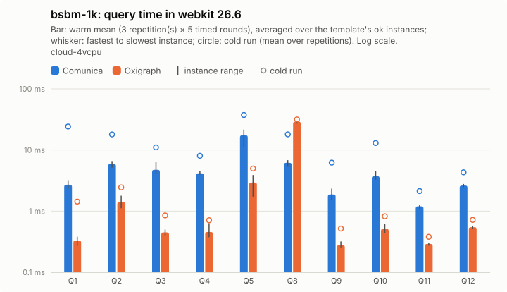

Per instance: [`bsbm-1k/instances_chromium.csv`](bsbm-1k/instances_chromium.csv), [`bsbm-1k/instances_firefox.csv`](bsbm-1k/instances_firefox.csv), [`bsbm-1k/instances_webkit.csv`](bsbm-1k/instances_webkit.csv); per template: `bsbm-1k/plot_<browser>.csv`; totals: [`bsbm-1k/totals.csv`](bsbm-1k/totals.csv); load: [`bsbm-1k/plot_load.csv`](bsbm-1k/plot_load.csv).

## Load and memory overview

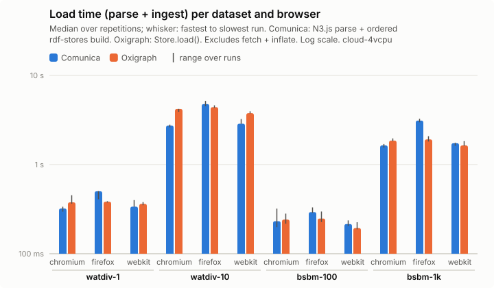

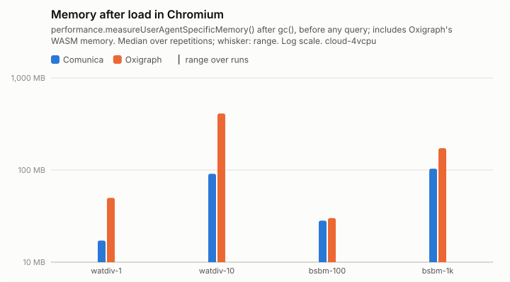

