# Results: 2026-11-04-comunica-55a70ad/4-483dc3c-rdf-stores-2.9.0-again

Generated by `npm run aggregate` and `npm run plot` from `raw/*.json`; only the notes section is written by hand.

<!-- notes:start -->
_No notes for this run._
<!-- notes:end -->

## Setup

| | |
|---|---|
| Machine | `cloud-4vcpu`: Intel(R) Xeon(R) Processor @ 2.10GHz, 4 logical CPUs, 15.7 GiB RAM, Ubuntu 24.04.5 LTS (Linux 6.18.44-fc-v233 x64) |
| Browsers (Playwright 1.63.0, headless) | chromium 153.0.8010.12, firefox 155.0, webkit 26.6 |
| Comunica | `@comunica/query-sparql-rdfjs-lite` 5.4.1 built from https://github.com/comunica/comunica at [`483dc3cfad`](https://github.com/comunica/comunica/commit/483dc3cfad79d24b6f6eb081e0113b0092658bba) (2026-11-04T14:29:58+01:00), N3.js 2.13.12, rdf-stores 2.9.0 (ordered store) |
| Oxigraph | `oxigraph` 0.5.13 (`web.js` WASM build) |
| Benchmark code | `bbe9fe7`; each raw file written by a resumed invocation names its commit; Vite 8.3.5 |
| Settings | 3 repetitions of every timing run, each in a fresh browser and context; per run 1 warmup round and 5 timed rounds; timeout 60 s per execution |
| Run | 2026-11-04T20:17:12.966Z to 2026-11-04T20:23:03.681Z |

## Bundle size

Everything the page loads (harness, adapter, engine); gzip level 9; kB = 1000 bytes.

| Page | JS raw | JS gzip | WASM raw | WASM gzip | Total raw | Total gzip |
|---|---:|---:|---:|---:|---:|---:|
| comunica | 1,320.9 | 285.7 | 0 | 0 | 1,320.9 | 285.7 |
| oxigraph | 28.1 | 8.7 | 4,324.9 | 1,533.7 | 4,353.1 | 1,542.4 |

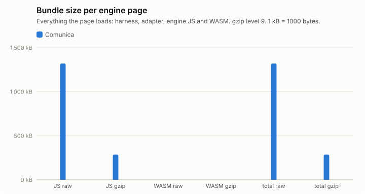

## Query times, load and memory

Timing runs were repeated (see Setup); warm statistics pool the timed rounds of all repetitions (per instance: repetitions × 5 executions), cold is the mean of the cold executions over repetitions, and per-run values (init, load, memory) are medians over repetitions, with the range in parentheses. Totals add the per-instance warm means. "All ok" sums each engine over its own ok instances; "common" sums over the instances that both engines got ok in that browser, which is the comparable number. Engine init = loading the adapter chunk (JS, plus WASM for Oxigraph) + constructing the engine. Load = parse + ingest; Oxigraph parses and ingests inside one `Store.load()` call, so its parse column is empty. Memory: Chromium only.

### watdiv-1

| Browser | Engine | ok | Total warm (all ok) | Total warm (common) | Total cold (common) | Geomean warm (common) | Init | Fetch+inflate | Parse | Ingest | Load | Memory |
|---|---|---:|---:|---:|---:|---:|---:|---:|---:|---:|---:|---:|
| chromium | comunica | 100/100 | 224 ms | 224 ms (100) | 381 ms | 1.6 ms | 174 ms | 48 ms | 295 ms | 0.0 ms | 295 ms (287 ms–354 ms) | 17.2 MB |
| firefox | comunica | 100/100 | 617 ms | 617 ms (100) | 783 ms | 5.2 ms | 245 ms | 107 ms | 448 ms | 0.0 ms | 448 ms (446 ms–518 ms) | – |
| webkit | comunica | 100/100 | 257 ms | 257 ms (100) | 503 ms | 1.9 ms | 215 ms | 63 ms | 326 ms | 0.0 ms | 326 ms (320 ms–355 ms) | – |

Three slowest instances per engine (warm mean [fastest–slowest execution]; cold mean)

- chromium / comunica: C3-1 18 ms [13 ms–27 ms]; cold 62 ms, C3-3 18 ms [13 ms–30 ms]; cold 18 ms, C3-4 17 ms [12 ms–26 ms]; cold 19 ms
- firefox / comunica: C3-2 32 ms [25 ms–50 ms]; cold 30 ms, C3-5 31 ms [25 ms–46 ms]; cold 36 ms, C3-1 31 ms [27 ms–46 ms]; cold 56 ms
- webkit / comunica: C3-3 19 ms [15 ms–25 ms]; cold 21 ms, C3-4 18 ms [13 ms–32 ms]; cold 19 ms, C3-2 18 ms [14 ms–24 ms]; cold 23 ms

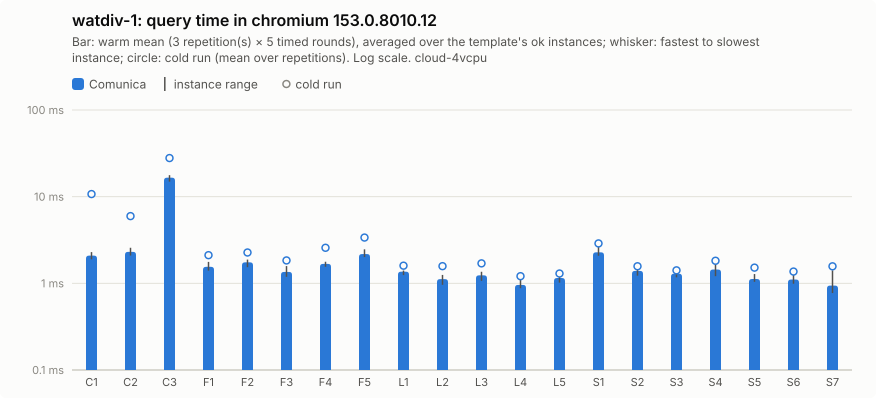

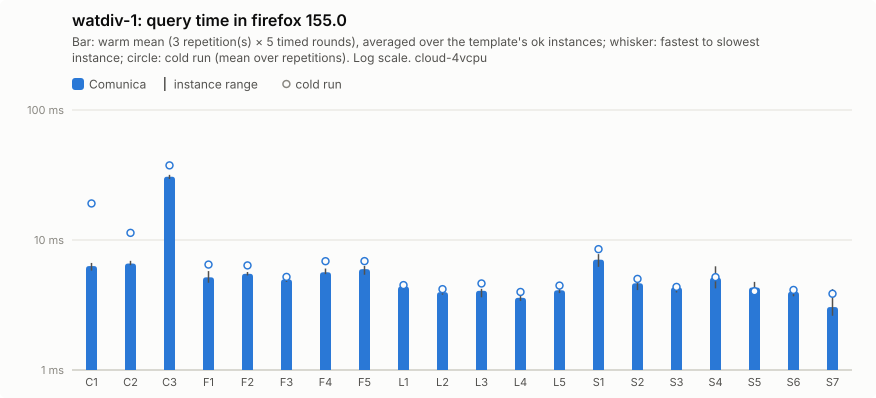

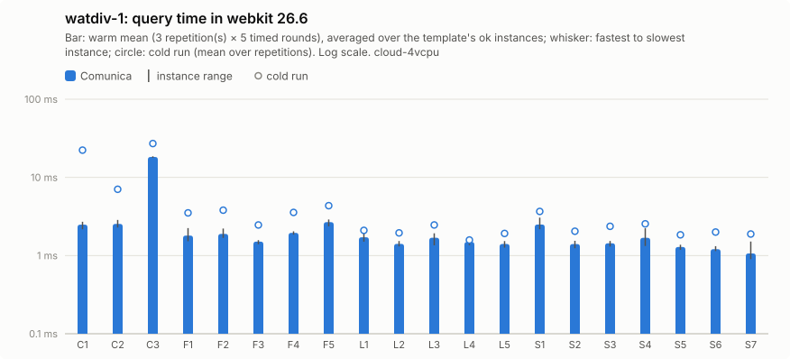

Per instance: [`watdiv-1/instances_chromium.csv`](watdiv-1/instances_chromium.csv), [`watdiv-1/instances_firefox.csv`](watdiv-1/instances_firefox.csv), [`watdiv-1/instances_webkit.csv`](watdiv-1/instances_webkit.csv); per template: `watdiv-1/plot_<browser>.csv`; totals: [`watdiv-1/totals.csv`](watdiv-1/totals.csv); load: [`watdiv-1/plot_load.csv`](watdiv-1/plot_load.csv).

### watdiv-10

| Browser | Engine | ok | Total warm (all ok) | Total warm (common) | Total cold (common) | Geomean warm (common) | Init | Fetch+inflate | Parse | Ingest | Load | Memory |
|---|---|---:|---:|---:|---:|---:|---:|---:|---:|---:|---:|---:|
| chromium | comunica | 100/100 | 840 ms | 840 ms (100) | 1.15 s | 2.3 ms | 188 ms | 441 ms | 2.70 s | 0.0 ms | 2.70 s (2.52 s–2.75 s) | 91.1 MB |
| firefox | comunica | 100/100 | 1.80 s | 1.80 s (100) | 2.27 s | 6.9 ms | 254 ms | 890 ms | 4.72 s | 0.0 ms | 4.72 s (4.68 s–4.87 s) | – |
| webkit | comunica | 100/100 | 1.13 s | 1.13 s (100) | 1.53 s | 3.4 ms | 210 ms | 689 ms | 3.00 s | 0.0 ms | 3.00 s (2.95 s–3.03 s) | – |

Three slowest instances per engine (warm mean [fastest–slowest execution]; cold mean)

- chromium / comunica: C3-4 134 ms [117 ms–227 ms]; cold 125 ms, C3-1 132 ms [119 ms–174 ms]; cold 251 ms, C3-5 128 ms [116 ms–158 ms]; cold 125 ms
- firefox / comunica: C3-4 247 ms [218 ms–291 ms]; cold 234 ms, C3-1 246 ms [220 ms–311 ms]; cold 450 ms, C3-5 244 ms [218 ms–296 ms]; cold 243 ms
- webkit / comunica: C3-1 221 ms [151 ms–281 ms]; cold 329 ms, C3-3 160 ms [135 ms–248 ms]; cold 140 ms, C3-2 154 ms [135 ms–208 ms]; cold 151 ms

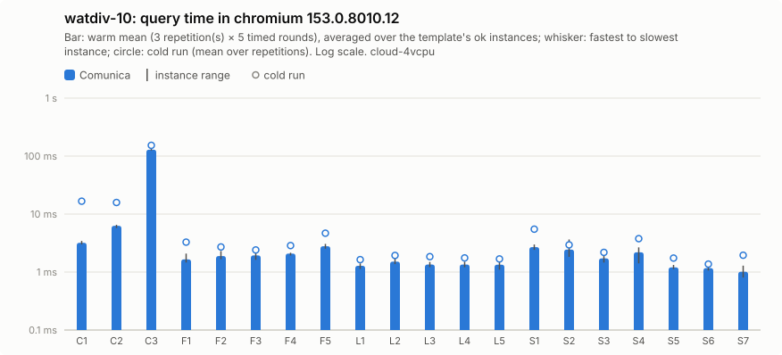

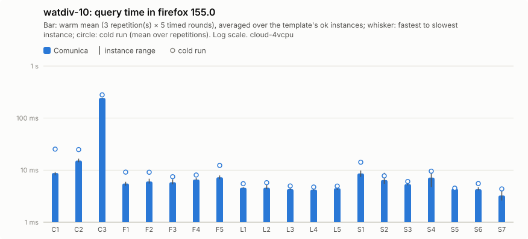

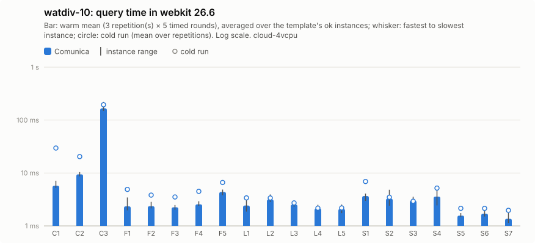

Per instance: [`watdiv-10/instances_chromium.csv`](watdiv-10/instances_chromium.csv), [`watdiv-10/instances_firefox.csv`](watdiv-10/instances_firefox.csv), [`watdiv-10/instances_webkit.csv`](watdiv-10/instances_webkit.csv); per template: `watdiv-10/plot_<browser>.csv`; totals: [`watdiv-10/totals.csv`](watdiv-10/totals.csv); load: [`watdiv-10/plot_load.csv`](watdiv-10/plot_load.csv).

### bsbm-100

| Browser | Engine | ok | Total warm (all ok) | Total warm (common) | Total cold (common) | Geomean warm (common) | Init | Fetch+inflate | Parse | Ingest | Load | Memory |
|---|---|---:|---:|---:|---:|---:|---:|---:|---:|---:|---:|---:|
| chromium | comunica | 50/50 | 156 ms | 156 ms (50) | 347 ms | 2.7 ms | 172 ms | 47 ms | 211 ms | 0.0 ms | 211 ms (210 ms–231 ms) | 28.3 MB |
| firefox | comunica | 50/50 | 658 ms | 658 ms (50) | 838 ms | 11 ms | 253 ms | 85 ms | 311 ms | 0.0 ms | 311 ms (294 ms–332 ms) | – |
| webkit | comunica | 50/50 | 198 ms | 198 ms (50) | 509 ms | 3.5 ms | 203 ms | 67 ms | 226 ms | 0.0 ms | 226 ms (201 ms–261 ms) | – |

Three slowest instances per engine (warm mean [fastest–slowest execution]; cold mean)

- chromium / comunica: Q5-5 7.7 ms [6.0 ms–10 ms]; cold 8.8 ms, Q5-4 6.9 ms [5.6 ms–9.9 ms]; cold 8.3 ms, Q5-2 6.5 ms [5.8 ms–9.2 ms]; cold 13 ms
- firefox / comunica: Q5-5 36 ms [30 ms–62 ms]; cold 39 ms, Q5-1 35 ms [25 ms–83 ms]; cold 54 ms, Q5-4 33 ms [27 ms–57 ms]; cold 34 ms
- webkit / comunica: Q5-5 9.2 ms [6.9 ms–15 ms]; cold 11 ms, Q5-1 8.3 ms [5.9 ms–13 ms]; cold 22 ms, Q5-3 7.9 ms [5.9 ms–15 ms]; cold 13 ms

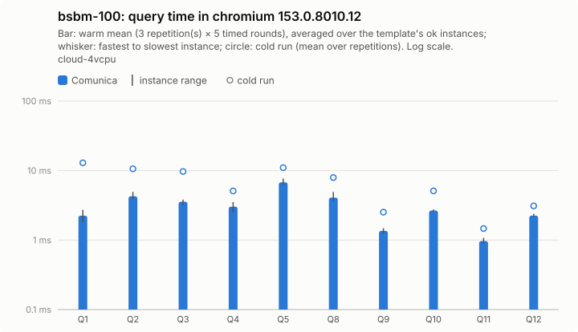

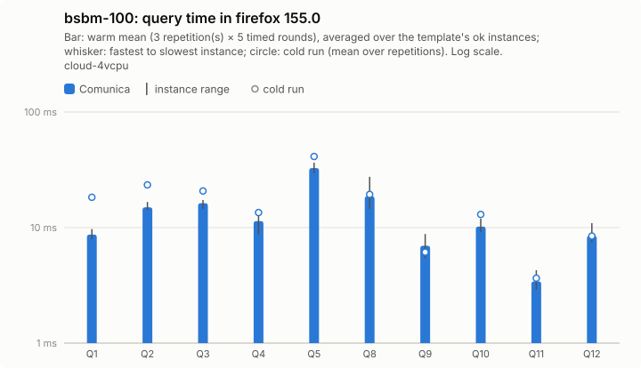

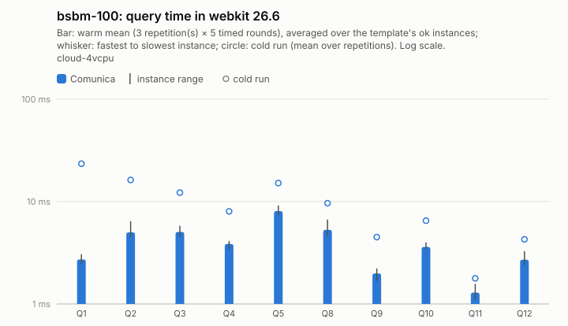

Per instance: [`bsbm-100/instances_chromium.csv`](bsbm-100/instances_chromium.csv), [`bsbm-100/instances_firefox.csv`](bsbm-100/instances_firefox.csv), [`bsbm-100/instances_webkit.csv`](bsbm-100/instances_webkit.csv); per template: `bsbm-100/plot_<browser>.csv`; totals: [`bsbm-100/totals.csv`](bsbm-100/totals.csv); load: [`bsbm-100/plot_load.csv`](bsbm-100/plot_load.csv).

### bsbm-1k

| Browser | Engine | ok | Total warm (all ok) | Total warm (common) | Total cold (common) | Geomean warm (common) | Init | Fetch+inflate | Parse | Ingest | Load | Memory |
|---|---|---:|---:|---:|---:|---:|---:|---:|---:|---:|---:|---:|
| chromium | comunica | 50/50 | 207 ms | 207 ms (50) | 425 ms | 3.0 ms | 180 ms | 380 ms | 1.64 s | 0.0 ms | 1.64 s (1.55 s–1.66 s) | 103.5 MB |
| firefox | comunica | 50/50 | 932 ms | 932 ms (50) | 1.28 s | 11 ms | 229 ms | 669 ms | 3.00 s | 0.0 ms | 3.00 s (2.99 s–3.41 s) | – |
| webkit | comunica | 50/50 | 270 ms | 270 ms (50) | 646 ms | 3.9 ms | 228 ms | 598 ms | 1.63 s | 0.0 ms | 1.63 s (1.54 s–1.64 s) | – |

Three slowest instances per engine (warm mean [fastest–slowest execution]; cold mean)

- chromium / comunica: Q5-2 22 ms [18 ms–31 ms]; cold 28 ms, Q5-5 20 ms [17 ms–29 ms]; cold 23 ms, Q5-4 18 ms [16 ms–30 ms]; cold 21 ms
- firefox / comunica: Q5-5 122 ms [109 ms–165 ms]; cold 122 ms, Q5-2 119 ms [101 ms–164 ms]; cold 153 ms, Q5-4 107 ms [90 ms–152 ms]; cold 101 ms
- webkit / comunica: Q5-5 26 ms [17 ms–53 ms]; cold 41 ms, Q5-2 25 ms [17 ms–40 ms]; cold 32 ms, Q5-4 23 ms [16 ms–32 ms]; cold 32 ms

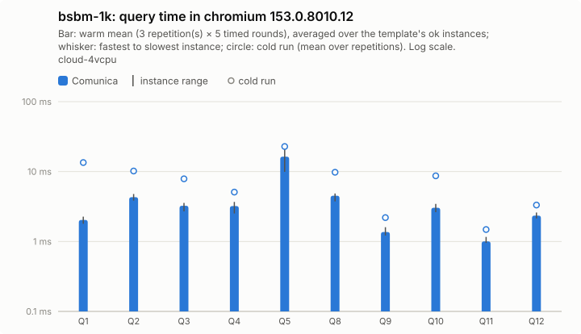

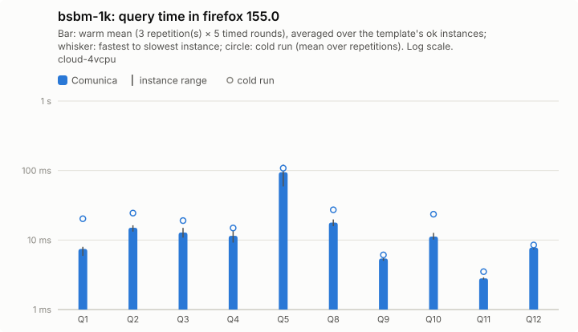

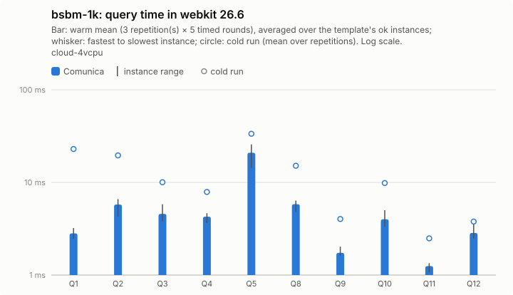

Per instance: [`bsbm-1k/instances_chromium.csv`](bsbm-1k/instances_chromium.csv), [`bsbm-1k/instances_firefox.csv`](bsbm-1k/instances_firefox.csv), [`bsbm-1k/instances_webkit.csv`](bsbm-1k/instances_webkit.csv); per template: `bsbm-1k/plot_<browser>.csv`; totals: [`bsbm-1k/totals.csv`](bsbm-1k/totals.csv); load: [`bsbm-1k/plot_load.csv`](bsbm-1k/plot_load.csv).

## Load and memory overview

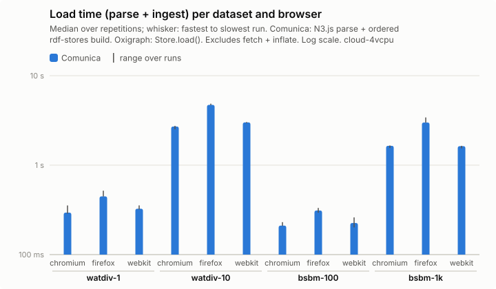

