# Results: 2026-11-04-comunica-55a70ad/5-483dc3c-rdf-stores-2.8.0-again

Generated by `npm run aggregate` and `npm run plot` from `raw/*.json`; only the notes section is written by hand.

<!-- notes:start -->
_No notes for this run._
<!-- notes:end -->

## Setup

| | |
|---|---|
| Machine | `cloud-4vcpu`: Intel(R) Xeon(R) Processor @ 2.10GHz, 4 logical CPUs, 15.7 GiB RAM, Ubuntu 24.04.5 LTS (Linux 6.18.44-fc-v233 x64) |
| Browsers (Playwright 1.63.0, headless) | chromium 153.0.8010.12, firefox 155.0, webkit 26.6 |
| Comunica | `@comunica/query-sparql-rdfjs-lite` 5.4.1 built from https://github.com/comunica/comunica at [`483dc3cfad`](https://github.com/comunica/comunica/commit/483dc3cfad79d24b6f6eb081e0113b0092658bba) (2026-11-04T14:29:58+01:00), N3.js 2.13.12, rdf-stores 2.8.0 (ordered store) |
| Oxigraph | `oxigraph` 0.5.13 (`web.js` WASM build) |
| Benchmark code | `bbe9fe7`; each raw file written by a resumed invocation names its commit; Vite 8.3.5 |
| Settings | 3 repetitions of every timing run, each in a fresh browser and context; per run 1 warmup round and 5 timed rounds; timeout 60 s per execution |
| Run | 2026-11-04T20:23:04.591Z to 2026-11-04T20:29:05.557Z |

## Bundle size

Everything the page loads (harness, adapter, engine); gzip level 9; kB = 1000 bytes.

| Page | JS raw | JS gzip | WASM raw | WASM gzip | Total raw | Total gzip |
|---|---:|---:|---:|---:|---:|---:|
| comunica | 1,319.8 | 285.4 | 0 | 0 | 1,319.8 | 285.4 |
| oxigraph | 28.1 | 8.7 | 4,324.9 | 1,533.7 | 4,353.1 | 1,542.4 |

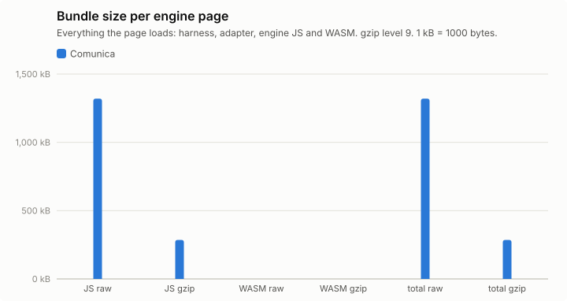

## Query times, load and memory

Timing runs were repeated (see Setup); warm statistics pool the timed rounds of all repetitions (per instance: repetitions × 5 executions), cold is the mean of the cold executions over repetitions, and per-run values (init, load, memory) are medians over repetitions, with the range in parentheses. Totals add the per-instance warm means. "All ok" sums each engine over its own ok instances; "common" sums over the instances that both engines got ok in that browser, which is the comparable number. Engine init = loading the adapter chunk (JS, plus WASM for Oxigraph) + constructing the engine. Load = parse + ingest; Oxigraph parses and ingests inside one `Store.load()` call, so its parse column is empty. Memory: Chromium only.

### watdiv-1

| Browser | Engine | ok | Total warm (all ok) | Total warm (common) | Total cold (common) | Geomean warm (common) | Init | Fetch+inflate | Parse | Ingest | Load | Memory |
|---|---|---:|---:|---:|---:|---:|---:|---:|---:|---:|---:|---:|
| chromium | comunica | 100/100 | 214 ms | 214 ms (100) | 381 ms | 1.6 ms | 171 ms | 47 ms | 290 ms | 0.0 ms | 290 ms (285 ms–293 ms) | 17.2 MB |
| firefox | comunica | 100/100 | 628 ms | 628 ms (100) | 846 ms | 5.3 ms | 272 ms | 108 ms | 433 ms | 0.0 ms | 433 ms (428 ms–481 ms) | – |
| webkit | comunica | 100/100 | 269 ms | 269 ms (100) | 548 ms | 2.0 ms | 223 ms | 68 ms | 347 ms | 0.0 ms | 347 ms (330 ms–375 ms) | – |

Three slowest instances per engine (warm mean [fastest–slowest execution]; cold mean)

- chromium / comunica: C3-1 17 ms [13 ms–30 ms]; cold 43 ms, C3-2 16 ms [12 ms–24 ms]; cold 20 ms, C3-3 15 ms [13 ms–22 ms]; cold 17 ms
- firefox / comunica: C3-2 33 ms [27 ms–55 ms]; cold 38 ms, C3-3 33 ms [26 ms–45 ms]; cold 30 ms, C3-1 32 ms [28 ms–45 ms]; cold 61 ms
- webkit / comunica: C3-4 20 ms [13 ms–33 ms]; cold 24 ms, C3-3 20 ms [14 ms–28 ms]; cold 20 ms, C3-2 20 ms [15 ms–30 ms]; cold 27 ms

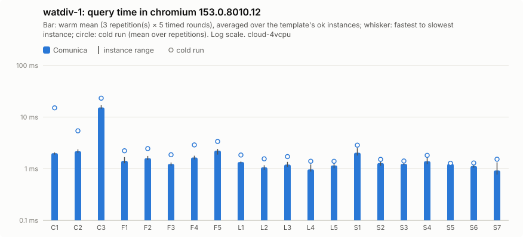

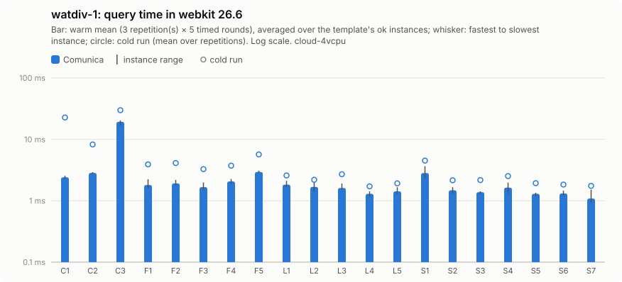

Per instance: [`watdiv-1/instances_chromium.csv`](watdiv-1/instances_chromium.csv), [`watdiv-1/instances_firefox.csv`](watdiv-1/instances_firefox.csv), [`watdiv-1/instances_webkit.csv`](watdiv-1/instances_webkit.csv); per template: `watdiv-1/plot_<browser>.csv`; totals: [`watdiv-1/totals.csv`](watdiv-1/totals.csv); load: [`watdiv-1/plot_load.csv`](watdiv-1/plot_load.csv).

### watdiv-10

| Browser | Engine | ok | Total warm (all ok) | Total warm (common) | Total cold (common) | Geomean warm (common) | Init | Fetch+inflate | Parse | Ingest | Load | Memory |
|---|---|---:|---:|---:|---:|---:|---:|---:|---:|---:|---:|---:|
| chromium | comunica | 100/100 | 885 ms | 885 ms (100) | 1.18 s | 2.4 ms | 172 ms | 446 ms | 2.63 s | 0.0 ms | 2.63 s (2.55 s–2.84 s) | 91.1 MB |
| firefox | comunica | 100/100 | 1.88 s | 1.88 s (100) | 2.25 s | 7.3 ms | 249 ms | 870 ms | 4.56 s | 0.0 ms | 4.56 s (4.50 s–4.63 s) | – |
| webkit | comunica | 100/100 | 1.27 s | 1.27 s (100) | 1.75 s | 3.7 ms | 211 ms | 675 ms | 2.76 s | 0.0 ms | 2.76 s (2.72 s–2.85 s) | – |

Three slowest instances per engine (warm mean [fastest–slowest execution]; cold mean)

- chromium / comunica: C3-5 137 ms [120 ms–234 ms]; cold 133 ms, C3-3 136 ms [119 ms–246 ms]; cold 136 ms, C3-1 136 ms [125 ms–200 ms]; cold 239 ms
- firefox / comunica: C3-5 255 ms [219 ms–316 ms]; cold 236 ms, C3-2 252 ms [220 ms–304 ms]; cold 230 ms, C3-3 252 ms [213 ms–320 ms]; cold 232 ms
- webkit / comunica: C3-1 258 ms [197 ms–349 ms]; cold 403 ms, C3-3 189 ms [135 ms–295 ms]; cold 157 ms, C3-5 168 ms [137 ms–243 ms]; cold 168 ms

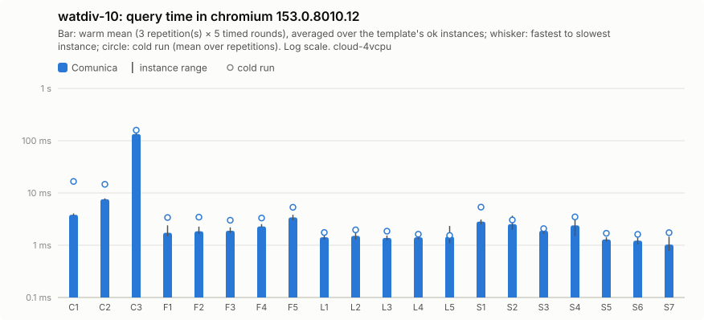

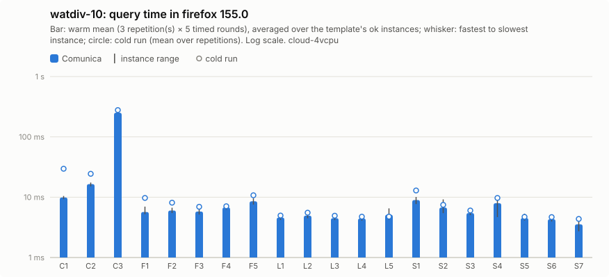

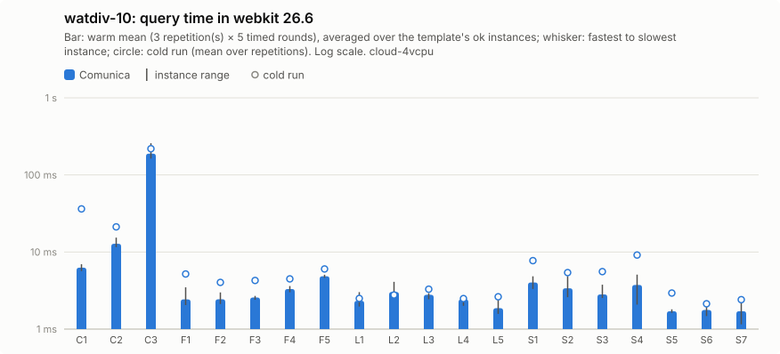

Per instance: [`watdiv-10/instances_chromium.csv`](watdiv-10/instances_chromium.csv), [`watdiv-10/instances_firefox.csv`](watdiv-10/instances_firefox.csv), [`watdiv-10/instances_webkit.csv`](watdiv-10/instances_webkit.csv); per template: `watdiv-10/plot_<browser>.csv`; totals: [`watdiv-10/totals.csv`](watdiv-10/totals.csv); load: [`watdiv-10/plot_load.csv`](watdiv-10/plot_load.csv).

### bsbm-100

| Browser | Engine | ok | Total warm (all ok) | Total warm (common) | Total cold (common) | Geomean warm (common) | Init | Fetch+inflate | Parse | Ingest | Load | Memory |
|---|---|---:|---:|---:|---:|---:|---:|---:|---:|---:|---:|---:|
| chromium | comunica | 50/50 | 172 ms | 172 ms (50) | 322 ms | 2.9 ms | 181 ms | 45 ms | 205 ms | 0.0 ms | 205 ms (200 ms–216 ms) | 28.3 MB |
| firefox | comunica | 50/50 | 695 ms | 695 ms (50) | 912 ms | 11 ms | 248 ms | 94 ms | 295 ms | 0.0 ms | 295 ms (295 ms–314 ms) | – |
| webkit | comunica | 50/50 | 205 ms | 205 ms (50) | 528 ms | 3.6 ms | 222 ms | 71 ms | 225 ms | 0.0 ms | 225 ms (208 ms–231 ms) | – |

Three slowest instances per engine (warm mean [fastest–slowest execution]; cold mean)

- chromium / comunica: Q5-5 8.6 ms [6.4 ms–14 ms]; cold 11 ms, Q5-3 7.8 ms [5.8 ms–14 ms]; cold 8.8 ms, Q5-4 7.8 ms [6.4 ms–11 ms]; cold 9.0 ms
- firefox / comunica: Q5-5 40 ms [33 ms–57 ms]; cold 38 ms, Q5-2 36 ms [30 ms–44 ms]; cold 47 ms, Q5-4 36 ms [28 ms–53 ms]; cold 44 ms
- webkit / comunica: Q5-5 8.9 ms [7.3 ms–14 ms]; cold 13 ms, Q5-2 8.7 ms [6.5 ms–14 ms]; cold 21 ms, Q5-1 7.9 ms [5.9 ms–11 ms]; cold 26 ms

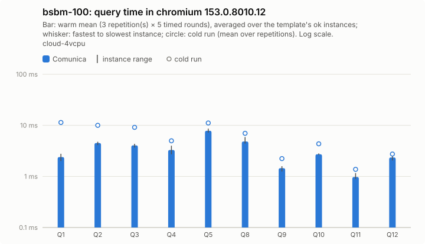

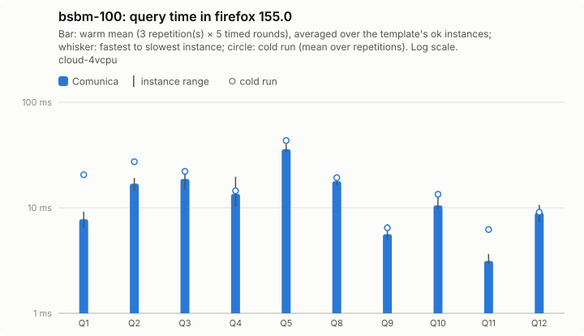

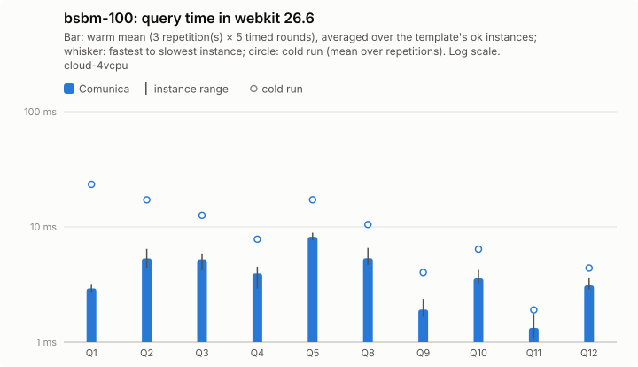

Per instance: [`bsbm-100/instances_chromium.csv`](bsbm-100/instances_chromium.csv), [`bsbm-100/instances_firefox.csv`](bsbm-100/instances_firefox.csv), [`bsbm-100/instances_webkit.csv`](bsbm-100/instances_webkit.csv); per template: `bsbm-100/plot_<browser>.csv`; totals: [`bsbm-100/totals.csv`](bsbm-100/totals.csv); load: [`bsbm-100/plot_load.csv`](bsbm-100/plot_load.csv).

### bsbm-1k

| Browser | Engine | ok | Total warm (all ok) | Total warm (common) | Total cold (common) | Geomean warm (common) | Init | Fetch+inflate | Parse | Ingest | Load | Memory |
|---|---|---:|---:|---:|---:|---:|---:|---:|---:|---:|---:|---:|
| chromium | comunica | 50/50 | 228 ms | 228 ms (50) | 461 ms | 3.1 ms | 178 ms | 407 ms | 1.63 s | 0.0 ms | 1.63 s (1.57 s–1.63 s) | 103.5 MB |
| firefox | comunica | 50/50 | 978 ms | 978 ms (50) | 1.33 s | 12 ms | 270 ms | 731 ms | 3.19 s | 0.0 ms | 3.19 s (3.02 s–3.28 s) | – |
| webkit | comunica | 50/50 | 276 ms | 276 ms (50) | 694 ms | 4.2 ms | 202 ms | 631 ms | 1.73 s | 0.0 ms | 1.73 s (1.63 s–1.76 s) | – |

Three slowest instances per engine (warm mean [fastest–slowest execution]; cold mean)

- chromium / comunica: Q5-2 29 ms [20 ms–48 ms]; cold 31 ms, Q5-5 24 ms [19 ms–40 ms]; cold 28 ms, Q5-4 21 ms [18 ms–31 ms]; cold 24 ms
- firefox / comunica: Q5-5 128 ms [115 ms–173 ms]; cold 126 ms, Q5-2 121 ms [107 ms–152 ms]; cold 143 ms, Q5-4 115 ms [96 ms–148 ms]; cold 114 ms
- webkit / comunica: Q5-5 25 ms [18 ms–51 ms]; cold 49 ms, Q5-2 24 ms [19 ms–37 ms]; cold 35 ms, Q5-4 23 ms [18 ms–32 ms]; cold 28 ms

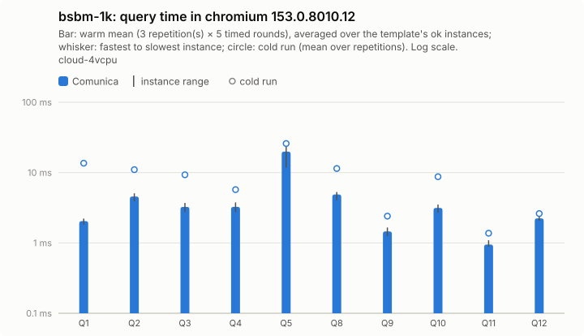

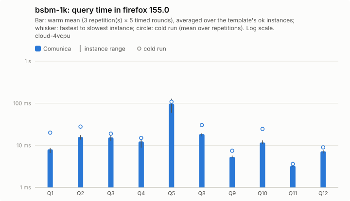

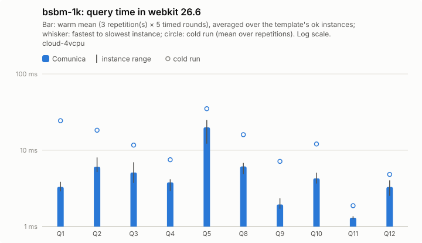

Per instance: [`bsbm-1k/instances_chromium.csv`](bsbm-1k/instances_chromium.csv), [`bsbm-1k/instances_firefox.csv`](bsbm-1k/instances_firefox.csv), [`bsbm-1k/instances_webkit.csv`](bsbm-1k/instances_webkit.csv); per template: `bsbm-1k/plot_<browser>.csv`; totals: [`bsbm-1k/totals.csv`](bsbm-1k/totals.csv); load: [`bsbm-1k/plot_load.csv`](bsbm-1k/plot_load.csv).

## Load and memory overview

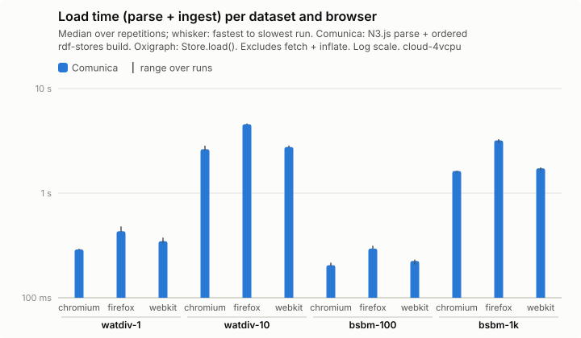

