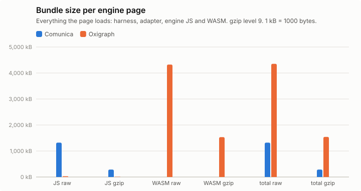
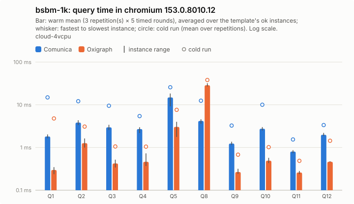
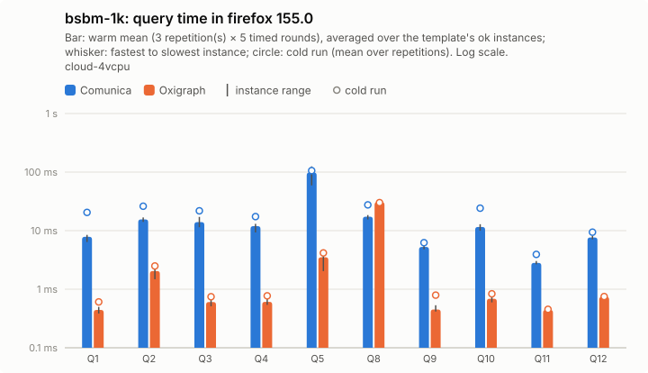
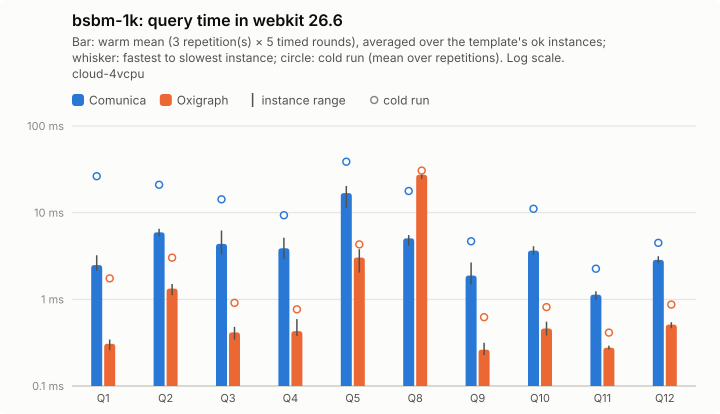
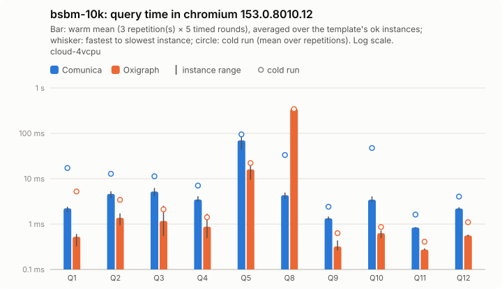
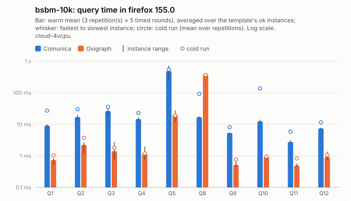
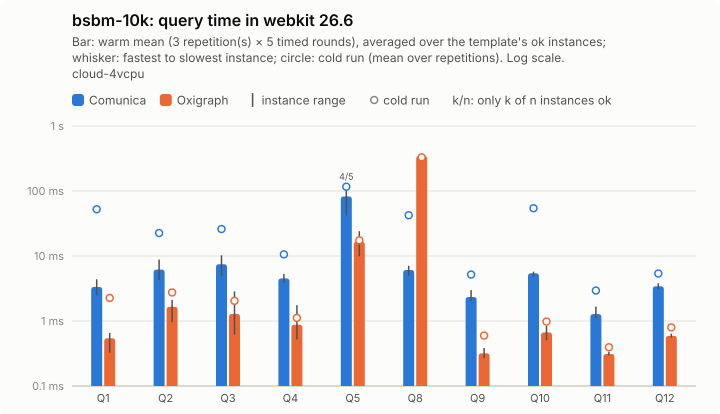
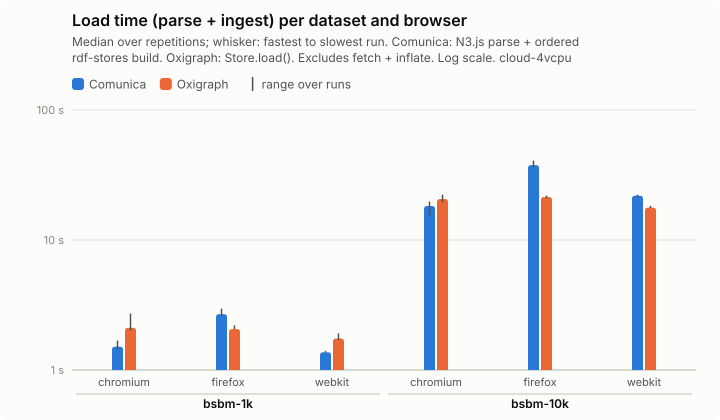
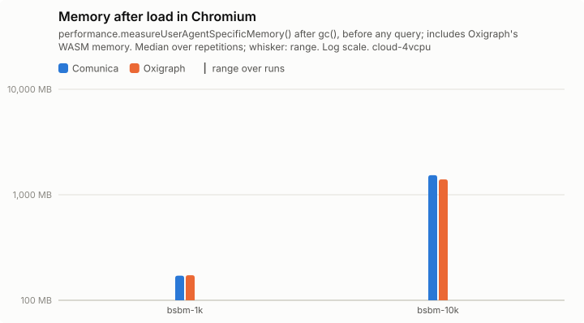

# Results: 2026-11-05-bsbm-10k-cloud-4vcpu

Generated by `npm run aggregate` and `npm run plot` from `raw/*.json`; only the notes section is written by hand.

<!-- notes:start -->
## Notes

BSBM at 10,000 products, the scale of Comunica's BSBM-File-10k CI benchmark (3,564,773 triples; same jbr experiment,
templates and test-driver seed as `bsbm-1k`), next to `bsbm-1k` in the same run. Comunica master `2cad759`
(rdf-stores 2.9.0, the store filled with rdf-data-factory terms) and Oxigraph 0.5.13, 10 warm-up rounds, 5 timed
rounds, 3 repetitions, on 2026-11-05. Comunica also ran in Node 26.13.0 (`npm run bench:node`). Tables in these notes
use, per instance, the median over the 3 repetitions of its warm mean; the generated tables further down pool the timed
rounds of all repetitions instead. Unlike the CI benchmark, which times Comunica's full file engine behind its SPARQL
endpoint over HTTP, this runs the lite engine inside the page, so the scale and the queries match but the times do not.

All executions returned the reference count, except one: in WebKit, Comunica's Q5-2 gave no answer within 90 s in
warm-up round 5 of the first repetition (it takes about 0.1 s otherwise). The runner killed the page, loaded it again
and finished the pass; the instance is left out of the WebKit comparisons below.

### Comunica against Oxigraph

| Dataset | Browser | Comunica total | Oxigraph total | Comunica ÷ Oxigraph, typical query | Same without Q8 | Q8 |
|---|---|---:|---:|---:|---:|---:|
| bsbm-1k | chromium | 188 ms | 180 ms | 3.37× | 4.77× | 0.15× |
| bsbm-1k | firefox | 961 ms | 202 ms | 10.29× | 14.25× | 0.55× |
| bsbm-1k | webkit | 234 ms | 168 ms | 4.52× | 6.43× | 0.19× |
| bsbm-10k | chromium | 489 ms | 1.81 s | 2.33× | 4.18× | 0.01× |
| bsbm-10k | firefox | 2.89 s | 2.01 s | 6.70× | 11.70× | 0.04× |
| bsbm-10k | webkit | 521 ms | 1.84 s | 3.03× | 5.47× | 0.02× |

"Typical query" is the geometric mean over instances of Comunica's time divided by Oxigraph's. At 10,000 products
Comunica's total is lower in Chromium and WebKit, but only because of Q8: Oxigraph's Q8 grows with the data (29 ms per
instance on `bsbm-1k`, 342 ms on `bsbm-10k` in Chromium, 12 times for 9.5 times the triples), while Comunica's stays at
about 4 ms. On the other nine templates Oxigraph stays faster on every one, and the gap narrows only a little with the
scale: 4.8 to 4.2 times in Chromium, 14.3 to 11.7 in Firefox, 6.4 to 5.5 in WebKit.

Mean per instance in Chromium (ms):

| Template | Comunica 1k | Oxigraph 1k | Comunica 10k | Oxigraph 10k |
|---|---:|---:|---:|---:|
| Q1 | 1.75 | 0.30 | 2.21 | 0.52 |
| Q2 | 3.92 | 1.26 | 4.58 | 1.39 |
| Q3 | 2.97 | 0.42 | 5.24 | 1.18 |
| Q4 | 2.64 | 0.46 | 3.44 | 0.87 |
| Q5 | 15 | 3.03 | 71 | 15 |
| Q8 | 4.27 | 29 | 4.14 | 342 |
| Q9 | 1.22 | 0.27 | 1.31 | 0.32 |
| Q10 | 2.76 | 0.48 | 3.31 | 0.65 |
| Q11 | 0.79 | 0.26 | 0.85 | 0.28 |
| Q12 | 1.93 | 0.46 | 2.22 | 0.56 |

Besides Q8, only Q5 (products similar to a given one, filtered on two numeric properties) grows much with the data,
about 5 times in both engines. The other eight templates take 0.8 to 5.2 ms in Comunica and 0.3 to 1.4 ms in Oxigraph
at both scales, and grow by at most 1.8 times in Comunica (2.8 in Oxigraph, Q3); Comunica's extra time on them goes up
from 0.5 to 2.7 ms per instance on `bsbm-1k` to 0.6 to 4.1 ms on `bsbm-10k`, so it is mostly a cost per query rather
than per triple.

Loading `bsbm-10k` takes Comunica 18.3 s in Chromium, 21.9 s in WebKit and 37.7 s in Firefox, against 20.6 s, 17.7 s and
21.4 s for Oxigraph; after loading, Chromium reports 1,533 MB for Comunica's page and 1,399 MB for Oxigraph's.

### Comunica in the browsers against Node 26

| Dataset | Chromium | Firefox | WebKit | Node 26 total |
|---|---:|---:|---:|---:|
| bsbm-1k | 0.90× | 3.90× | 1.20× | 200 ms |
| bsbm-10k | 0.99× | 4.03× | 1.37× | 501 ms |

Geometric mean over instances of the browser's time divided by Node 26's, as in `../2026-11-05-cloud-4vcpu`: Chromium
matches Node at both scales.
<!-- notes:end -->

## Setup

| | |
|---|---|
| Machine | `cloud-4vcpu`: Intel(R) Xeon(R) Processor @ 2.10GHz, 4 logical CPUs, 15.7 GiB RAM, Ubuntu 24.04.5 LTS (Linux 6.18.44-fc-v236 x64) |
| Browsers (Playwright 1.63.0, headless) | chromium 153.0.8010.12, firefox 155.0, webkit 26.6, node26 v26.13.0 |
| Comunica | `@comunica/query-sparql-rdfjs-lite` 5.4.1 built from https://github.com/comunica/comunica at [`2cad75988d`](https://github.com/comunica/comunica/commit/2cad75988d2fe50e5ea4004c4a1a492a8e9c6aa0) (2026-11-05T13:46:46+01:00), N3.js 2.13.12, rdf-stores 2.9.0 (ordered store) |
| Oxigraph | `oxigraph` 0.5.13 (`web.js` WASM build) |
| Benchmark code | `7a42f49` (with uncommitted changes); each raw file written by a resumed invocation names its commit; Vite 8.3.5 |
| Settings | 3 repetitions of every timing run, each in a fresh browser and context; per run 10 warmup round and 5 timed rounds; timeout 60 s per execution |
| Run | 2026-11-05T12:53:23.157Z to 2026-11-05T13:18:33.353Z |

## Bundle size

Everything the page loads (harness, adapter, engine); gzip level 9; kB = 1000 bytes.

| Page | JS raw | JS gzip | WASM raw | WASM gzip | Total raw | Total gzip |
|---|---:|---:|---:|---:|---:|---:|
| comunica | 1,321.8 | 285.8 | 0 | 0 | 1,321.8 | 285.8 |
| oxigraph | 28.1 | 8.7 | 4,324.9 | 1,533.7 | 4,353 | 1,542.4 |

## Query times, load and memory

Timing runs were repeated (see Setup); warm statistics pool the timed rounds of all repetitions (per instance: repetitions × 5 executions), cold is the mean of the cold executions over repetitions, and per-run values (init, load, memory) are medians over repetitions, with the range in parentheses. Totals add the per-instance warm means. "All ok" sums each engine over its own ok instances; "common" sums over the instances that both engines got ok in that browser, which is the comparable number. Engine init = loading the adapter chunk (JS, plus WASM for Oxigraph) + constructing the engine. Load = parse + ingest; Oxigraph parses and ingests inside one `Store.load()` call, so its parse column is empty. Memory: Chromium only.

### bsbm-1k

| Browser | Engine | ok | Total warm (all ok) | Total warm (common) | Total cold (common) | Geomean warm (common) | Init | Fetch+inflate | Parse | Ingest | Load | Memory |
|---|---|---:|---:|---:|---:|---:|---:|---:|---:|---:|---:|---:|
| chromium | comunica | 50/50 | 186 ms | 186 ms (50) | 492 ms | 2.7 ms | 219 ms | 422 ms | 1.51 s | 0.0 ms | 1.51 s (1.42 s–1.68 s) | 171.0 MB |
| chromium | oxigraph | 50/50 | 178 ms | 178 ms (50) | 297 ms | 0.8 ms | 47 ms | 442 ms | – | 2.11 s | 2.11 s (2.02 s–2.72 s) | 172.8 MB |
| firefox | comunica | 50/50 | 961 ms | 961 ms (50) | 1.32 s | 12 ms | 235 ms | 723 ms | 2.69 s | 0.0 ms | 2.69 s (2.61 s–2.96 s) | – |
| firefox | oxigraph | 50/50 | 201 ms | 201 ms (50) | 209 ms | 1.1 ms | 92 ms | 748 ms | – | 2.06 s | 2.06 s (2.06 s–2.20 s) | – |
| webkit | comunica | 50/50 | 240 ms | 240 ms (50) | 750 ms | 3.6 ms | 231 ms | 624 ms | 1.37 s | 0.0 ms | 1.37 s (1.37 s–1.40 s) | – |
| webkit | oxigraph | 50/50 | 172 ms | 172 ms (50) | 220 ms | 0.8 ms | 89 ms | 618 ms | – | 1.75 s | 1.75 s (1.69 s–1.91 s) | – |

Three slowest instances per engine (warm mean [fastest–slowest execution]; cold mean)

- chromium / comunica: Q5-5 18 ms [15 ms–32 ms]; cold 27 ms, Q5-2 18 ms [15 ms–28 ms]; cold 28 ms, Q5-4 17 ms [13 ms–35 ms]; cold 23 ms
- chromium / oxigraph: Q8-1 32 ms [29 ms–41 ms]; cold 44 ms, Q8-2 30 ms [25 ms–36 ms]; cold 44 ms, Q8-5 28 ms [23 ms–39 ms]; cold 33 ms
- firefox / comunica: Q5-2 125 ms [106 ms–162 ms]; cold 130 ms, Q5-5 125 ms [105 ms–149 ms]; cold 120 ms, Q5-4 114 ms [94 ms–161 ms]; cold 115 ms
- firefox / oxigraph: Q8-2 33 ms [26 ms–45 ms]; cold 33 ms, Q8-1 32 ms [28 ms–39 ms]; cold 32 ms, Q8-5 30 ms [24 ms–42 ms]; cold 27 ms
- webkit / comunica: Q5-5 20 ms [15 ms–29 ms]; cold 37 ms, Q5-2 20 ms [16 ms–30 ms]; cold 51 ms, Q5-4 18 ms [13 ms–27 ms]; cold 41 ms
- webkit / oxigraph: Q8-2 31 ms [24 ms–43 ms]; cold 34 ms, Q8-1 29 ms [26 ms–40 ms]; cold 35 ms, Q8-3 27 ms [22 ms–40 ms]; cold 29 ms

Per instance: [`bsbm-1k/instances_chromium.csv`](bsbm-1k/instances_chromium.csv), [`bsbm-1k/instances_firefox.csv`](bsbm-1k/instances_firefox.csv), [`bsbm-1k/instances_webkit.csv`](bsbm-1k/instances_webkit.csv); per template: `bsbm-1k/plot_<browser>.csv`; totals: [`bsbm-1k/totals.csv`](bsbm-1k/totals.csv); load: [`bsbm-1k/plot_load.csv`](bsbm-1k/plot_load.csv).

### bsbm-10k

| Browser | Engine | ok | Total warm (all ok) | Total warm (common) | Total cold (common) | Geomean warm (common) | Init | Fetch+inflate | Parse | Ingest | Load | Memory |
|---|---|---:|---:|---:|---:|---:|---:|---:|---:|---:|---:|---:|
| chromium | comunica | 50/50 | 488 ms | 488 ms (50) | 1.16 s | 3.7 ms | 198 ms | 3.61 s | 18.3 s | 0.0 ms | 18.3 s (15.5 s–19.8 s) | 1532.7 MB |
| chromium | oxigraph | 50/50 | 1.85 s | 1.85 s (50) | 1.89 s | 1.6 ms | 50 ms | 3.54 s | – | 20.6 s | 20.6 s (19.5 s–22.3 s) | 1398.8 MB |
| firefox | comunica | 50/50 | 2.98 s | 2.98 s (50) | 4.57 s | 15 ms | 325 ms | 13.9 s | 37.7 s | 0.0 ms | 37.7 s (36.3 s–40.8 s) | – |
| firefox | oxigraph | 50/50 | 2.00 s | 2.00 s (50) | 1.99 s | 2.2 ms | 132 ms | 9.68 s | – | 21.4 s | 21.4 s (20.9 s–21.9 s) | – |
| webkit | comunica | 49/50 (1 timeout) | 530 ms | 530 ms (49) | 1.57 s | 5.0 ms | 373 ms | 13.3 s | 21.9 s | 0.0 ms | 21.9 s (21.3 s–22.3 s) | – |
| webkit | oxigraph | 50/50 | 1.85 s | 1.84 s (49) | 1.77 s | 1.6 ms | 90 ms | 7.65 s | – | 17.7 s | 17.7 s (17.6 s–18.3 s) | – |

Three slowest instances per engine (warm mean [fastest–slowest execution]; cold mean)

- chromium / comunica: Q5-5 100 ms [84 ms–134 ms]; cold 102 ms, Q5-4 91 ms [77 ms–120 ms]; cold 97 ms, Q5-3 62 ms [53 ms–88 ms]; cold 74 ms
- chromium / oxigraph: Q8-2 355 ms [319 ms–420 ms]; cold 347 ms, Q8-5 348 ms [309 ms–391 ms]; cold 330 ms, Q8-3 346 ms [312 ms–386 ms]; cold 350 ms
- firefox / comunica: Q5-5 721 ms [611 ms–1.01 s]; cold 732 ms, Q5-4 666 ms [532 ms–979 ms]; cold 591 ms, Q5-3 415 ms [384 ms–473 ms]; cold 493 ms
- firefox / oxigraph: Q8-1 380 ms [336 ms–437 ms]; cold 386 ms, Q8-3 379 ms [318 ms–445 ms]; cold 365 ms, Q8-5 370 ms [330 ms–450 ms]; cold 353 ms
- webkit / comunica: Q5-5 110 ms [90 ms–128 ms]; cold 117 ms, Q5-4 108 ms [82 ms–151 ms]; cold 113 ms, Q5-3 71 ms [57 ms–136 ms]; cold 103 ms
- webkit / oxigraph: Q8-5 357 ms [311 ms–418 ms]; cold 304 ms, Q8-3 352 ms [293 ms–415 ms]; cold 351 ms, Q8-4 346 ms [296 ms–474 ms]; cold 331 ms

Not ok:

- webkit / comunica Q5-2: timeout (no response within 90000 ms; page killed)

Per instance: [`bsbm-10k/instances_chromium.csv`](bsbm-10k/instances_chromium.csv), [`bsbm-10k/instances_firefox.csv`](bsbm-10k/instances_firefox.csv), [`bsbm-10k/instances_webkit.csv`](bsbm-10k/instances_webkit.csv); per template: `bsbm-10k/plot_<browser>.csv`; totals: [`bsbm-10k/totals.csv`](bsbm-10k/totals.csv); load: [`bsbm-10k/plot_load.csv`](bsbm-10k/plot_load.csv).

## Load and memory overview

