# Results: 2026-11-05-cloud-4vcpu

Generated by `npm run aggregate` and `npm run plot` from `raw/*.json`; only the notes section is written by hand.

<!-- notes:start -->
## Notes

Comunica master `6b5eb94` (rdf-stores 2.9.0) and Oxigraph 0.5.13 on 2026-11-05, WatDiv and BSBM (no LDBC SNB), with
the new default of 10 warm-up rounds (the 2026-11-01 run used one; see
[`../2026-11-05-warmup-cloud-4vcpu`](../2026-11-05-warmup-cloud-4vcpu/README.md)), 5 timed rounds and 3 repetitions.
All 116,100 executions, in the browsers and in Node, returned the reference count. The tables below use, per
instance, the median over the 3 repetitions of its warm mean; the generated tables further down pool the timed
rounds of all repetitions instead.

### Comunica against Oxigraph

| Dataset | Browser | Comunica total | Oxigraph total | Comunica ÷ Oxigraph, typical query | Templates where Comunica is faster |
|---|---|---:|---:|---:|---|
| watdiv-1 | chromium | 213 ms | 1.02 s | 3.13× | C3 −92 % |
| watdiv-1 | firefox | 680 ms | 1.20 s | 8.35× | C3 −85 % |
| watdiv-1 | webkit | 265 ms | 1.12 s | 3.70× | C3 −90 % |
| watdiv-10 | chromium | 874 ms | 10.69 s | 1.80× | C2 −52 %, C3 −94 % |
| watdiv-10 | firefox | 2.14 s | 13.69 s | 4.69× | C3 −89 % |
| watdiv-10 | webkit | 1.10 s | 12.55 s | 1.97× | C2 −45 %, C3 −93 % |
| bsbm-100 | chromium | 172 ms | 44 ms | 4.86× | none |
| bsbm-100 | firefox | 751 ms | 55 ms | 14.52× | none |
| bsbm-100 | webkit | 190 ms | 41 ms | 5.68× | none |
| bsbm-1k | chromium | 233 ms | 214 ms | 3.53× | Q8 −86 % |
| bsbm-1k | firefox | 1.12 s | 214 ms | 11.21× | Q8 −40 % |
| bsbm-1k | webkit | 269 ms | 188 ms | 4.40× | Q8 −81 % |

With the warm-up corrected, the comparison is the same as before: a typical query is 1.8 to 3.7 times faster in
Oxigraph in Chromium and WebKit and 4.7 to 14.5 times in Firefox; Comunica is faster only on WatDiv C3 (7 to 16 times),
C2 on watdiv-10 in Chromium and WebKit, and BSBM Q8 on bsbm-1k.

### Comunica in the browsers against Node

The same protocol in Node (`npm run bench:node -- --mode timing`, a fresh process per run, same Comunica build, store,
loader and query function): Node 22.23.4 (V8 12.4), Node 24.22.1 (V8 13.6) and Node 26.13.0 (V8 14.6, the newest, so
the reference here). "÷ Node 26" is the geometric mean over instances of the ratio.

| Dataset | chromium total | firefox total | webkit total | node22 total | node24 total | node26 total | Chromium ÷ Node 26 | Firefox ÷ Node 26 | WebKit ÷ Node 26 | Node 22 ÷ Node 26 | Node 24 ÷ Node 26 |
|---|---:|---:|---:|---:|---:|---:|---:|---:|---:|---:|---:|
| watdiv-1 | 213 ms | 680 ms | 265 ms | 765 ms | 653 ms | 700 ms | 0.86× | 3.26× | 1.06× | 1.19× | 0.91× |
| watdiv-10 | 874 ms | 2.14 s | 1.10 s | 5.87 s | 8.39 s | 5.90 s | 0.84× | 3.02× | 1.08× | 1.11× | 1.32× |
| bsbm-100 | 172 ms | 751 ms | 190 ms | 182 ms | 178 ms | 173 ms | 1.01× | 4.20× | 1.14× | 1.07× | 1.05× |
| bsbm-1k | 233 ms | 1.12 s | 269 ms | 254 ms | 225 ms | 225 ms | 0.99× | 4.07× | 1.21× | 1.14× | 1.02× |

A typical query takes 0.84 to 1.01 times its Node 26 time in Chromium, so Chromium does not hold Comunica back
against Node on a recent V8. WebKit takes 1.06 to 1.21 times, Firefox 3.0 to 4.2 times. All three Node versions
are much slower on WatDiv C3 than the browsers: 105 to 119 ms per instance on watdiv-1 against 16 ms in Chromium,
and 1.1 to 1.6 s on watdiv-10 against 0.14 s, which makes Node's WatDiv totals the highest.

<!-- notes:end -->

## Setup

| | |
|---|---|
| Machine | `cloud-4vcpu`: Intel(R) Xeon(R) Processor @ 2.10GHz, 4 logical CPUs, 15.7 GiB RAM, Ubuntu 24.04.5 LTS (Linux 6.18.44-fc-v236 x64) |
| Browsers (Playwright 1.63.0, headless) | chromium 153.0.8010.12, firefox 155.0, webkit 26.6, node22 v22.23.4, node24 v24.22.1, node26 v26.13.0 |
| Comunica | `@comunica/query-sparql-rdfjs-lite` 5.4.1 built from https://github.com/comunica/comunica at [`6b5eb94bb3`](https://github.com/comunica/comunica/commit/6b5eb94bb3b3736b6ce246d101e1ac61daaaa57e) (2026-11-05T08:43:20+01:00), N3.js 2.13.12, rdf-stores 2.9.0 (ordered store) |
| Oxigraph | `oxigraph` 0.5.13 (`web.js` WASM build) |
| Benchmark code | `527f40d` (invocation started 2026-11-05T08:12:11.338Z), `527f40d` (invocation started 2026-11-05T08:12:45.305Z); each raw file written by a resumed invocation names its commit; Vite 8.3.5 |
| Settings | 3 repetitions of every timing run, each in a fresh browser and context; per run 10 warmup round and 5 timed rounds; timeout 60 s per execution |
| Run | 2026-11-05T08:12:11.339Z to 2026-11-05T09:02:21.638Z |

## Bundle size

Everything the page loads (harness, adapter, engine); gzip level 9; kB = 1000 bytes.

| Page | JS raw | JS gzip | WASM raw | WASM gzip | Total raw | Total gzip |
|---|---:|---:|---:|---:|---:|---:|
| comunica | 1,321.8 | 285.6 | 0 | 0 | 1,321.8 | 285.6 |
| oxigraph | 28.1 | 8.7 | 4,324.9 | 1,533.7 | 4,353 | 1,542.4 |

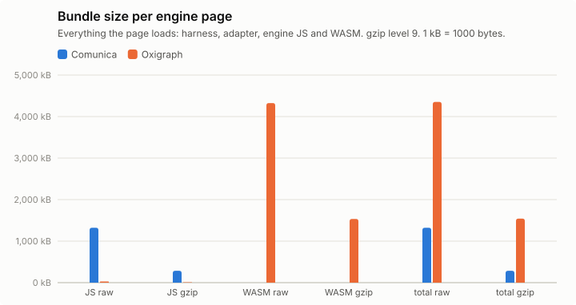

## Support matrix

One execution of every query instance at the smallest scale of each family, classified against `data/<dataset>/reference.json`. Per query: [`support-matrix.csv`](support-matrix.csv).

**watdiv-1**

| | chromium/comunica | chromium/oxigraph | firefox/comunica | firefox/oxigraph | webkit/comunica | webkit/oxigraph |
|---|---:|---:|---:|---:|---:|---:|
| ok | 100/100 | 100/100 | 100/100 | 100/100 | 100/100 | 100/100 |
| other | – | – | – | – | – | – |

**bsbm-100**

| | chromium/comunica | chromium/oxigraph | firefox/comunica | firefox/oxigraph | webkit/comunica | webkit/oxigraph |
|---|---:|---:|---:|---:|---:|---:|
| ok | 50/50 | 50/50 | 50/50 | 50/50 | 50/50 | 50/50 |
| other | – | – | – | – | – | – |

## Query times, load and memory

Timing runs were repeated (see Setup); warm statistics pool the timed rounds of all repetitions (per instance: repetitions × 5 executions), cold is the mean of the cold executions over repetitions, and per-run values (init, load, memory) are medians over repetitions, with the range in parentheses. Totals add the per-instance warm means. "All ok" sums each engine over its own ok instances; "common" sums over the instances that both engines got ok in that browser, which is the comparable number. Engine init = loading the adapter chunk (JS, plus WASM for Oxigraph) + constructing the engine. Load = parse + ingest; Oxigraph parses and ingests inside one `Store.load()` call, so its parse column is empty. Memory: Chromium only.

### watdiv-1

| Browser | Engine | ok | Total warm (all ok) | Total warm (common) | Total cold (common) | Geomean warm (common) | Init | Fetch+inflate | Parse | Ingest | Load | Memory |
|---|---|---:|---:|---:|---:|---:|---:|---:|---:|---:|---:|---:|
| chromium | comunica | 100/100 | 214 ms | 214 ms (100) | 424 ms | 1.5 ms | 189 ms | 51 ms | 298 ms | 0.0 ms | 298 ms (297 ms–330 ms) | 17.3 MB |
| chromium | oxigraph | 100/100 | 1.01 s | 1.01 s (100) | 1.10 s | 0.5 ms | 43 ms | 50 ms | – | 420 ms | 420 ms (410 ms–435 ms) | 50.0 MB |
| firefox | comunica | 100/100 | 681 ms | 681 ms (100) | 915 ms | 5.7 ms | 272 ms | 119 ms | 477 ms | 0.0 ms | 477 ms (445 ms–526 ms) | – |
| firefox | oxigraph | 100/100 | 1.20 s | 1.20 s (100) | 1.24 s | 0.7 ms | 127 ms | 120 ms | – | 484 ms | 484 ms (416 ms–565 ms) | – |
| webkit | comunica | 100/100 | 268 ms | 268 ms (100) | 579 ms | 1.9 ms | 218 ms | 77 ms | 377 ms | 0.0 ms | 377 ms (346 ms–459 ms) | – |
| webkit | oxigraph | 100/100 | 1.12 s | 1.12 s (100) | 1.10 s | 0.5 ms | 81 ms | 78 ms | – | 434 ms | 434 ms (382 ms–474 ms) | – |

Three slowest instances per engine (warm mean [fastest–slowest execution]; cold mean)

- chromium / comunica: C3-1 17 ms [12 ms–24 ms]; cold 60 ms, C3-4 16 ms [12 ms–27 ms]; cold 20 ms, C3-5 16 ms [12 ms–25 ms]; cold 21 ms
- chromium / oxigraph: C3-1 206 ms [171 ms–263 ms]; cold 206 ms, C3-5 201 ms [167 ms–290 ms]; cold 195 ms, C3-4 195 ms [166 ms–258 ms]; cold 218 ms
- firefox / comunica: C3-4 35 ms [24 ms–48 ms]; cold 36 ms, C3-1 34 ms [24 ms–48 ms]; cold 67 ms, C3-5 34 ms [25 ms–48 ms]; cold 37 ms
- firefox / oxigraph: C3-1 245 ms [204 ms–305 ms]; cold 236 ms, C3-4 232 ms [202 ms–292 ms]; cold 237 ms, C3-2 231 ms [198 ms–273 ms]; cold 230 ms
- webkit / comunica: C3-4 24 ms [14 ms–41 ms]; cold 21 ms, C3-3 21 ms [12 ms–31 ms]; cold 26 ms, C3-2 21 ms [14 ms–30 ms]; cold 28 ms
- webkit / oxigraph: C3-3 228 ms [174 ms–313 ms]; cold 187 ms, C3-5 221 ms [173 ms–322 ms]; cold 216 ms, C3-1 215 ms [183 ms–294 ms]; cold 223 ms

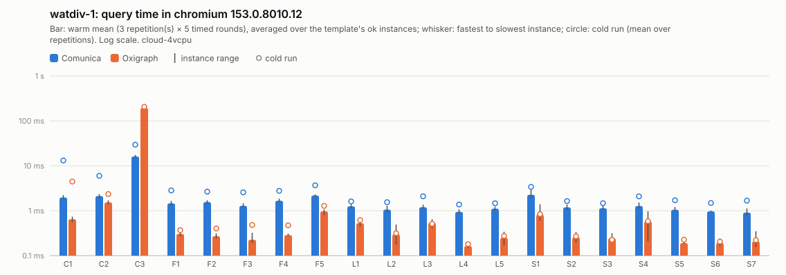

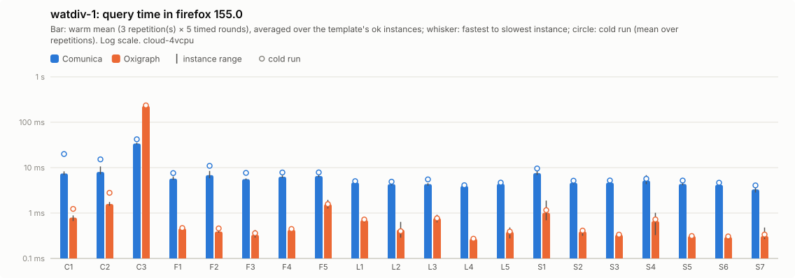

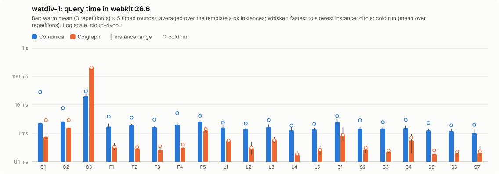

Per instance: [`watdiv-1/instances_chromium.csv`](watdiv-1/instances_chromium.csv), [`watdiv-1/instances_firefox.csv`](watdiv-1/instances_firefox.csv), [`watdiv-1/instances_webkit.csv`](watdiv-1/instances_webkit.csv); per template: `watdiv-1/plot_<browser>.csv`; totals: [`watdiv-1/totals.csv`](watdiv-1/totals.csv); load: [`watdiv-1/plot_load.csv`](watdiv-1/plot_load.csv).

### watdiv-10

| Browser | Engine | ok | Total warm (all ok) | Total warm (common) | Total cold (common) | Geomean warm (common) | Init | Fetch+inflate | Parse | Ingest | Load | Memory |
|---|---|---:|---:|---:|---:|---:|---:|---:|---:|---:|---:|---:|
| chromium | comunica | 100/100 | 941 ms | 941 ms (100) | 1.17 s | 2.3 ms | 204 ms | 496 ms | 2.84 s | 0.0 ms | 2.84 s (2.69 s–3.13 s) | 91.2 MB |
| chromium | oxigraph | 100/100 | 10.7 s | 10.7 s (100) | 11.3 s | 1.2 ms | 54 ms | 453 ms | – | 4.10 s | 4.10 s (3.94 s–5.11 s) | 411.3 MB |
| firefox | comunica | 100/100 | 2.13 s | 2.13 s (100) | 2.48 s | 8.0 ms | 302 ms | 966 ms | 5.40 s | 0.0 ms | 5.40 s (5.19 s–5.69 s) | – |
| firefox | oxigraph | 100/100 | 13.5 s | 13.5 s (100) | 13.5 s | 1.8 ms | 107 ms | 1.03 s | – | 4.65 s | 4.65 s (4.59 s–5.05 s) | – |
| webkit | comunica | 100/100 | 1.11 s | 1.11 s (100) | 1.79 s | 3.0 ms | 317 ms | 784 ms | 3.13 s | 0.0 ms | 3.13 s (3.03 s–3.47 s) | – |
| webkit | oxigraph | 100/100 | 12.5 s | 12.5 s (100) | 12.4 s | 1.5 ms | 84 ms | 773 ms | – | 4.33 s | 4.33 s (4.32 s–4.44 s) | – |

Three slowest instances per engine (warm mean [fastest–slowest execution]; cold mean)

- chromium / comunica: C3-1 156 ms [112 ms–271 ms]; cold 238 ms, C3-3 156 ms [113 ms–208 ms]; cold 119 ms, C3-4 151 ms [114 ms–247 ms]; cold 150 ms
- chromium / oxigraph: C3-3 2.16 s [2.00 s–2.59 s]; cold 2.22 s, C3-2 2.12 s [1.93 s–2.44 s]; cold 2.24 s, C3-5 2.12 s [1.88 s–2.42 s]; cold 2.21 s
- firefox / comunica: C3-1 304 ms [240 ms–366 ms]; cold 506 ms, C3-3 294 ms [245 ms–393 ms]; cold 297 ms, C3-4 289 ms [225 ms–397 ms]; cold 279 ms
- firefox / oxigraph: C3-2 2.70 s [2.22 s–3.19 s]; cold 2.47 s, C3-5 2.67 s [2.32 s–3.39 s]; cold 2.80 s, C3-4 2.66 s [2.31 s–3.11 s]; cold 2.78 s
- webkit / comunica: C3-1 181 ms [144 ms–231 ms]; cold 455 ms, C3-2 175 ms [116 ms–248 ms]; cold 174 ms, C3-3 173 ms [124 ms–262 ms]; cold 193 ms
- webkit / oxigraph: C3-2 2.56 s [2.18 s–3.12 s]; cold 2.36 s, C3-4 2.54 s [2.21 s–2.89 s]; cold 2.43 s, C3-3 2.47 s [2.13 s–2.80 s]; cold 2.32 s

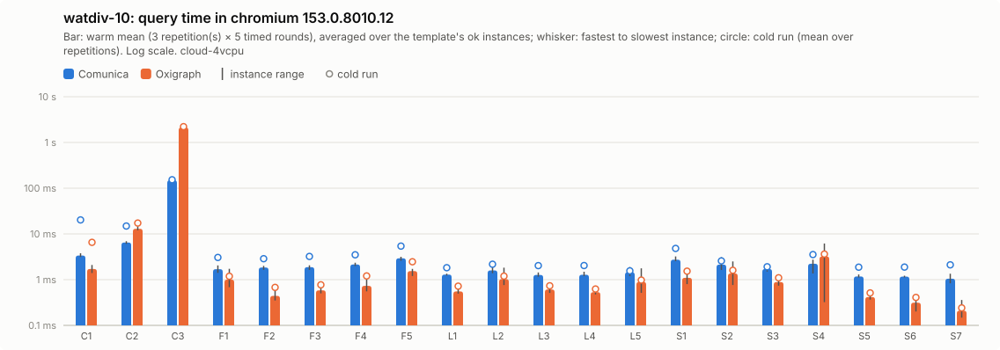

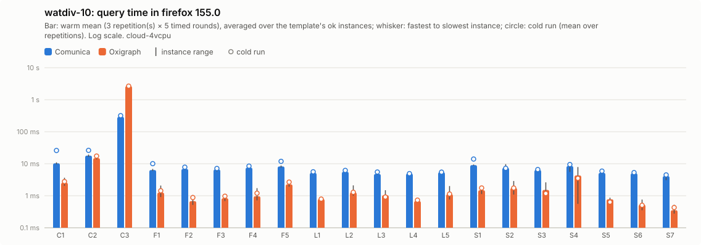

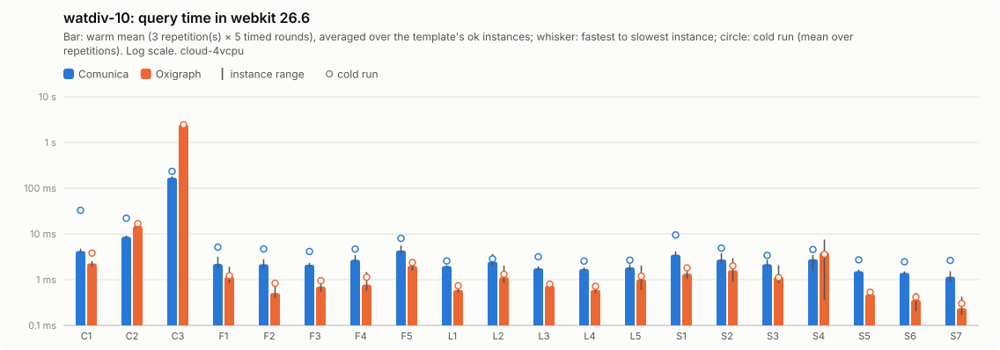

Per instance: [`watdiv-10/instances_chromium.csv`](watdiv-10/instances_chromium.csv), [`watdiv-10/instances_firefox.csv`](watdiv-10/instances_firefox.csv), [`watdiv-10/instances_webkit.csv`](watdiv-10/instances_webkit.csv); per template: `watdiv-10/plot_<browser>.csv`; totals: [`watdiv-10/totals.csv`](watdiv-10/totals.csv); load: [`watdiv-10/plot_load.csv`](watdiv-10/plot_load.csv).

### bsbm-100

| Browser | Engine | ok | Total warm (all ok) | Total warm (common) | Total cold (common) | Geomean warm (common) | Init | Fetch+inflate | Parse | Ingest | Load | Memory |
|---|---|---:|---:|---:|---:|---:|---:|---:|---:|---:|---:|---:|
| chromium | comunica | 50/50 | 174 ms | 174 ms (50) | 356 ms | 3.0 ms | 216 ms | 52 ms | 255 ms | 0.0 ms | 255 ms (227 ms–319 ms) | 28.3 MB |
| chromium | oxigraph | 50/50 | 44 ms | 44 ms (50) | 118 ms | 0.6 ms | 50 ms | 47 ms | – | 287 ms | 287 ms (281 ms–317 ms) | 30.1 MB |
| firefox | comunica | 50/50 | 762 ms | 762 ms (50) | 1.01 s | 13 ms | 264 ms | 99 ms | 353 ms | 0.0 ms | 353 ms (335 ms–397 ms) | – |
| firefox | oxigraph | 50/50 | 56 ms | 56 ms (50) | 65 ms | 0.9 ms | 138 ms | 117 ms | – | 268 ms | 268 ms (241 ms–326 ms) | – |
| webkit | comunica | 50/50 | 191 ms | 191 ms (50) | 551 ms | 3.4 ms | 265 ms | 85 ms | 272 ms | 0.0 ms | 272 ms (247 ms–338 ms) | – |
| webkit | oxigraph | 50/50 | 42 ms | 42 ms (50) | 71 ms | 0.6 ms | 81 ms | 80 ms | – | 287 ms | 287 ms (192 ms–304 ms) | – |

Three slowest instances per engine (warm mean [fastest–slowest execution]; cold mean)

- chromium / comunica: Q5-5 8.4 ms [5.8 ms–11 ms]; cold 9.1 ms, Q5-2 8.0 ms [5.1 ms–9.8 ms]; cold 12 ms, Q5-3 7.8 ms [5.1 ms–17 ms]; cold 10 ms
- chromium / oxigraph: Q8-2 4.0 ms [3.0 ms–5.3 ms]; cold 8.5 ms, Q8-1 3.7 ms [2.9 ms–4.5 ms]; cold 7.6 ms, Q8-3 3.4 ms [2.5 ms–5.2 ms]; cold 7.7 ms
- firefox / comunica: Q5-5 44 ms [33 ms–73 ms]; cold 63 ms, Q5-4 43 ms [28 ms–61 ms]; cold 44 ms, Q5-3 41 ms [28 ms–59 ms]; cold 58 ms
- firefox / oxigraph: Q8-2 4.1 ms [3.1 ms–4.8 ms]; cold 6.4 ms, Q8-1 4.0 ms [3.0 ms–4.6 ms]; cold 4.7 ms, Q8-3 3.5 ms [2.7 ms–5.1 ms]; cold 4.2 ms
- webkit / comunica: Q5-5 8.4 ms [5.9 ms–11 ms]; cold 16 ms, Q5-2 8.3 ms [5.4 ms–11 ms]; cold 15 ms, Q5-1 8.3 ms [5.3 ms–19 ms]; cold 23 ms
- webkit / oxigraph: Q8-2 3.7 ms [2.9 ms–4.7 ms]; cold 5.5 ms, Q8-1 3.6 ms [2.8 ms–5.2 ms]; cold 3.7 ms, Q8-3 2.9 ms [2.3 ms–3.9 ms]; cold 2.7 ms

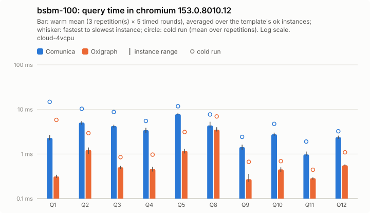

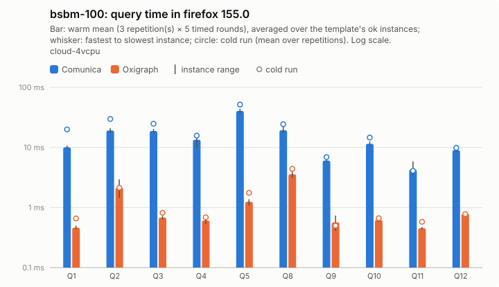

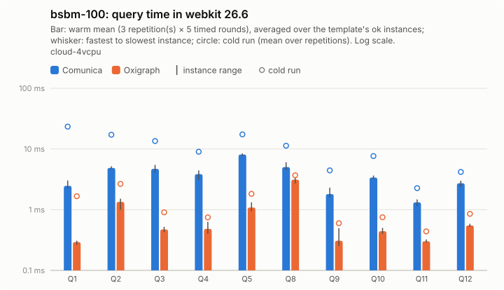

Per instance: [`bsbm-100/instances_chromium.csv`](bsbm-100/instances_chromium.csv), [`bsbm-100/instances_firefox.csv`](bsbm-100/instances_firefox.csv), [`bsbm-100/instances_webkit.csv`](bsbm-100/instances_webkit.csv); per template: `bsbm-100/plot_<browser>.csv`; totals: [`bsbm-100/totals.csv`](bsbm-100/totals.csv); load: [`bsbm-100/plot_load.csv`](bsbm-100/plot_load.csv).

### bsbm-1k

| Browser | Engine | ok | Total warm (all ok) | Total warm (common) | Total cold (common) | Geomean warm (common) | Init | Fetch+inflate | Parse | Ingest | Load | Memory |
|---|---|---:|---:|---:|---:|---:|---:|---:|---:|---:|---:|---:|
| chromium | comunica | 50/50 | 230 ms | 230 ms (50) | 528 ms | 3.1 ms | 226 ms | 458 ms | 1.88 s | 0.0 ms | 1.88 s (1.78 s–1.90 s) | 103.6 MB |
| chromium | oxigraph | 50/50 | 212 ms | 212 ms (50) | 266 ms | 0.9 ms | 50 ms | 420 ms | – | 2.09 s | 2.09 s (1.95 s–2.30 s) | 172.8 MB |
| firefox | comunica | 50/50 | 1.12 s | 1.12 s (50) | 1.47 s | 13 ms | 284 ms | 768 ms | 3.35 s | 0.0 ms | 3.35 s (3.26 s–4.02 s) | – |
| firefox | oxigraph | 50/50 | 211 ms | 211 ms (50) | 234 ms | 1.2 ms | 117 ms | 783 ms | – | 2.05 s | 2.05 s (2.03 s–2.88 s) | – |
| webkit | comunica | 50/50 | 274 ms | 274 ms (50) | 760 ms | 3.9 ms | 230 ms | 625 ms | 1.77 s | 0.0 ms | 1.77 s (1.75 s–1.86 s) | – |
| webkit | oxigraph | 50/50 | 192 ms | 192 ms (50) | 233 ms | 0.9 ms | 78 ms | 625 ms | – | 1.70 s | 1.70 s (1.70 s–2.22 s) | – |

Three slowest instances per engine (warm mean [fastest–slowest execution]; cold mean)

- chromium / comunica: Q5-2 25 ms [17 ms–40 ms]; cold 29 ms, Q5-5 25 ms [17 ms–33 ms]; cold 28 ms, Q5-4 23 ms [16 ms–30 ms]; cold 25 ms
- chromium / oxigraph: Q8-1 35 ms [29 ms–46 ms]; cold 43 ms, Q8-3 35 ms [26 ms–41 ms]; cold 32 ms, Q8-5 34 ms [24 ms–41 ms]; cold 30 ms
- firefox / comunica: Q5-5 161 ms [121 ms–232 ms]; cold 139 ms, Q5-2 140 ms [111 ms–285 ms]; cold 147 ms, Q5-4 137 ms [107 ms–195 ms]; cold 132 ms
- firefox / oxigraph: Q8-1 35 ms [29 ms–40 ms]; cold 35 ms, Q8-2 33 ms [27 ms–41 ms]; cold 35 ms, Q8-3 32 ms [26 ms–37 ms]; cold 33 ms
- webkit / comunica: Q5-5 27 ms [18 ms–37 ms]; cold 55 ms, Q5-2 26 ms [20 ms–36 ms]; cold 36 ms, Q5-4 25 ms [17 ms–37 ms]; cold 36 ms
- webkit / oxigraph: Q8-2 32 ms [25 ms–41 ms]; cold 34 ms, Q8-1 32 ms [27 ms–40 ms]; cold 35 ms, Q8-5 30 ms [24 ms–40 ms]; cold 31 ms

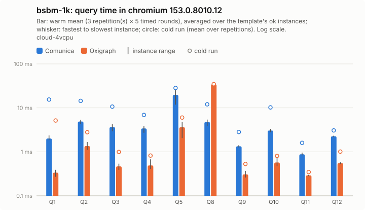

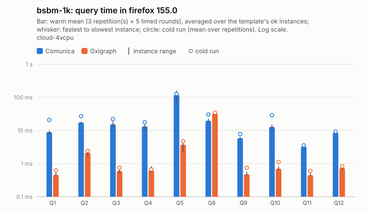

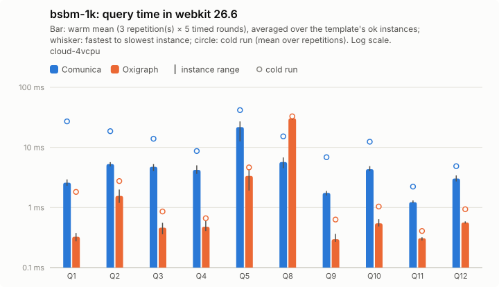

Per instance: [`bsbm-1k/instances_chromium.csv`](bsbm-1k/instances_chromium.csv), [`bsbm-1k/instances_firefox.csv`](bsbm-1k/instances_firefox.csv), [`bsbm-1k/instances_webkit.csv`](bsbm-1k/instances_webkit.csv); per template: `bsbm-1k/plot_<browser>.csv`; totals: [`bsbm-1k/totals.csv`](bsbm-1k/totals.csv); load: [`bsbm-1k/plot_load.csv`](bsbm-1k/plot_load.csv).

## Load and memory overview

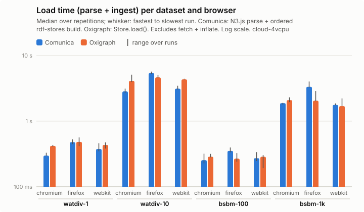

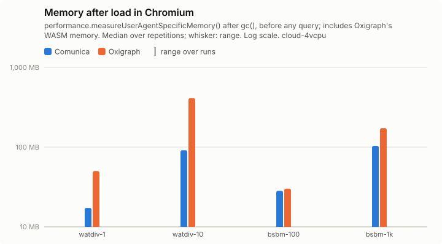

