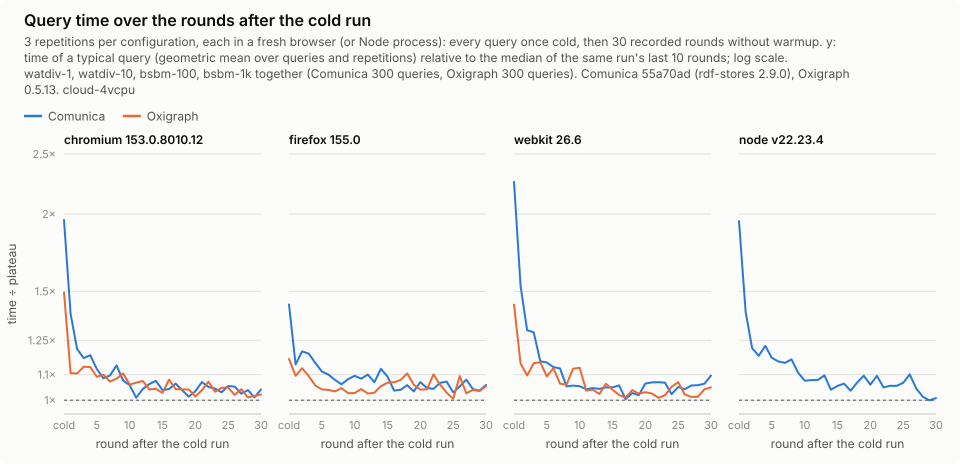
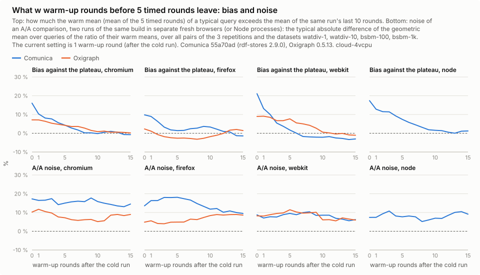

# Warm-up experiment: how many rounds until query times settle

Comunica master `55a70ad` (rdf-stores 2.9.0) and Oxigraph 0.5.13, on 2026-11-05, cloud VM (Intel Xeon @ 2.10 GHz,
4 vCPUs, 15.7 GiB RAM, Linux 6.18.44, Node 22.23.4). Browsers: Chromium 153.0.8010.12, Firefox 155.0, WebKit 26.6.

The timing runs so far used one warm-up round after the cold run, then 5 timed rounds. With that, Comunica's first
timed round was still 4 to 16 % slower than its fifth. This experiment measures how query times converge:

- `npm run bench -- --mode warmup --curve-rounds 30 --repeat 3` (06:23 to 07:51 UTC): every configuration (browser,
  engine, dataset) in a fresh browser, every query once cold, then 30 recorded rounds without warmup. WatDiv 1 and 10,
  BSBM 100 and 1000; 72 runs, all 167,400 executions returned the reference count.
- `npm run bench:node -- --mode warmup --curve-rounds 30 --repeat 3` (after the browser runs): the same for Comunica in
  Node, with the same Comunica build, store, loader and query function, in a fresh process per run; 12 runs, all 27,900
  executions returned the reference count.
- `npm run plot:warmup -- results/2026-11-05-warmup-cloud-4vcpu` draws the charts and writes the CSVs below.

Every run is compared with its own plateau, its last 10 rounds: the curves divide each round by their median, the bias
divides a warm mean by their mean. A typical query is the geometric mean over queries and repetitions.

## Query time over the rounds

The cold run of Comunica takes about 2× its plateau in Chromium and Node, 2.3× in WebKit and 1.4× in Firefox; Oxigraph's
1.2 to 1.5×. Comunica's first round after the cold run is still about 1.35× in Chromium and Node.

Per dataset: [`plot_warmup_datasets.svg`](plot_warmup_datasets.svg); numbers: [`warmup_curves.csv`](warmup_curves.csv).

## What a number of warm-up rounds leaves

Bias of the warm mean of 5 timed rounds after w warm-up rounds, against the same run's plateau:

| | w = 0 | w = 1 (the old default) | w = 5 | w = 10 | w = 15 |
|---|---:|---:|---:|---:|---:|
| Comunica, Chromium | +16.0 % | +10.3 % | +4.3 % | −0.2 % | −0.8 % |
| Comunica, Firefox | +9.8 % | +9.0 % | +1.4 % | +3.3 % | −1.4 % |
| Comunica, WebKit | +21.1 % | +13.2 % | +1.7 % | −2.1 % | −3.0 % |
| Comunica, Node | +17.4 % | +12.8 % | +7.4 % | +1.6 % | +1.2 % |
| Oxigraph, Chromium | +7.2 % | +7.1 % | +4.2 % | +0.8 % | +0.1 % |
| Oxigraph, Firefox | +2.3 % | +1.1 % | −2.7 % | −1.8 % | +1.4 % |
| Oxigraph, WebKit | +9.0 % | +9.1 % | +7.7 % | +0.6 % | −1.1 % |

With one warm-up round, Comunica's warm times were 9 to 13 % above its plateau, Oxigraph's 1 to 9 %. After 10 rounds
both are within about ±3 %. **The default is now 10 warm-up rounds** (`--warmup 10`), except for LDBC SNB
(`--warmup-overrides`, default `ldbc-snb-0.1=1`): its queries take seconds and show no trend after one warm-up round,
and ten rounds would multiply a run that already takes hours.

The A/A noise, the typical difference between two runs of the same build in separate fresh browsers, stays at about
5 to 18 % whatever the number of warm-up rounds, and changes by a point or two with medians instead of means or 10
instead of 5 timed rounds. It comes from runs that are slow as a whole or for a stretch of rounds, mostly Comunica's:

- watdiv-1 in Chromium, repetition 2: 1.8× slower than repetition 1 in all 30 rounds;
- bsbm-1k in Firefox, repetition 1: rounds 3 to 10 at 2 to 2.6×, then back;
- watdiv-10 in WebKit, repetition 1: twice as slow from round 20 on.

More warm-up rounds cannot remove that; more repetitions (fresh browsers) and medians over them can. Comparisons of
builds should use several repetitions per side (`npm run compare` takes the median over repetitions).

Numbers: [`warmup_protocol.csv`](warmup_protocol.csv).

## Comunica in the browsers against Node

Comunica after 10 warm-up rounds: per run the median of rounds 11 to 30 per query, per query the median over the 3
runs. Totals over the queries; "÷ Node" is the geometric mean over queries of the ratio.

| Dataset | Node total | Chromium total | Firefox total | WebKit total | Chromium ÷ Node | Firefox ÷ Node | WebKit ÷ Node |
|---|---:|---:|---:|---:|---:|---:|---:|
| watdiv-1 | 693 ms | 174 ms | 584 ms | 217 ms | 0.70× | 2.73× | 0.86× |
| watdiv-10 | 5.67 s | 824 ms | 1.75 s | 1.01 s | 0.70× | 2.29× | 0.98× |
| bsbm-100 | 165 ms | 132 ms | 569 ms | 138 ms | 0.81× | 3.26× | 0.87× |
| bsbm-1k | 218 ms | 177 ms | 909 ms | 217 ms | 0.81× | 3.46× | 1.00× |

Warmed up, a typical query is 19 to 30 % faster in Chromium than in Node 22, about as fast in WebKit, and 2.3 to 3.5×
slower in Firefox. Node's totals are high because of WatDiv C3, about 8× slower in Node than in Chromium (548 ms
against 66 ms on watdiv-1, 5.46 s against 0.66 s on watdiv-10); the other templates are within 1 to 2×. The browser
does not hold Comunica back against Node; Firefox is the outlier.

## Files

`raw/warmup-<dataset>-<browser|node>-<engine>-r<n>.json` (runner format; `settings.rounds` = 30, no warmup),
`meta.json`, the three charts and two CSVs above.
